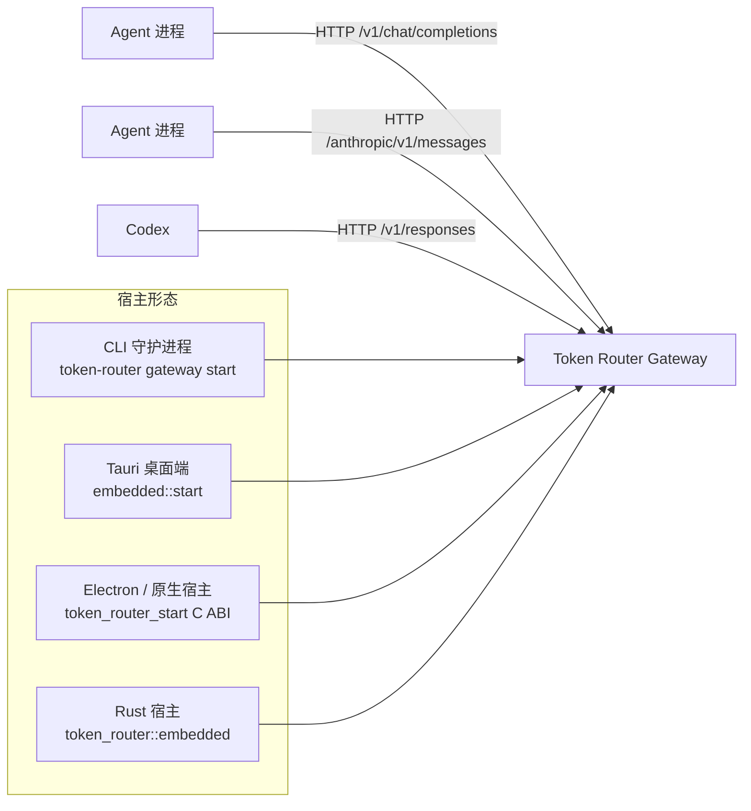
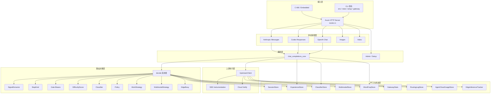
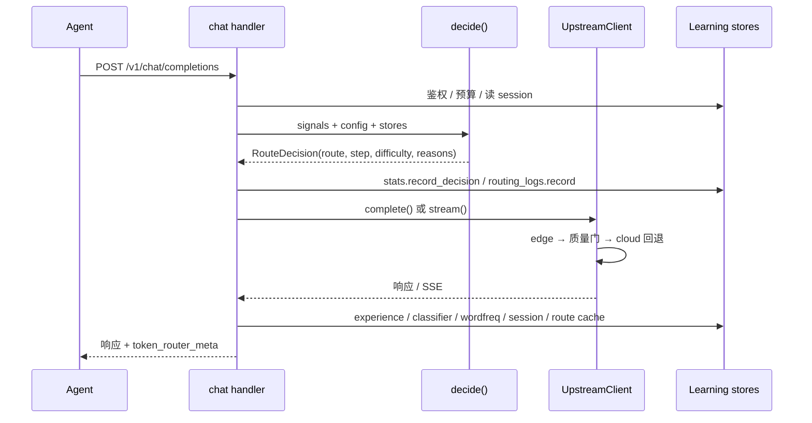
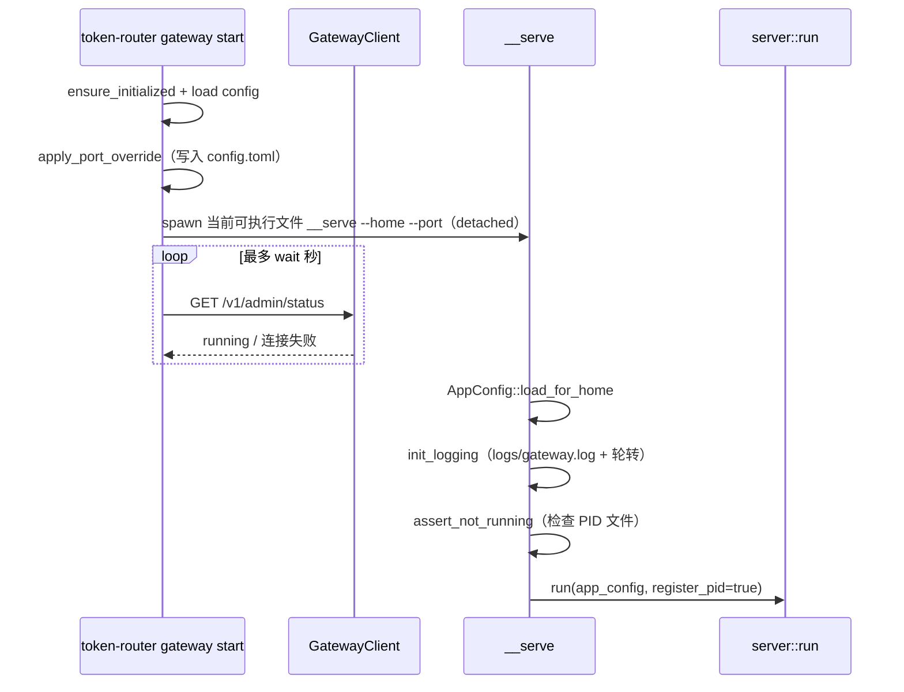
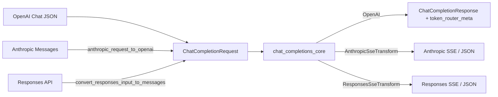
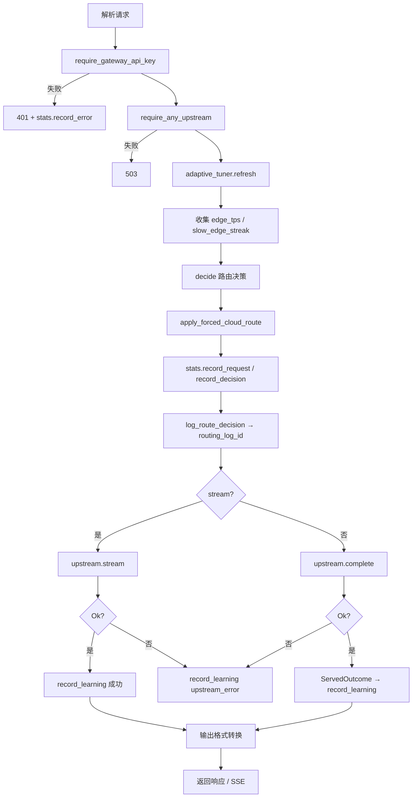
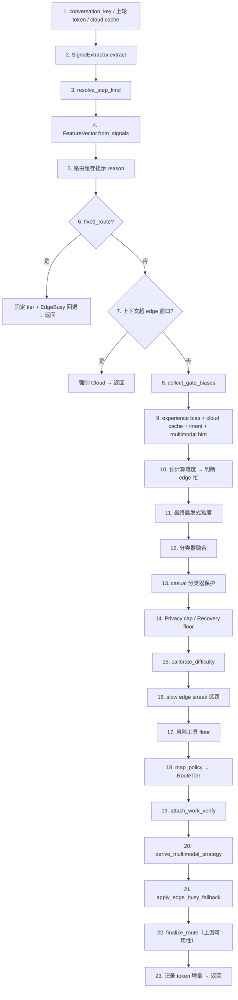
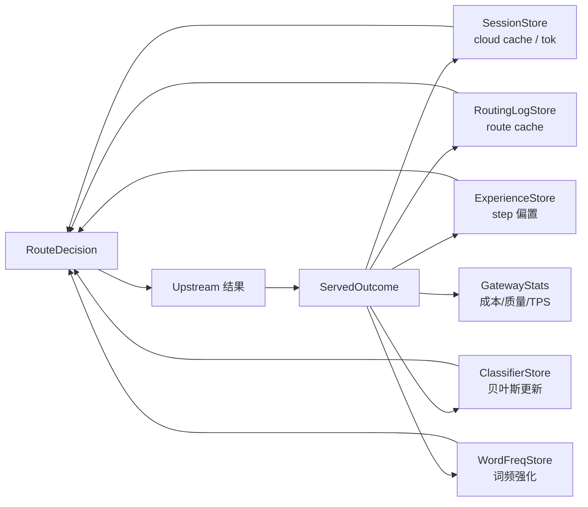
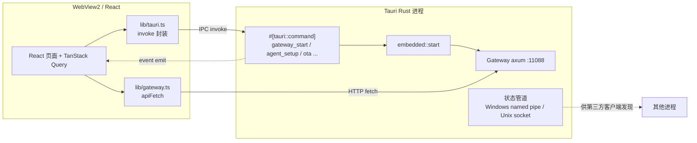
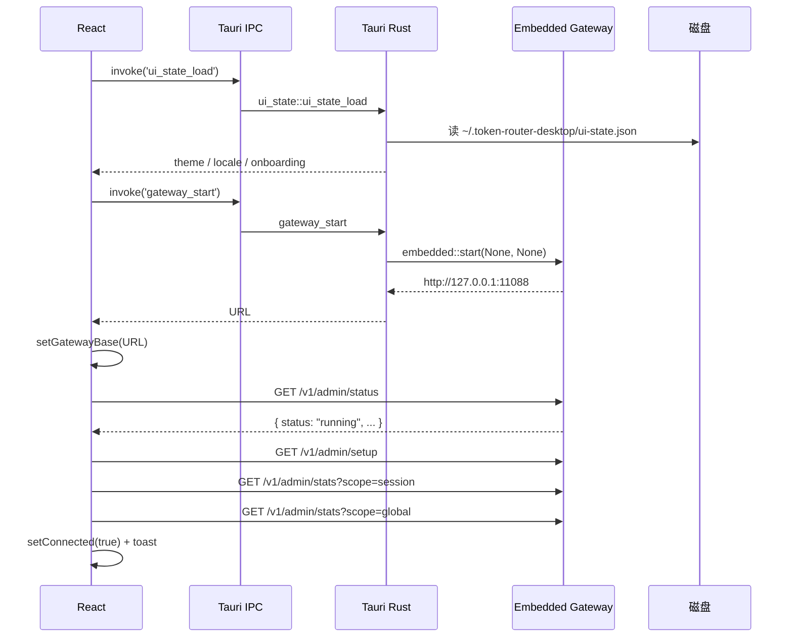

> **已归档（2026-11-17）**：本文档为历史档案，不再维护。现行文档见 [docs/README.md](../README.md)。

# Token Router 架构文档

> 适用版本：`0.19.11`（`Cargo.toml`）
> 源码基线：`dev` 分支，约 4.76 万行 Rust（`src/` 下 120 个 `.rs` 文件）
> 本文以源码为准；`README.md` 中较早的架构章节与当前实现存在少量漂移，差异点在 [§18](#18-已知风险与技术债) 中列出。

---

## 目录

- [1. 项目定位](#1-项目定位)
- [2. 术语表](#2-术语表)
- [3. 总体架构](#3-总体架构)
- [4. 代码结构](#4-代码结构)
- [5. 启动、生命周期与宿主形态](#5-启动生命周期与宿主形态)
- [6. HTTP 层](#6-http-层)
- [7. 聊天请求主链路](#7-聊天请求主链路)
- [8. 路由决策引擎](#8-路由决策引擎)
- [9. 上游执行层](#9-上游执行层)
- [10. 学习与状态子系统](#10-学习与状态子系统)
- [11. 配置系统](#11-配置系统)
- [12. 持久化总表](#12-持久化总表)
- [13. 可观测性](#13-可观测性)
- [14. Agent 接入](#14-agent-接入)
- [15. 桌面端与第三方宿主](#15-桌面端与第三方宿主)
- [16. 构建、测试与发布](#16-构建测试与发布)
- [17. 关键设计决策与权衡](#17-关键设计决策与权衡)
- [18. 已知风险与技术债](#18-已知风险与技术债)
- [19. 附录](#19-附录)

---

## 1. 项目定位

Token Router（产品名 Flowy Router）是一个**本地 LLM 流量网关**：它在 AI Agent（OpenClaw、Hermes、Claude Code、Codex、OpenCode 等）与上游模型之间插入一层，按请求内容自动决定把请求发给**端侧模型（edge）**还是**云端模型（cloud）**，并在两者之间做级联、质量校验、失败回退与在线学习。

核心价值：

| 目标 | 实现手段 |
|---|---|
| 降低云端 token 成本 | 简单请求走 edge；`cloud_input_saved` 统计节省量 |
| 保持复杂任务质量 | 难度评分 + 贝叶斯分类器 + 级联校验，难任务走 cloud |
| 对 Agent 完全透明 | 暴露 OpenAI / Anthropic / Codex Responses 兼容协议，Agent 无需改代码 |
| 越用越准 | experience / classifier / wordfreq / multimodal 四套在线学习 |
| 单二进制、零外部依赖 | Rust + axum + SQLite（`rusqlite` bundled），无 Redis/Postgres |
| 多形态交付 | CLI 守护进程、嵌入式库、C ABI 动态库、Tauri 桌面端 |

---

## 2. 术语表

| 术语 | 含义 |
|---|---|
| **tier** | 上游层级：`edge`（端侧/本地）或 `cloud`（云端） |
| **RouteTier** | 路由结论：`Edge` / `Cloud` / `Cascade`（先 edge，失败或质量不达标再 cloud） |
| **StepKind** | Agent 当前所处的“步态”：直接聊天、工具选择、工具参数填充、工具结果消化、初始规划等 11 种 |
| **difficulty** | `[0,1]` 难度分；与 profile 阈值比较后映射为 RouteTier |
| **θ_edge / θ_cloud** | 路由阈值；`d < θ_edge` → edge，`θ_edge ≤ d < θ_cloud` → cascade，`d ≥ θ_cloud` → cloud |
| **Profile** | 路由档位：`economy` / `balanced` / `premium` / `privacy`，决定阈值对 |
| **RoutingMode** | `single` / `cascade` / `split`，决定中间区间如何落点 |
| **Cascade** | 先调用 edge，通过质量门则采用；否则回退 cloud |
| **Verify** | 对 work 步态抽样，同时调用 edge 与 cloud，由 cloud 结果校验 edge 是否正确 |
| **conversation_key** | 从对话前缀稳定哈希出的会话键，用于粘性、token 增量、缓存 |
| **cloud cache** | 云端 prompt cache 的利用热度，影响后续请求是否倾向 cloud |
| **fallback** | 本次请求实际由 cloud 服务，但路由决策原本是 edge/cascade |

---

## 3. 总体架构

### 3.1 运行形态

同一套 `token_router` crate 以四种形态运行：



| 形态 | 入口 | 进程模型 | 默认 home | 默认端口 |
|---|---|---|---|---|
| CLI 守护进程 | `src/main.rs` → `__serve` | 独立进程，PID 文件 | `~/.token-router` | `16621` |
| 嵌入式（Tauri / Rust） | `src/embedded.rs` | 宿主进程内独立线程 + Tokio runtime | `~/.token-router-desktop`（`desktop` feature） | `11088` |
| C ABI 动态库 | `src/ffi.rs` | 加载它的进程内 | 调用方指定 | 调用方指定 |

> 端口与目录随 `desktop` feature 变化：`src/config/paths.rs:6` 与 `src/config/setup.rs:269`。

### 3.2 分层图



依赖方向总体是**单向向下**：`api` → `routing` / `upstream` → 各 store。`routing::decide()` 是纯读取型决策中心（接收 store 引用，不写库）；写回集中在 `api/chat.rs::record_learning` 与 `served_outcome.rs`。

### 3.3 路由与学习的闭环



---

## 4. 代码结构

```
src/
├── main.rs                 CLI 入口与子命令分派（__serve 隐藏子命令）
├── lib.rs                  库入口，导出所有模块
├── client.rs               CLI → Gateway 的 HTTP 客户端
├── cli_settings.rs         CLI 运行期设置（home / port / key / admin token）
├── daemon_ctl.rs           进程生命周期：start / stop / status / restart
├── env_cmd.rs              token-router env
├── setup_cmd.rs            token-router setup（本地或远端）
├── stats_cmd.rs            token-router stats（含中英文报告渲染）
├── embedded.rs             进程内 Gateway 单例（线程 + runtime）
├── ffi.rs                  C ABI 导出
├── agent_setup/            8 类 Agent 配置文件写入
├── wsl_setup/              Windows → WSL Agent 配置
├── config/
│   ├── mod.rs              重导出
│   ├── paths.rs            home / config / pid / logs / db 路径
│   ├── file.rs             ConfigFile：TOML 磁盘结构 + 默认值
│   ├── setup.rs            SetupView / Patch、默认上游、端口覆盖
│   └── auth_keys.rs        入站 API Key 增删改查与迁移
└── gateway/
    ├── mod.rs              模块声明与 AppConfig / run / logging 重导出
    ├── config.rs           AppConfig：ConfigFile → 运行时结构
    ├── config_manager.rs   Arc<RwLock> 热更新
    ├── server.rs           建 store、建 AppState、起 axum、优雅关闭
    ├── daemon.rs           PID 文件、存活检测
    ├── logging.rs          tracing + 文件轮转 + 日志尾部读取
    ├── error.rs            AppError → HTTP 状态码
    ├── edge_load.rs        端侧在飞推理计数（RAII guard）
    ├── flowy.rs            Flowy 云模型名归一化
    ├── agent_usage.rs      每 agent 5 小时云 token 预算
    ├── served_outcome.rs   服务结果写回 session / route cache
    ├── api/                HTTP 层（见 §6）
    ├── routing/            路由决策引擎（见 §8）
    ├── upstream/           上游转发（见 §9）
    ├── session/            会话状态 + cloud cache
    ├── experience/         按 StepKind 的经验偏置
    ├── classifier/         朴素贝叶斯难度分类器
    ├── multimodal/         视觉能力探测缓存
    ├── routing_log/        路由日志 + 请求路由缓存（SQLite）
    ├── stats/              SQLite 统计库 + TPS/延迟指标
    ├── image/              图片生成适配（openai/seedream/dashscope/comfyui）
    └── video/              视频同 host 透传
```

主要文件规模（行）：

| 文件 | 行数 | 说明 |
|---|---:|---|
| `gateway/api/responses.rs` | 1418 | Codex Responses 双向转换 + SSE 状态机 |
| `gateway/upstream/forward.rs` | 1424 | 上游调用、级联、回退、指标 |
| `gateway/stats/db.rs` | 2422 | 统计 SQLite schema 与查询 |
| `gateway/stats/mod.rs` | 1489 | 统计门面 |
| `stats_cmd.rs` | 1453 | 离线统计报告 |
| `gateway/routing/signals.rs` | 1549 | 信号提取（最大单体） |
| `gateway/api/anthropic.rs` | 1081 | Anthropic 双向转换 + SSE |
| `gateway/routing/cognitive_intent.rs` | 1058 | 5 语言认知意图词表 |
| `gateway/routing/decision.rs` | 893 | 决策主流水线 |
| `agent_setup/mod.rs` | 2216 | Agent 配置写入 |

---

## 5. 启动、生命周期与宿主形态

### 5.1 CLI 命令树

```
token-router [--home DIR] [--port PORT] <command>

  env   [--json]                     输出解析后的路径与配置
  stats [--global] [--json] [--lang] 查看统计（session / global）
  setup [--remote] [--reset] ...     初始化或修改上游
  gateway start|stop|status|restart  守护进程管理
  __serve                           （隐藏）由 start 重新拉起的真实服务进程
  __restart-wait <pid>               （隐藏）等待旧进程退出后拉起新进程
```

`src/main.rs` 只做参数解析与分派，具体逻辑在 `daemon_ctl.rs` / `setup_cmd.rs` / `stats_cmd.rs`。

### 5.2 守护进程启动流程



要点：

- **PID 文件**：`{home}/gateway.pid`，`daemon::write_pid_file` / `remove_pid_file`；`is_process_alive` 做平台相关检测。
- **端口覆盖**：`--port` 会写回 `config.toml`（`apply_port_override`），不是仅进程内生效。
- **start 的等待**：轮询 `/v1/admin/status` 直到健康或超时。
- **Windows 绑定**：`server.rs::bind_gateway_windows` 设置 `SO_REUSEADDR`，`AddrInUse` 时以 200ms 起步退避重试 5 次，规避崩溃后的 `TIME_WAIT`。

### 5.3 服务器初始化（`gateway/server.rs`）

`run_with_options()` 是唯一的装配点：

1. 可选写 PID 文件。
2. 创建 `GatewayRuntime`（`started_at`、`watch::Sender<bool>` 关闭信号）。
3. 依次打开并启动后台任务：
   - `GatewayStats::open` + `spawn_flush_task`
   - `ExperienceStore::open` + `spawn_flush_task`
   - `ClassifierStore::open` + `spawn_flush_task` + `spawn_decay_task`
   - `MultimodalStore::open` + `spawn_flush_task`
   - `SessionStore::open` + `spawn_flush_task` + `spawn_cleanup_task`
   - `AgentCloudUsageStore::open` + `spawn_flush_task`
   - `WordFreqStore::open` + `spawn_flush_task`
   - `RoutingLogStore::open` + `spawn_route_cache_cleanup_task`
4. 构造 `AdaptiveTuner`、`EdgeInferenceTracker`、`ConfigManager`、`ImageClient`、`VideoClient`、`UpstreamClient`。
5. 组装 `AppState`，注册 `router(state)`，叠加 `TraceLayer` 与 `CorsLayer::permissive()`。
6. `bind_gateway(addr)`，通知就绪。
7. `axum::serve(...).with_graceful_shutdown(cancel)`。
8. 关闭时 flush 各 store，删除 PID 文件。

### 5.4 嵌入式启动（`src/embedded.rs`）

- 全局单例 `static EMBEDDED: Mutex<Option<EmbeddedGateway>>`。
- `start(home, port)`：
  1. 若已运行直接报 `gateway already running in this process`。
  2. 加载 `AppConfig`，创建 `CancellationToken` 与 `sync_channel(1)` 就绪通道。
  3. 新建线程 `token-router-gateway`，内部建立多线程 Tokio runtime，初始化日志，调用 `server::run_with_options(..., RunOptions::embedded(...))`。
  4. 主线程最多等待 30 秒；超时但 `/health` 探测成功则**收养**已有实例。
- 供 Tauri 的 `gateway_start/stop/restart/status` 与 FFI 共用。
- 桌面端前端如何通过 IPC 与 HTTP 双通道与它通信，见 [§15.1](#151-tauri-桌面端desktop)。

### 5.5 C ABI（`src/ffi.rs` + `ffi/token_router.h`）

| 函数 | 说明 |
|---|---|
| `token_router_version()` | 返回静态版本字符串 |
| `token_router_start(home_dir, port, err, err_len)` | 后台启动内嵌 Gateway |
| `token_router_stop(err, err_len)` | 停止 |
| `token_router_is_running()` | 1 / 0 |
| `token_router_gateway_url(buf, len)` | 写出 `http://host:port` |

错误码：`TOKEN_OK=0`、`ALREADY_RUNNING=1`、`NOT_RUNNING=2`、`INVALID_ARG=3`、`INTERNAL=4`。crate 同时产出 `rlib`、`cdylib`、`staticlib`。

### 5.6 热重启与关停

- `POST /v1/admin/restart`：校验 admin token → `daemon_ctl::schedule_daemon_restart(home, old_pid)` 派生 `__restart-wait` → flush → `runtime.trigger_shutdown()`。
- `POST /v1/admin/shutdown`：校验 admin token → flush → `trigger_shutdown()`。
- 关闭信号经 `watch` 转为 `CancellationToken`，`axum` 优雅退出后执行最终 flush。

---

## 6. HTTP 层

### 6.1 路由表（`src/gateway/api/routes.rs`）

| 方法 | 路径 | 处理器 | 鉴权 |
|---|---|---|---|
| GET | `/health` | `health` | 无 |
| GET | `/setup` | `setup_page`（内置 HTML 配置页） | 无 |
| GET | `/v1/admin/status` | `admin::status` | 无 |
| GET | `/v1/admin/stats` | `admin::stats`（`?scope=session\|global`） | 无 |
| GET | `/v1/admin/stats/timeline` | `admin::stats_timeline` | 无 |
| GET | `/v1/admin/stats/models/timeline` | `admin::stats_model_timeline` | 无 |
| GET | `/v1/admin/stats/models/timeline/all` | `admin::stats_all_models_timeline` | 无 |
| GET | `/v1/admin/logs` | `admin::logs` | 无 |
| GET | `/v1/admin/routing-logs` | `admin::routing_logs` | 无 |
| GET / POST | `/v1/admin/setup` | `setup::setup_get` / `setup_post` | admin token（POST） |
| POST | `/v1/admin/setup/init` | `setup::setup_init` | admin token |
| GET / POST | `/v1/admin/auth-keys` | `auth_keys::*` | admin token |
| PATCH / DELETE | `/v1/admin/auth-keys/{id}` | `auth_keys::*` | admin token |
| POST | `/v1/admin/shutdown` | `admin::shutdown` | admin token |
| POST | `/v1/admin/restart` | `admin::restart` | admin token |
| GET | `/v1/admin/agents` | `agents::agents_list` | admin token |
| GET | `/v1/admin/agents/{agent}` | `agents::agents_get` | admin token |
| POST | `/v1/admin/agents/{agent}/configure` | `agents::agents_configure` | admin token |
| GET | `/v1/admin/wsl` | `agents::wsl_detect` | admin token |
| POST | `/v1/admin/wsl/{distro}/agents/{agent}/configure` | `agents::wsl_configure` | admin token |
| POST | `/v1/chat/completions` | `chat_completions_handler` | 入站 API Key |
| POST | `/v1/images/generations` | `images_generations` | 入站 API Key |
| POST | `/v1/images/edits` | `images_edits`（multipart） | 入站 API Key |
| POST | `/v1/video/forward` | `video_forward`（header 驱动透传） | 入站 API Key |
| GET | `/v1/models` | `list_models` | 无 |
| GET | `/v1/models/{model_id}` | `get_model` | 无 |
| POST | `/v1/responses` | `responses_handler` | 入站 API Key |
| POST | `/anthropic/v1/messages` | `anthropic_messages_handler` | 入站 API Key |
| GET | `/anthropic/v1/models` | `list_models` | 无 |
| GET | `/anthropic/v1/models/{model_id}` | `get_model` | 无 |
| POST | `/v1/messages` | `anthropic_messages_handler` | 入站 API Key |

> Admin 只读端点（status/stats/logs/routing-logs）默认不校验 admin token；写端点与配置端点校验。若 `admin_token` 未配置，则所有端点都不校验。

### 6.2 鉴权

- **入站 API Key**（`api/auth.rs`）：
  - `Authorization: Bearer <key>` 或 `x-api-key: <key>`。
  - `AppConfig.inbound_api_keys` 为空时禁用鉴权；否则必须匹配。
  - Key 来自 `[gateway].api_key`（旧）或 `[gateway].api_keys[]`（新），仅在 `auth_enabled=true` 时生效。
  - 匹配到的 key 会解析为 `AuthKeyContext { id, name, key_preview }`，用于统计维度。
- **Admin Token**（`api/setup.rs::require_admin`）：请求头 `x-token-router-admin-token`。
- **Agent 维度**：`x-agent-id` 请求头被提取为 `agent_id`，影响上游覆盖、云预算、统计与日志。
- **强制路由**：`x-token-router-force-route: cloud` 可把非固定 edge 的决策改为 cloud。

### 6.3 错误模型（`gateway/error.rs`）

| 变体 | HTTP | 典型来源 |
|---|---|---|
| `BadRequest` | 400 | 请求体/路径非法、multipart 解析失败 |
| `Unauthorized` | 401 | API Key / admin token 错误 |
| `Upstream` | 502 | 上游连接失败、非 2xx、SSE 中断 |
| `Unavailable` | 503 | 未配置上游、固定 tier 缺配置、视频 tier 不存在 |
| `NotFound` | 404 | 未知模型等 |
| `Internal` | 500 | 序列化、IO、锁中毒等 |

响应体统一为：

```json
{ "error": { "message": "...", "type": "token_router_error" } }
```

### 6.4 协议兼容层

三种客户端协议最终都汇入 `chat_completions_core`，只是**输入转换**与**输出格式**不同：



细节：

- **Anthropic**（`api/anthropic.rs`）：
  - `system` 展平为 system message；`content` 数组中的 `tool_use` / `tool_result` / `thinking` 转为 OpenAI 结构。
  - `thinking` / `budget_tokens` 映射为上游 `reasoning_effort` 或 `enable_thinking`（`compat/anthropic.rs`）。
  - 流式输出由 `AnthropicSseTransform` 重建 `message_start` / `content_block_*` / `message_delta` / `message_stop` 事件，并处理 `thinking` 块。
  - 去除 Anthropic 计费头文本。
- **Responses**（`api/responses.rs`）：
  - `instructions` + `input[]` 转为 messages；`function_call_output` 转为 tool 消息。
  - `previous_response_id` 由 `CodexChatHistoryStore` 补齐缺失的工具调用历史。
  - `reasoning.effort` 透传到上游。
  - 非流式响应重建 `output[]`（message / reasoning / function_call）；流式由 `ResponsesSseTransform` 生成 `response.created` / `output_item.*` / `response.completed` 等事件。
- **消息修复**（`api/compat/messages.rs`）：
  - `repair_assistant_tool_call_adjacency`：修复被中断的 assistant tool_call 与 tool 结果错位。
  - `normalize_trailing_assistant_tool_calls`：去掉末尾没有结果的 tool_call。
  - `collapse_system_messages`：多个 system 合并。
  - DeepSeek 等上游需要时补 `reasoning_content` / `thinking` 参数。

### 6.5 图片与视频

图片（`gateway/image/`）：

- 端点：`POST /v1/images/generations`、`POST /v1/images/edits`。
- tier 选择 `resolve_image_tier`：`image_route` 为 `edge`/`cloud` 时严格固定；`auto`（或 `None`）优先 edge，edge 忙且 cloud 可用时升 cloud。
- provider 适配器：`openai`、`seedream`（火山）、`dashscope`（百炼万相）、`comfyui`（本地 workflow，支持 T2I / I2I 工作流文件）。
- 超时 180s；edge 调用会持有 `EdgeInferenceGuard`（避免与 chat 抢端侧）。

视频（`gateway/video/`）：

- 端点：`POST /v1/video/forward`。
- 纯透传，不解析业务 body：
  - `X-Video-Method`：上游 HTTP 方法（必填）。
  - `X-Video-Path`：上游绝对路径（必填，禁止 `..`、scheme、其他 host）。
  - `X-Video-Tier`：可选 `edge` / `cloud`；缺省按 `video_route` 解析。
  - 只转发 `content-type`、`accept`、`x-dashscope-async`，并用配置的 API Key 替换鉴权。
  - 最大 body 64 MiB，超时 180s。
- 这样设计是为了兼容各家视频 API 的异步任务协议，而无需为每家在网关里建模型。

---

## 7. 聊天请求主链路

`src/gateway/api/chat.rs::chat_completions_core` 是唯一编排点。



关键点：

- **指标计数顺序**：只有拿到路由决策后才 `record_request`，保证 `requests_total == edge + cloud + cascade`。
- **学习写回**：`record_learning()` 依次调用
  1. `experience.record_outcome(step_kind, outcome)`，工具错误时额外 `record_tool_failure`
  2. `wordfreq.reinforce_from_outcome(...)`
  3. `classifier.record(features, outcome, route, work_strategy, tool_error_streak)`
  4. `record_request_completion(...)` → session 状态 + 请求路由缓存
- **流式**：`instrument_stream` 在流结束时补记 usage、TPS、延迟、agent 预算与 session 写回。
- **错误**：`log_request_error` 写入 `routing_logs.error_reason`，同时计入 stats。

---

## 8. 路由决策引擎

> 本章是架构级概览。路由内核的完整设计、全部偏置数值、学习闭环、执行策略与调参手册见 [`model-router.md`](./model-router.md)。

入口：`src/gateway/routing/decision.rs::decide()`。它是纯函数式流程：读取配置与各 store，产出一个 `RouteDecision`。

### 8.1 输入与输出

输入：

| 输入 | 来源 |
|---|---|
| `AppConfig` | `ConfigManager` |
| `ChatCompletionRequest` | HTTP body |
| `SessionStore` | 上轮 token / cloud cache / 溢出钉住 |
| `ExperienceStore` | 按 StepKind 的历史偏置 |
| `MultimodalStore` | 视觉模型能力缓存 |
| `EffectiveRouting` | `AdaptiveTuner::refresh`（阈值与抽样率） |
| `EdgeInferenceTracker` | 端侧是否正在推理 |
| `edge_tps` / `slow_edge_streak` | `GatewayStats` |
| `ClassifierStore` | 贝叶斯融合 |
| `RoutingLogStore` | 请求级路由缓存 |
| `WordFreqStore` | 词频稀有度 |

输出 `RouteDecision` 主要字段：

```rust
pub struct RouteDecision {
    pub route: RouteTier,              // Edge | Cloud | Cascade
    pub profile: Profile,
    pub mode: RoutingMode,
    pub step_kind: StepKind,
    pub difficulty: f32,
    pub reason_codes: Vec<String>,
    pub tokens_in_estimate: u32,
    pub tokens_out_estimate: u32,
    pub cloud_input_saved_estimate: u32,
    pub conversation_key: String,
    pub assistant_failed_recent: bool,
    pub consecutive_tool_error_streak: u32,
    pub multimodal_strategy: MultimodalStrategy,
    pub work_strategy: WorkStrategy,
    pub edge_ok_probability: Option<f32>,
    pub classifier_features: Option<FeatureVector>,
    pub casual_quality_fallback: bool,  // DirectChat 在 edge 时的质量回退开关
    pub routing_log_id: Option<i64>,
}
```

### 8.2 决策流水线（按代码顺序）



### 8.3 信号提取（`routing/signals.rs`）

`RequestSignals` 约 40 个字段，全部由请求体静态推断，**不依赖自定义 Header**，因此对任意 Agent 通用。

| 类别 | 字段 |
|---|---|
| Token 估算 | `tok_system`、`tok_tools_schema`、`tok_rest`、`tok_total_in`、`tok_loop_delta`、`tok_out_estimate`、`last_user_tok` |
| 轮次结构 | `n_tool_defs`、`n_turns`、`loop_steps`、`tool_invocations_since_last_user` |
| 工具状态 | `pending_tool_calls`、`tool_arg_ready`、`last_role_tool`、`synthetic_tool_result`、`tools_enabled`、`had_tool_roundtrip` |
| 失败恢复 | `assistant_failed_recent`、`consecutive_tool_error_streak` |
| 步态线索 | `is_heartbeat_poll`、`voice_repair_loop`、`subagent_spawn_hint`、`memory_compact_hint`、`cron_background` |
| 意图 | `intent_hard`、`intent_hard_specific`、`intent_easy`、`intent_plan`、`intent_cloud`、`intent_long_gen`、`intent_edge`、`intent_analysis`、`intent_decision`、`intent_research` |
| 多模态 | `multimodal`、`user_multimodal` |
| 工具风险 | `risky_tool_hard`、`risky_tool_soft`、`risky_tool_*_names` |
| 词法 | `rare_lexical`、`special_lexical`、`rare_token_ratio` |
| 用户反馈 | `user_rejects_answer` |

设计要点：

- `tok_loop_delta = tok_total_in - session.last_tok_in`，用于识别 Agent 循环中突然注入的长上下文。
- `is_casual_chat()`：`tok_rest < 8192`、`n_turns ≤ 8`、无工具往返、无 `pending_tool_calls`、无硬意图、非失败恢复、图与 tools 不同时出现；多轮带工具时最新用户消息必须命中 easy 意图；多轮无工具时允许 `last_user_tok ≤ 512` 的短跟帖。
- `intent_*` 只取**最新 user 消息**；`intent_cloud` / `intent_edge` 在最近 4 轮 user 消息窗口内解析（`resolve_recent_tier_intent`）。
- 词法稀有度：`whatlang` 检测语言 → 英/日/韩/中分词（英文 WordLevel，中日韩最长匹配）→ 查 `wordfreq.db`；阈值 `1e-7`、稀有 token ≥2、占比 ≥25%。
- 工具风险：`Delete` / `exec` 中的 `rm`、`mv` 为 hard；`browser` / `sessions_spawn` / `message` 为 soft。

### 8.4 步态分类（`routing/step_kind.rs`）

`resolve_step_kind()` 按固定优先级判断：

| 优先级 | 条件 | StepKind | 偏置 |
|---:|---|---|---:|
| 1 | `is_heartbeat_poll` | `HeartbeatAck` | -0.60 |
| 2 | `assistant_failed_recent` | `RecoveryAfterFailure` | +0.55 |
| 3 | `pending_tool_calls && tool_arg_ready` | `ToolArgFill` | -0.35 |
| 4 | `pending_tool_calls` | `ToolSelect` | -0.20 |
| 5 | `last_role_tool && !synthetic_tool_result` | `ToolResultDigest` | -0.45 |
| 6 | `voice_repair_loop` | `ToolResultDigest` | -0.45 |
| 7 | `subagent_spawn_hint` | `SubagentSpawn` | +0.50 |
| 8 | `is_casual_chat()` | `DirectChat` | -0.55 |
| 9 | `memory_compact_hint` | `MemoryCompact` | +0.20 |
| 10 | `cron_background` | `CronBackground` | -0.15 |
| 11 | `intent_plan` 或认知首轮 | `InitialPlan` | +0.55 |
| 12 | 再次 `is_casual_chat()` | `DirectChat` | -0.55 |
| 13 | `!tools_enabled && had_tool_roundtrip` | `FinalReply` | +0.05 |
| 14 | 兜底 | `ToolSelect` / `FinalReply` | — |

### 8.5 门控现在是“偏置”而不是“硬短路”

这是与 README 旧描述最大的差异。`routing/gates.rs` 的 `collect_gate_biases()` 返回线性偏置与 reason code，**不再直接决定路由**：

| 门控 | 条件 | 线性偏置 |
|---|---|---:|
| `GATE_EDGE_DOWN` | edge 未配置 | 仅记录 reason，返回空偏置（后续由 `finalize_route` 强制单侧） |
| `GATE_USER_REJECT` | 最新 user 否定上一轮回答 | +0.55 |
| `GATE_OPENCLAW_COMPACT` | `MemoryCompact` 且超出 80% edge 窗口 | +0.45 |
| `GATE_CTX_OVERFLOW` | 非 compact 且超出 80% 窗口 | casual +0.35 / 其他 +0.50 |
| `GATE_ASSISTANT_FAILURE` | 最近 assistant 失败（非 heartbeat） | +0.20 |
| `GATE_RISKY_TOOL` | hard 风险工具 + ToolSelect/ToolArgFill + 尚无 tool 结果 | +0.30 |

此外，决策后半段对 `GATE_RISKY_TOOL` 有一个**保底**：若最终难度仍低于 `θ_cloud`，直接抬到 `θ_cloud`（等价于强制定云）。

`decision.rs` 中还有一条独立硬规则（在门控之前）：

```text
fixed_route 为空 && cloud 已配置
  && (tok_total_in > ctx_edge_max_tokens || session 已钉住溢出)
  → 直接 RouteTier::Cloud（reason CTX_OVER_EDGE）
```

### 8.6 难度公式（`routing/difficulty.rs`）

```text
raw = 0.20 × min(ctx_ratio, 1)
    + 0.25 × min(user_ctx_ratio, 1)
    + 0.05 × min(tool_ratio, 1)
    + 0.30 × intent_hard
    + 0.25 × intent_cloud
    + 0.25 × intent_long_gen
    - 0.30 × intent_edge
    - 0.40 × intent_easy
    + 0.12 × user_multimodal
    + step_kind.bias()
    + experience_bias
    + 0.15 × assistant_failed_recent
    + tool_error_streak_bias
    + tool_loop_bias
    + lexical_rarity_bias
    + 0.10 × risky_tool_soft
    + cognitive_intent_bias
    + gate_parts
    + external_parts（intent / cache / multimodal hint）
    + context_parts（edge busy / 复杂多模态 / 长生成）

d = sigmoid(raw) = 1 / (1 + e^(-raw))
```

各偏置细节：

| 项 | 取值 |
|---|---|
| `ctx_ratio` | DirectChat/HeartbeatAck 用 `tok_rest`，其余用 `tok_loop_delta`，除以 `ctx_edge_max_tokens` |
| `user_ctx_ratio` | `last_user_tok / ctx_edge_max_tokens` |
| `tool_ratio` | `n_tool_defs / 20` |
| `tool_error_streak_bias` | 1→0.10，2→0.28，3→0.38，4+→0.48 |
| `tool_loop_bias` | 仅当 `tok_total_in > 50%` 窗口：15–17→0.08，18–22→0.12，23+→0.15 |
| `lexical_rarity_bias` | rare 0.08 / special 0.12 / both 0.18 |
| 认知意图 | plan 0.15，analysis 0.18，decision 0.15，research 0.15（仅首轮 `tool_invocations_since_last_user == 0 && !pending_tool_calls`） |
| `external_parts` | `CLOUD_INTENT +0.40`、`EDGE_INTENT -0.25`、`MEMORY_COMPACT_IN_BUDGET -0.75`、`MULTIMODAL_CACHE_CLOUD +0.55`、`MULTIMODAL_CACHE_EDGE -0.30`、cloud cache 衰减项 |
| `context_parts` | `GATE_EDGE_BUSY +0.30`、`MULTIMODAL_COMPLEX_CLOUD +0.35`、`LONG_GEN_EDGE_TPS_LOW +0.50` / `LONG_GEN_EDGE -0.15` |

### 8.7 分类器融合

`classifier.predict_and_fuse(features, d_heuristic)`：

```text
p_edge = softmax(log P(edge_ok|features), log P(cloud_needed|features))
w      = min(step_samples / min_samples, 1.0) × max_weight   // max_weight ≤ 0.60
d      = (1 - w) × d_heuristic + w × (1 - p_edge)
```

- 冷启动阶段 `w` 很小，启发式占主导；样本足够后最多让出 60% 权重。
- 标签只来自“edge 曾被尝试”的请求：edge 成功 → `EdgeOk`；cascade 回退或上游错误 → `CloudNeeded`。
- 特征不含正文，只含 `step_kind`、上下文桶、工具桶、循环桶、意图、错误 streak、风险工具、多模态等离散值。
- 每 3600s 执行衰减重训练：`factor = 0.5^(elapsed / half_life_hours)`，小样本特征并入先验后删除。

### 8.8 决策后校准（`calibrate_difficulty`）

按顺序对难度做上下限修正：

| 条件 | 动作 |
|---|---|
| 用户否定上一轮 | 抬到 `θ_cloud` |
| `intent_cloud` + casual | 抬到 `θ_cloud` |
| 多模态缓存命中 cloud | 抬到 `θ_cloud` |
| `intent_long_gen` 且 edge TPS 低 | 抬到 `θ_cloud` |
| MemoryCompact 且窗口未溢出 | 压到 `θ_cloud - ε` |
| `intent_edge` + casual + edge 可用 | 压到 `θ_edge - ε` |
| work 执行步态且未超窗口、无多模态、错误 streak < 2 | 压到 `θ_edge - ε` |
| `privacy` profile | 除 Recovery 外，`min(d, 0.20)`；Recovery 抬到 `θ_cloud` |
| 连续慢 edge（1/2/3+） | +0.08 / +0.18 / +0.28 |

### 8.9 策略映射（`routing/policy.rs`）

| Profile | θ_edge | θ_cloud | 默认 Mode |
|---|---:|---:|---|
| `economy` | 0.40 | 0.60 | Cascade |
| `balanced`（默认） | 0.35 | 0.55 | Cascade |
| `premium` | 0.25 | 0.45 | Single |
| `privacy` | 0.45 | 0.65 | Cascade（实现上仍受 privacy cap 影响） |

映射规则：

```text
DirectChat / HeartbeatAck（mode != split）
  d < θ_cloud ? Edge : Cloud        // 不产出 Cascade

Single:    d < θ_edge ? Edge : Cloud
Cascade:   d < θ_edge ? Edge : (d < θ_cloud ? Cascade : Cloud)
Split:     恒为 Cloud
```

### 8.10 Work 策略（`routing/work.rs`）

- `is_plan_step`：`InitialPlan`，或 `intent_plan` + 无 tool 往返 + 特定步态。
- `is_work_step`：ToolSelect / ToolArgFill / ToolResultDigest / FinalReply / SubagentSpawn / MemoryCompact / CronBackground。
- 仅当 `route == Cascade` 且命中确定性抽样时，`WorkStrategy::Verify`：
  - 抽样哈希 = `conversation_key + step_kind + tokens_in`，同会话同步态结果稳定。
  - 默认 `work_verify_sample_rate = 0.1`。
- 其余情况为 `WorkStrategy::None`，但会写 `WORK_EXEC_EDGE` / `WORK_SAMPLE_SKIP` 等 reason。

### 8.11 多模态策略（`multimodal/`）

`MultimodalRouteHint`：

| 缓存结论 | 含义 | 策略 |
|---|---|---|
| `CachedEdge` | edge 已验证支持该模型 | `CachedEdge` |
| `CachedEdgeFallback` | 两者都不支持，但 edge 曾尝试 | `CachedEdgeFallback` |
| `CachedCloud` | edge 不支持、cloud 支持 | `CachedCloud` |
| `Probe` | 未知 | `Probe`（先探测 edge，失败再 cloud） |

缓存以 `edge:<url>|ek:<key>|cloud:<url>|ck:<key>` 为指纹；指纹变化即清空 `by_model`。多模态策略只对 `DirectChat` 生效；复杂多模态（带 tools 或非 DirectChat）由 `MULTIMODAL_COMPLEX_CLOUD +0.35` 推向 cloud。

### 8.12 Edge 忙与慢 edge

- `EdgeInferenceTracker` 用 `AtomicUsize` 记录在飞推理数；`begin()` 返回 `Drop` 自动递减的 guard。
- `edge_busy_applies()`：edge 忙 + cloud 可用 + 该请求本来会用 edge + 非 casual + 非单 tier 配置 → 升 cloud。
- 固定 `route=edge/cloud` 或只配置单侧时不做跨层重定向。
- `GatewayStats` 的 `slow_edge_streak` 在 edge 生成 TPS 过低时累加（180s 衰减），决策层按 streak 加成难度。

### 8.13 上游可用性与强制路由

- `require_any_upstream`：两侧都未配置 → 503。
- `finalize_route`：只配置一侧时强制该侧，并写 `UPSTREAM_EDGE_ONLY` / `UPSTREAM_CLOUD_ONLY`。
- `apply_forced_cloud_route`：`X-Token-Router-Force-Route: cloud` 且 cloud 已配置且非固定 edge 时改为 Cloud，写 `FORCE_ROUTE_CLOUD`。
- 固定 `route=edge` 时**绝不**因失败升 cloud；固定 `route=cloud` 同理。

### 8.14 Reason Codes

`reason_codes` 是路由可解释性的核心，写入日志、响应头与非流式响应体。常见前缀：

- 步态：`STEP_DIRECT_CHAT`、`STEP_INITIAL_PLAN`…
- 门控：`GATE_*`
- 难度：`DIFF_D:<part>:±x`、`DIFF_HEUR`、`DIFF_LINEAR_SUM`、`DIFFICULTY_0.42`
- 意图：`CLOUD_INTENT`、`EDGE_INTENT`、`PLAN_INTENT`、`ANALYSIS_INTENT`、`DECISION_INTENT`、`RESEARCH_INTENT`
- 学习：`EXP_BIAS_+0.08`、`BAYES_P_0.73`、`DIFF_FUSE:...`
- 缓存/多模态：`MULTIMODAL_CACHE_CLOUD`、`MULTIMODAL_PROBE_EDGE`、`REQ_ROUTE_CACHE_CLOUD:<model>`
- 执行：`WORK_VERIFY_SAMPLE(p=0.10)`、`CASUAL_EDGE_FALLBACK`、`EDGE_SLOW_STREAK_2`、`CTX_OVER_EDGE`
- 上游：`UPSTREAM_CLOUD_ONLY`、`FORCE_ROUTE_CLOUD`

---

## 9. 上游执行层

`src/gateway/upstream/forward.rs::UpstreamClient` 负责把决策变成真实 HTTP 调用。

### 9.1 目标解析

`UpstreamTarget` 由 `AppConfig::resolve_upstream(agent_id, tier)` 得到：

- agent 级配置优先于全局 `[upstream.edge]` / `[upstream.cloud]`。
- `base_url`、`api_key`、`model`（展示 id）、`upstream_model`（真实转发名）四元组。
- URL 拼接：`{base_url}/chat/completions`（去掉尾部 `/`）。

### 9.2 `complete()` 分支矩阵

先判断是否允许跨层回退：`fixed_route ∈ {Edge, Cloud}` 时**禁止**。

| 决策 | 策略 | 行为 |
|---|---|---|
| 固定 `edge` | `complete_edge_only` | 只调 edge，失败直接返回错误 |
| 固定 `cloud` | `complete_cloud_only` | 只调 cloud |
| `multimodal_strategy != None` | `complete_multimodal` | 按 Cached/Probe 分派 |
| `work_strategy == Verify` | `complete_work_verify` | edge + cloud 双调，cloud 校验 edge |
| `Edge` + `casual_quality_fallback` | `complete_edge_with_quality_fallback` | edge → 质量门 → cloud |
| `Edge` | `complete_edge_with_context_fallback` | edge → 上下文溢出则钉住并升 cloud |
| `Cloud` 且预算允许 | 直接 cloud | — |
| `Cloud` 但预算耗尽 | 先试 edge 质量门，再 cloud | 写 `cascade_edge_ok` / `cascade_fallback` |
| `Cascade` | `complete_edge_with_quality_fallback` | edge → 质量门 → cloud |

### 9.3 `stream()` 分支矩阵

与 `complete()` 对齐，区别：

- 流式无法在返回前知道内容质量，因此“质量回退”退化为**连接/状态码失败才回退**。
- 一旦 edge 的 SSE 已开始向客户端输出，就不再回退。
- `stream_cascade` 用于 Cascade / Verify / casual 回退场景。

### 9.4 级联质量门（`cascade_gate_pass`）

edge 响应必须满足其一：

- **文本**：非空、长度 > 8、且不含不确定性表达（`response_has_uncertainty`）。
- **工具调用**：非空，且每个 call 的 `function.name` 与 `arguments` 都非空。

不通过则计入 `cascade_fallback` 并调用 cloud。

### 9.5 Verify：cloud 校验 edge（`upstream/verify.rs`）

`cloud_verifies_edge`：

- 若任一方有 tool_calls：两方都必须有，且工具名序列完全一致。
- 否则比较文本：两段都 ≥ 8 字符、cloud 文本不含不确定性词、词集合 Jaccard 相似度 ≥ 0.12。

通过则采用 edge 响应（省 cloud 输出），否则采用 cloud 响应。

### 9.6 云 token 预算

- 粒度：`agent_id`（缺省用 `__default__`）× 5 小时滚动窗口。
- 配置：`[agent.<id>].cloud_token_budget`；`None` 或 `0` 表示不限。
- 检查点：cloud 调用前；流式在结束时累加实际用量。
- 预算耗尽时，Cloud 决策会降级为“先试 edge 质量门，再 cloud?”，实际上仍然保底 cloud（避免请求失败），但会计入 cascade 指标。

### 9.7 请求改写（`apply_upstream_model`）

1. 按 tier 调用 `for_upstream` / `for_edge_upstream`：
   - 数组 `content` 归一化为字符串（部分上游只接受 string）。
   - 合并多个 system。
   - 修复 tool_call 邻接关系。
   - 按上游需要补 `reasoning_content` / `thinking`。
   - Anthropic 来源的计费头剥离。
2. 若 `upstream_model` 存在且非空且不是 `auto`，覆盖请求 `model`。

### 9.8 指标与 SSE 采集

- 非流式：`record_upstream_metrics`（prompt/completion/cached、latency、模型维度、auth key 维度、TPS 样本）。
- 流式：`instrument_stream` 包装字节流，用 `StreamChunkAccumulator` + `inspect_sse_bytes` 逐行解析：
  - 统计 content / tool_calls / usage；
  - 记录 TTFT、last token、总延迟；
  - 结束后写 stats、agent 预算、routing log token 用量、session 回写。
- 流式不会阻塞转发：解析与 yield 在同一条流上完成。

---

## 10. 学习与状态子系统

设计统一模式：**内存状态 + 定时/脏标记落盘**，或**直接 SQLite 写入**。所有 store 在 `server.rs` 启动时打开并挂后台任务。

### 10.1 `GatewayStats`（`gateway/stats/`）

| 项 | 内容 |
|---|---|
| 文件 | `{data_dir}/stats.db`（SQLite WAL，schema v5） |
| 作用域 | `global`（跨重启）+ `session`（本次进程，启动时清空） |
| 主要表 | `stats_totals`、`stats_hourly`、`stats_step_kinds`、`latency_samples`、`tps_samples`、`auth_key_meta`、`auth_key_totals`、`stats_model_totals`、`stats_model_hourly` |
| 写入 | 每次记录在调用线程同步提交；`with_mut` 在一个事务里同时更新 global/session |
| 读取 | `snapshot()`、`query_timeline()`、`query_model_timeline()` |
| 迁移 | 旧 `stats.json` 一次性导入后改名 `.bak` |
| 后台 | `spawn_flush_task` 每 5s，但当前 `flush_if_dirty` 实际为空操作（见 §18） |

会话统计用于“本次启动表现”，全局统计用于长期成本/质量分析。

### 10.2 `SessionStore`（`gateway/session/`）

| 项 | 内容 |
|---|---|
| 文件 | `{data_dir}/sessions/<sanitized-key>.json` |
| 版本 | `SessionData v2` |
| 内存 | `Mutex<HashMap<String, SessionEntry>>` + `dirty_keys` |
| 关键字段 | `last_tok_in`、`cloud_cache_anchor_unix`、`cloud_cache_peak_linear`、`last_route`、`last_fallback`、`last_step_kind`、`ctx_overflow_pin` |
| 写回 | `apply_served_outcome`：edge 成功清 cloud cache；cloud 命中缓存则提升 peak（上限 25%） |
| 后台 | 5s flush 脏键；按 retention 清理过期文件（cloud cache 活跃时不过期） |

用途：token 增量、cloud cache 粘性、上下文溢出钉住、跨请求会话连续性。

### 10.3 `ExperienceStore`（`gateway/experience/`）

| 项 | 内容 |
|---|---|
| 文件 | `{data_dir}/experience.json` |
| 数据 | 按 StepKind 统计 `edge_ok`、`cascade_fallback`、`upstream_error`、`tool_failure` |
| 偏置 | `bias = clamp(learning_rate × (fallback_rate - target_fallback), ±max_bias)` |
| 默认 | lr 0.08、max_bias 0.12、target_fallback 0.15 |
| 后台 | 5s 脏标记落盘 |

偏置直接进入难度公式，是“同类步态历史上 edge 是否靠谱”的粗粒度记忆。

### 10.4 `ClassifierStore`（`gateway/classifier/`）

| 项 | 内容 |
|---|---|
| 文件 | `{data_dir}/classifier.json` |
| 模型 | 离散特征朴素贝叶斯（log 空间） |
| 先验 | 可由启发式种子初始化（80/20，按 StepKind 加权） |
| 融合 | `w = min(step_samples/min_samples, 1) × max_weight`，`max_weight ≤ 0.60` |
| 标签 | 仅 edge 尝试过的请求：EdgeOk / CloudNeeded |
| 后台 | 5s flush；3600s 衰减 + 小样本特征合并 |
| 默认 | min_samples 100、half_life 168h |

### 10.5 `MultimodalStore`（`gateway/multimodal/`）

| 项 | 内容 |
|---|---|
| 文件 | `{data_dir}/multimodal.json` |
| 数据 | `upstream_fingerprint` + `by_model{edge,cloud: Unknown/Supported/Unsupported, probed_at}` |
| 行为 | 指纹变化清空缓存；`route_hint` 返回 CachedEdge / CachedCloud / CachedEdgeFallback / Probe |
| 写回 | 探测或请求结果后 `record_edge` / `record_cloud` |

### 10.6 `RoutingLogStore`（`gateway/routing_log/`）

| 项 | 内容 |
|---|---|
| 文件 | `{data_dir}/routing_logs.db`（SQLite，schema v6） |
| 主表 | `routing_logs`：模型、路由、步态、难度、reason_codes、served_route、served_model、token 用量、错误原因 |
| 上限 | 每次插入后裁剪到最近 50,000 行 |
| 缓存表 | `request_route_cache(hash_code UNIQUE, route, model, created_at, updated_at)` |
| 后台 | 路由缓存按 `request_route_cache_retention_days` 清理 |

### 10.7 `WordFreqStore`（`gateway/routing/wordfreq_store.rs`）

| 项 | 内容 |
|---|---|
| 文件 | `{data_dir}/wordfreq.db`（schema v2） |
| 表 | `word_freq(lang, word, weight, source, seen_count, last_seen_unix)` |
| 语言 | en / zh / ja / ko，各维护 WordFreq + WordLevel tokenizer |
| 学习 | easy 对话观察新词；edge 成功的 DirectChat/HeartbeatAck 强化 |
| 提升 | `seen_count ≥ min_seen_to_promote` 时 weight 10 |
| 上限 | 每语言 5000 learned 词 |
| 种子 | `wordfreq_seed.rs`（`scripts/gen_wordfreq_tables.js` 生成） |

### 10.8 `AgentCloudUsageStore`

- 文件 `agent_cloud_usage.json`，每 agent 5 小时窗口用量。
- 窗口键 = `unix_secs / 18000`，跨窗口惰性清零。
- 5s flush；无过期 agent 清理（map 只增不减）。

### 10.9 `EdgeInferenceTracker`

- 纯内存 `AtomicUsize`，`begin()` 返回 RAII guard。
- 被 chat 上游、图片、视频共同使用，用于判断端侧是否忙。
- 同时驱动 `edge_busy` 路由与 `image_route=auto` 的升云。

### 10.10 学习写回闭环



这是一个**在线强化学习式循环**：决策 → 执行 → 结果 → 更新统计/偏置 → 下一次决策。唯一的硬约束是 `fixed_route` 与单上游可用性，保证可预测性。

---

## 11. 配置系统

### 11.1 文件与优先级

- 主配置：`{home}/config.toml`。
- `--home` 优先；否则若进程已加载过 home 则用它（`RUNTIME_APP_HOME`）；否则默认目录。
- `--port` 会覆盖并写回 `listen`。
- 首次启动自动生成默认配置（`ensure_initialized`）。
- 示例配置在 `example/`：`config.toml`、`config.edge-only.toml`、`config.minimal.toml`、`config.economy.toml`。

### 11.2 TOML 结构（`config/file.rs`）

```toml
[gateway]
listen = "127.0.0.1:16621"        # desktop 构建默认 11088
route = "auto"                     # auto | edge | cloud | cascade
routing_mode = "cascade"           # single | cascade | split
default_profile = "balanced"       # economy | balanced | premium | privacy
ctx_edge_max_tokens = 200000
auth_enabled = false
api_key = "..."                    # 旧式单 key
admin_token = "..."

[[gateway.api_keys]]               # 新式多 key
id = "..."
name = "Default"
key = "token-..."
created_at = 0
is_default = true

# 学习 / 缓存 / 会话
experience_enabled = true
classifier_enabled = true
multimodal 能力缓存自动维护
wordfreq_learning_enabled = true
cloud_cache_decay_half_life_secs = 600
cloud_cache_boost_max = 0.18
request_route_cache_enabled = true
session_persist_enabled = true
work_verify_sample_rate = 0.1

# 图片/视频独立路由
image_route = "auto"
video_route = "auto"

[upstream.edge]
base_url = "http://127.0.0.1:11434/v1"
api_key = "..."
model = "auto"                     # 展示 id；auto 表示保留客户端请求的 model
upstream_model = "qwen2.5:14b"     # 实际转发名

[upstream.cloud]
base_url = "https://api.deepseek.com/v1"
api_key = "..."
model = "auto"
upstream_model = "deepseek-chat"

[upstream.image.edge]
provider = "comfyui"               # openai | seedream | dashscope | comfyui
base_url = "http://127.0.0.1:8188"
workflow_file = "/path/t2i.json"
workflow_file_i2i = "/path/i2i.json"

[upstream.video.cloud]
provider = "openai"
base_url = "https://..."

[agent.<id>]
cloud_token_budget = 200000
[agent.<id>.upstream.edge]
base_url = "..."
[agent.<id>.upstream.cloud]
base_url = "..."
```

默认值摘要：

| 字段 | 默认 |
|---|---|
| `route` | `auto` |
| `routing_mode` | `cascade` |
| `default_profile` | `balanced` |
| `ctx_edge_max_tokens` | 200000 |
| `work_verify_sample_rate` | 0.1 |
| `classifier_min_samples` / `max_weight` | 100 / 0.60 |
| `classifier_decay_half_life_hours` | 168 |
| `cloud_cache_decay_half_life_secs` / `boost_max` | 600 / 0.18 |
| `session_retention_days` | 7 |
| `request_route_cache_retention_days` | 7 |
| `log_max_size_mb` / `log_max_files` | 10 / 5 |
| `wordfreq_min_seen_to_promote` | 3 |

### 11.3 运行时配置映射

`AppConfig::from_file()` 把 TOML 拍平成运行时结构，并完成：

- `route` → `fixed_route: Option<RouteTier>`（`auto` = None）。
- `[agent.*]` → 每 agent 的 `AgentUpstreamConfig`（含预算）。
- 图片/视频端点 → `ResolvedImageUpstream` / `ResolvedVideoUpstream`。
- `auth_enabled` 决定是否构建 `inbound_api_keys` 与 `auth_key_by_value`。

### 11.4 热更新（`ConfigManager`）

- `Arc<RwLock<AppConfig>>`。
- setup / auth-key 变更：读 TOML → 修改 → 写回 → `AppConfig::from_file` → 替换内存。
- `AppState::apply_runtime_config()` 把需要即时生效的设置推给 experience / classifier / wordfreq / adaptive_tuner。
- 注意：监听地址、日志轮转等结构性配置需要重启；路由、阈值、学习开关可热更新。

### 11.5 入站 Key 管理

- 首次初始化确保存在一个 `Default` key（`ensure_default_gateway_auth_key`）。
- CRUD 走 `/v1/admin/auth-keys`，写回 `config.toml` 并同步 `auth_key_meta` 统计表。
- Key 值格式 `token-<uuid>`，展示时只给 preview。

---

## 12. 持久化总表

| 路径 | 格式 | 写入时机 | 生命周期 |
|---|---|---|---|
| `config.toml` | TOML | setup / auth key / port 覆盖 | 永久 |
| `gateway.pid` | 文本 PID | 启动 / 关闭 | 进程级 |
| `logs/gateway.log` | 文本 | tracing 实时 | 按大小轮转（默认 10MiB × 5） |
| `stats.db` | SQLite WAL | 每次请求指标 | 永久（session scope 启动清空） |
| `sessions/<key>.json` | JSON | 5s 脏键 flush | 默认 7 天，cloud cache 活跃时延长 |
| `experience.json` | JSON | 5s 脏标记 | 永久 |
| `classifier.json` | JSON | 5s 脏标记 | 永久，小时级衰减 |
| `multimodal.json` | JSON | 5s 脏标记 | 永久，上游指纹变化即清空 |
| `routing_logs.db` | SQLite WAL | 每次决策 / 服务 / 错误 | 保留最近 5 万行 |
| `wordfreq.db` | SQLite WAL | 学习时即时写入 | 永久，每语言 5000 学习词 |
| `agent_cloud_usage.json` | JSON | 5s 脏标记 | 永久，5 小时窗口滚动 |
| `callme` | 文本（可执行路径） | 初始化 | 永久 |
| `stats.json` | JSON（legacy） | 仅迁移 | 迁移后改名 `.bak` |

---

## 13. 可观测性

### 13.1 响应内元数据

非流式响应附带 `token_router_meta`：

```json
{
  "route": "edge",
  "fallback": false,
  "difficulty_score": 0.31,
  "step_kind": "direct_chat",
  "reason_codes": ["STEP_DIRECT_CHAT", "DIFFICULTY_0.31", "..."],
  "tokens_in": 812,
  "tokens_out": 96,
  "input_ratio": 0.894,
  "cloud_input_saved": 812,
  "profile": "balanced"
}
```

流式响应通过响应头暴露：

- `x-token-router-route`
- `x-token-router-fallback`
- `x-token-router-step-kind`
- `x-token-router-profile`
- `x-token-router-difficulty`
- `x-token-router-edge-prob`
- `x-token-router-reason-codes`（逗号分隔）

### 13.2 路由日志

`/v1/admin/routing-logs` 支持：

- `after_id`：增量轮询（升序）。
- `before_id`：翻旧页（降序）。
- `limit`：默认 100，上限 500。

每条记录包含决策时快照与服务结果，是排查“为什么这次走了 cloud”的第一手资料。

### 13.3 统计

- `GET /v1/admin/stats?scope=session|global`
- `GET /v1/admin/stats/timeline?window=h24|d7|d30`
- `GET /v1/admin/stats/models/timeline`
- `GET /v1/admin/stats/models/timeline/all`
- CLI：`token-router stats [--global] [--json] [--lang zh]`

统计维度包括：请求数、edge/cloud/cascade 分布、fallback、token 与 cached token、云输入节省、延迟 p95/p99、TPS、错误、auth key、模型、StepKind、经验偏置、分类器状态、预算。

### 13.4 日志读取

`GET /v1/admin/logs` 支持 `offset`（增量）、`before_offset`（向前翻）、`max_bytes`（默认 64KiB，上限 512KiB）。前端日志页据此做虚拟滚动。

---

## 14. Agent 接入

`src/agent_setup/mod.rs` 把 Gateway 地址、模型、Key 写入 Agent 配置。

支持的 Host Agent：

| Agent | 配置文件 | 地址风格 |
|---|---|---|
| `openclaw` | `~/.openclaw/openclaw.json` | `/v1` |
| `hermes` | `~/.hermes/config.yaml` | `/v1` |
| `hermes-flash` | `~/.hermes-flash/config.yaml` | `/v1` |
| `claude-code` | `~/.claude/settings.json`（兼容 `~/.claude.json`） | `/anthropic` |
| `codex` | `~/.codex/config.toml` + `auth.json` + 模型目录 | `/v1` |
| `opencode` | `~/.config/opencode/opencode.json` | `/v1` |
| `codebuddy` | `~/.codebuddy/models.json` | 完整 chat completions URL |
| `workbuddy` | `~/.workbuddy/models.json` | 完整 chat completions URL |

行为约定：

- 多数 Agent 要求“已初始化”（配置文件存在），否则返回 `agent_not_initialized:<agent>:<path>`；opencode/codebuddy/workbuddy 可自动创建。
- 写入前备份 `<file>.bak-<unix_ts>`；读取时去 BOM；JSON/YAML/TOML 尽量保留已有字段。
- API Key：优先调用方传入；否则读取默认入站 key；再否则生成 `placeholder-<uuid>`。
- 上下文窗口：edge 与 cloud 取较大者，限制在 4096–2,000,000。
- Codex 额外写模型目录（`token-router-model-catalog.json`）并合并 `models_cache.json`，保留 Codex 原生的非 router 模型。

WSL（`src/wsl_setup/`，仅 Windows）：

- `wsl.exe --list --verbose` 找运行中的发行版。
- 用非登录 shell 获取 `$HOME`，映射为 `\\wsl.localhost\<distro>\home\<user>` 或 `\\wsl$\...`。
- 在 WSL 内用 `/dev/tcp` 探测 Gateway 可达 host（`127.0.0.1` / `localhost` / 默认网关 / nameserver）。
- 通过 UNC home 调用同一套 `configure_*_at`，写入 WSL 内的 Agent 配置。
- 支持 7 个 Agent（不含 `hermes-flash`）。

---

## 15. 桌面端与第三方宿主

### 15.1 Tauri 桌面端（`desktop/`）

#### 15.1.1 技术栈与页面

| 层 | 技术 |
|---|---|
| 前端 | React 19 + TypeScript + Vite 8、TanStack Router/Query、Zustand、ECharts |
| 桌面壳 | Tauri v2（Rust） |
| 包管理 | pnpm workspace |

页面（`desktop/frontend/src/pages/`）：

- `/overview` 总览
- `/upstream/$navId` 上游配置
- `/routing` 路由参数
- `/stats` 统计
- `/agents` Agent 接入
- `/logs` 日志
- `/settings` 设置

Tauri 侧还包含：托盘、单实例、状态管道（命名管道 / Unix socket）、Herdsman 本地模型服务、OTA、反馈、UI 状态持久化、Codex 模型目录、微信登录回调、DevTools 限制。

#### 15.1.2 双通道总览

桌面端不是“前端 → Tauri → 网关”的单链路，而是两条并行通道：

- **Tauri IPC（invoke / event）**：进程生命周期、本地文件、系统能力。
- **HTTP（WebView `fetch`）**：全部业务数据，直连**同进程内嵌的 axum Gateway**。



#### 15.1.3 通道 A：Tauri IPC

前端统一走 `desktop/frontend/src/lib/tauri.ts`：

```ts
import { invoke } from '@tauri-apps/api/core'

export async function tauriInvoke<T>(cmd: string, args = {}): Promise<T> {
  return invoke<T>(cmd, args)
}

export async function gatewayStart() {
  return tauriInvoke<string>('gateway_start')
}
```

Rust 侧在 `desktop/src-tauri/src/lib.rs` 的 `invoke_handler` 注册全部命令：

```rust
.invoke_handler(tauri::generate_handler![
    gateway_start, gateway_stop, gateway_restart,
    gateway_is_running, gateway_url, gateway_status,
    gateway_read_logs, gateway_read_routing_logs, gateway_open_logs_dir,
    agent_setup::configure_openclaw_agent, /* ... 其余 7 个 Agent */
    wsl_setup::wsl_detect_environment, wsl_setup::wsl_configure_agent,
    herdsman::herdsman_get_status, /* ... */
    ui_state::ui_state_load, ui_state::ui_state_save,
    ota::service::ota_check_now, /* ... */
    feedback::feedback_submit,
])
```

IPC 命令分类：

| 类别 | 命令 | 为什么必须走 IPC |
|---|---|---|
| 网关生命周期 | `gateway_start/stop/restart/is_running/url/status` | 需要直接调用 `embedded::start/stop`，HTTP 无法启停自己 |
| 本地日志 | `gateway_read_logs`、`gateway_read_routing_logs`、`gateway_open_logs_dir` | 网关不可用时也能读文件；打开系统文件管理器 |
| Agent 配置 | `configure_*_agent`、`check_agent_*`、`read_*_auth_key_cmd` | 写 `~/.claude`、`~/.codex` 等宿主目录 |
| WSL 配置 | `wsl_detect_environment`、`wsl_configure_agent` | 调 `wsl.exe`、走 UNC 路径 |
| 本地模型服务 | `herdsman_*` | 探测 / 安装 / 启动 Herdsman |
| UI 偏好 | `ui_state_load/save` | 持久化到 `~/.token-router-desktop/ui-state.json` |
| OTA | `ota_check_now/download/do/get_post_restart_notice` | 下载、替换 exe、重启 |
| 反馈 | `feedback_app_version/submit` | 读取版本、提交网络请求 |
| 窗口 | `show_main_window`、`hide_main_window` | 托盘 / 窗口控制 |

事件推送（Rust → 前端）：

| 事件 | 发送方 | 订阅方 |
|---|---|---|
| `ota:event` | `ota/service.rs` | `OtaModal`、`SettingsPage` |
| `herdsman-connected` | `herdsman.rs` | `lib/edge-upstream.ts` |
| `herdsman-models` | `herdsman.rs` | `lib/edge-upstream.ts` |
| `herdsman-install-detected` | `herdsman.rs` | `lib/edge-upstream.ts` |
| `wechat-login-callback` | `lib.rs` | `LoginScreen` |

命令必须显式授权，配置在 `capabilities/default.json` 与 `permissions/*.toml`：

```json
"permissions": [
  "core:default",
  "allow-gateway-start",
  "allow-gateway-stop",
  "allow-gateway-restart",
  "allow-gateway-status",
  "allow-gateway-read-logs",
  "allow-configure-codex-agent",
  "allow-ota-check-now"
]
```

#### 15.1.4 通道 B：HTTP 直连 Gateway

`gateway_start` 不启动外部进程，而是在 Tauri 进程内启动嵌入式 Gateway：

```rust
fn gateway_start() -> Result<String, String> {
    if embedded::is_running() {
        embedded::gateway_url().ok_or_else(|| "gateway already running".to_string())
    } else {
        embedded::start(None, None).map_err(|e| e.to_string())
    }
}
```

`useBootstrap.ts` 拿到 URL 后写入 Zustand：

```ts
if (tauri) {
  const url = await gatewayStart()
  setGatewayBase(normalizeClientGatewayBase(url))
}
await tryConnect()
```

之后的业务请求都走 `lib/gateway.ts::apiFetch`：

```ts
export async function apiFetch<T>(path: string, opts: RequestInit = {}): Promise<T> {
  const res = await fetch(getGatewayBase() + path, {
    ...opts,
    headers: { 'Content-Type': 'application/json', ...opts.headers },
  })
  const json = await res.json().catch(() => ({}))
  if (!res.ok) throw new Error(json.error || res.statusText)
  return json
}
```

`gatewayBase` 默认 `http://127.0.0.1:11088`（`constants/defaults.ts`）。

HTTP 承担的业务面：

| 端点 | 用途 |
|---|---|
| `GET /v1/admin/status` | 连接检测、侧栏状态、10s 轮询 |
| `GET /v1/admin/setup` | 上游配置视图 |
| `POST /v1/admin/setup` | 保存上游 / 路由配置 |
| `GET /v1/admin/stats?scope=session`（或 `global`） | 统计，10s 轮询 |
| `GET /v1/admin/stats/timeline` | 统计曲线 |
| `GET /v1/admin/stats/models/timeline*` | 模型 token 曲线 |
| `GET /v1/admin/logs` | 日志尾部（1s 轮询） |
| `GET /v1/admin/routing-logs` | 路由日志 |
| `GET/POST/PATCH/DELETE /v1/admin/auth-keys` | API Key 管理 |
| `GET/POST /v1/admin/agents*` | Agent 配置（HTTP 版） |
| `GET /v1/admin/wsl` | WSL 探测（HTTP 版） |
| `POST /v1/responses` | 流式对话测试 / 使用 |

查询层用 TanStack Query 封装在 `queries/gateway.ts`，例如：

```ts
useQuery({
  queryKey: queryKeys.gatewayStatus,
  queryFn: () => apiFetch('/v1/admin/status'),
  refetchInterval: connected ? 10_000 : false,
})
```

为什么 WebView 可以直接 fetch：

- WebView 的 origin 是 `tauri://localhost` / `http://tauri.localhost`，请求 `127.0.0.1:11088` 属于跨域；
- 网关默认挂 `CorsLayer::permissive()`（`gateway/server.rs`），不会被浏览器拦截；
- `tauri.conf.json` 中 `"csp": null`，没有 CSP 限制；
- 没有引入 `tauri-plugin-http`，用的是 WebView 原生 `fetch`。

#### 15.1.5 启动时序



之后页面按需调用 HTTP；用户在设置页点“重启网关”时走 `invoke('gateway_restart')` → `embedded::stop()` + `embedded::start()` → 返回新 URL → `refreshGatewayStatusAfterRestart()` 最多重试 10 次 × 300ms。OTA 下载进度通过 `ota:event` 推送，不轮询。

#### 15.1.6 两条通道的分工

| 场景 | 走哪条 | 原因 |
|---|---|---|
| 启停 / 重启网关 | IPC | 需要操作进程内单例 |
| 读写上游配置、统计、日志（在线） | HTTP | 与 CLI / 远程网关共用同一套 API |
| 网关没起来时看日志 | IPC | 不依赖 HTTP 服务 |
| 读写 `~/.claude`、`~/.codex` | IPC | 网关 API 也能做，但桌面端更直接 |
| WSL 配置 | IPC | 需要 `wsl.exe` 与 UNC |
| UI 主题 / 语言 / 引导状态 | IPC | 存本地 JSON，不进网关配置 |
| OTA | IPC + event | 需要替换 exe、重启进程 |
| 第三方客户端发现网关 | 状态管道 | `\\.\pipe\Token-Router-status` 返回 endpoint + token |

典型回退链：

- 日志页：HTTP `/v1/admin/logs` 失败 → Tauri `gateway_read_logs`。
- 路由日志：Tauri `gateway_read_routing_logs` → HTTP `/v1/admin/routing-logs` → 解析 `gateway.log`。
- 配置保存：`POST /v1/admin/setup` → `ConfigManager` 写回 `config.toml` 并热更新 → 前端 `setSetup` + 失效 Query。

#### 15.1.7 状态管道（供第三方宿主发现）

桌面端启动 `status_pipe.rs`，对外暴露只读状态：

- Windows：`\\.\pipe\Token-Router-status`
- Unix：`Token-Router-status.sock`

返回 JSON 包含 `app_name`、`running`、`host`、`port`、`endpoint`、`webui_url`、`chat_endpoint`、`responses_endpoint`、`anthropic_endpoint`、`token`、`timestamp`。它**不供前端使用**，而是让 OpenClaw / Codex 等外部进程自动发现本地网关地址与鉴权 token。

#### 15.1.8 注意事项

1. **admin token 未被前端携带**：`apiFetch` 只设置 `Content-Type`，不发送 `x-token-router-admin-token`。若 `config.toml` 配置了 `admin_token`，桌面端保存配置、改 Key 等写操作会 401；当前 UI 未暴露该字段，默认依赖“仅回环访问 + 无 admin token”。
2. **端口差异**：桌面端默认 `11088`（`desktop` feature），CLI 守护进程默认 `16621`。桌面 UI 只连 `embedded` 返回的地址，不会自动连外部 CLI 网关。
3. **`gateway_read_logs` 用默认 home**：它内部 `AppConfig::load()` 走默认路径；若使用 `--home` 自定义目录，IPC 读日志可能与网关实际目录不一致，HTTP 版没有这个问题。
4. **业务状态集中在 HTTP 侧**：Tauri command 基本是薄封装；页面绕过 `apiFetch` 直接调 `gateway_*` 会丢掉统一错误处理与 Query 缓存失效。
5. **`isTauri()` 是能力开关**：浏览器直接打开（Vite dev 或远程访问）时 `isTauri()` 为 false，跳过 `gateway_start`，改用 `DEFAULT_GATEWAY_BASE` 连接已有网关；此时 Agent 配置、日志回退、OTA 等 IPC 功能不可用。
6. **新增命令要同步三处**：Rust `invoke_handler`、`permissions/*.toml` 的 permission、`capabilities/default.json` 的授权列表；否则前端调用会报 “command not allowed”。

### 15.2 Electron / 原生宿主

- 通过 `ffi/token_router.h` + `koffi` / `ffi-rs` 加载动态库。
- 示例：`example/electron/main.mjs`、`packaging/electron-win32/`。
- 宿主职责：加载 DLL → `token_router_start(home, port)` → 读取 `token_router_gateway_url` → 注入到自身 Agent 配置 → 退出时 `token_router_stop`。
- `packaging/electron-win32/incept.md` 是完整接入指南。

### 15.3 其他交付物

- `packaging/flatpak/`：`com.tokenrouter.desktop` manifest、Flathub 模板、AppStream 元数据。
- Windows NSIS / macOS bundle 配置在 `desktop/src-tauri/tauri.conf.json` 与 `desktop/src-tauri/windows/`。

---

## 16. 构建、测试与发布

### 16.1 Cargo

```bash
cargo build                 # debug CLI + lib
cargo build --release       # release
cargo test                  # 单元测试 + 集成测试
cargo test --test gateway_cli
cargo build --release --features desktop   # 桌面端默认端口/目录
```

- `[lib] crate-type = ["rlib", "cdylib", "staticlib"]`。
- 测试分布：各模块内 `#[cfg(test)]` + `tests/gateway_cli.rs`（CLI 注册、home/port、env 输出）。
- 没有 `package.json`；前端与桌面在 `desktop/` 子项目。

### 16.2 Makefile 主要目标

| 类别 | 目标 |
|---|---|
| 构建 | `build`、`release`、`release-dylib`、`release-arm64` |
| 守护进程 | `start`、`stop`、`restart`、`status`、`env`、`setup`、`stats*` |
| 桌面 | `ui-build`、`tauri-dev`、`tauri-build`、`tauri-build-linux`、`tauri-build-macos`、`flatpak-build` |
| Electron | `package-electron-win`、`clean-package-electron-win` |
| 发布 | `ota-stage`、`build-ota`、`ota-publish`、`push`、`version` |
| 环境 | `setup-linux-desktop-deps`、`setup-tauri-nsis` |

注意：`make test` / `make check` / `make clean` / `make install` 在 `.PHONY` 与帮助文本中出现，但 Makefile 中**没有对应 recipe**；请直接使用 `cargo test` 等。

### 16.3 代码生成

- `scripts/gen_keywords.*` → `src/gateway/routing/keywords.rs`
- `scripts/gen_cognitive_intent.*` → `src/gateway/routing/cognitive_intent.rs`
- `scripts/gen_wordfreq_tables.js` → `src/gateway/routing/wordfreq_seed.rs`
- `scripts/bump_version.mjs` 同步根 Cargo.toml、Tauri Cargo.toml/conf、package.json、README、`docs/ota-release-notes.json`

### 16.4 OTA 发布

```bash
export MODELSCOPE_TOKEN=...
make build-ota
make ota-publish
# 或
BUILD=1 make push
```

流程：

1. `scripts/stage-ota.sh` 按平台找安装包，复制到 `target/ota/`，命名 `Token-Router-v<version>-<channel>-<region>-<account>.<ext>`。
2. `scripts/publish_ota/publish.py` 上传到 ModelScope 数据集 `flowy2025/token_router_versions`，生成 `latest.json`（含中英 release notes，来源 `docs/ota-release-notes.json`）。
3. 失败重试 3 次。

---

## 17. 关键设计决策与权衡

| 决策 | 理由 | 代价 |
|---|---|---|
| **单二进制 + 嵌入式库** | 零运维、易分发；CLI/Tauri/Electron 共用一套实现 | 动态库需要 C ABI 边界处理；嵌入式与外部进程可能并存（已用 `/health` 收养兜底） |
| **路由只读请求体，不要求自定义 Header** | 对任何 Agent 透明，无需改造 | 信号提取逻辑复杂，需要大量关键词/语言表 |
| **难度分 + 阈值，而非规则硬短路** | 可解释、可学习、可按 profile 调节 | 阈值需要调参；多条偏置叠加时行为不够直观 |
| **门控改为线性偏置** | 避免单条规则一票否决，保持连续可调 | 旧文档/旧理解容易误判；极端场景需要额外 floor（如风险工具） |
| **固定 `route=edge/cloud` 严格不跨层** | 让用户能确定性控制成本/隐私 | 上游故障时请求失败，而不是自动降级 |
| **在线学习（experience/classifier/wordfreq）** | 针对本机 Agent 工作负载自适应 | 存在冷启动、漂移、反馈噪声；需要衰减与样本门槛 |
| **SQLite 作为唯一数据库** | 无外部服务、事务可靠、便于 CLI 离线读取 | 高频写入有 WAL 开销；需要自行管理保留期 |
| **确定性抽样（Verify）** | 同一会话结果稳定，避免连续入样 | 抽样率调整后需要重新积累样本 |
| **图片/视频独立路由** | 与聊天成本模型不同（按张/按秒） | 配置项增多 |
| **视频纯透传** | 兼容各家异步任务协议，零适配成本 | 网关无法理解视频任务语义、无法做质量门 |
| **多协议转换在入口完成** | 核心只有一条编排链路 | 转换层（尤其 Responses/Anthropic SSE）复杂度高 |

---

## 18. 已知风险与技术债

以下均可在源码中直接复核，供后续迭代参考。

### 18.1 文档与实现漂移

- `README.md` 仍描述“Adaptive Tuner 每 30s / 40 请求调整 θ 与 verify rate”，但当前 `compute_effective_routing()` **只返回配置静态值**，学习只通过难度分体现；`AdaptiveTuner::refresh` 每次请求重算但结果不变。
- README 把 `gates.rs` 描述为“硬门控直接定路”，当前实现是**线性偏置**；只有上下文超窗与固定路由是硬短路。
- README 的 `tool_error_streak_bias` 数值（+0.10/+0.18/+0.30/+0.40）与当前代码（0.10/0.28/0.38/0.48）不一致。

### 18.2 统计

- `StatsDb::flush_if_dirty` / `flush` 当前是空操作，每次记录已同步提交；`spawn_flush_task` 每 5s 空转。
- `latency_samples` 与 `stats_hourly` 没有保留期清理，长期运行会持续增长；只有 `tps_samples` 清理 7 天前 global 行。
- `session` scope 每次启动清空，不能跨重启查看“本次会话历史”。

### 18.3 会话与缓存

- `SessionStore` 文件名 sanitize 会把非 `[A-Za-z0-9-_]` 字符替换为 `_`，不同 conversation_key 可能映射到同一文件（内存 map 仍按原 key 区分）。
- `MultimodalStore::route_hint` 会经 `sync_fingerprint` 无条件置 dirty，活跃路由期间 `multimodal.json` 每 5s 被重写。
- `classifier.json` 的启发式种子在 `open` 时只 `touch()` 不置 dirty，首次落盘要等第一次 `record` 或 `flush`。
- `agent_cloud_usage.json` 的 agent map 只增不减。

### 18.4 安全与隐私

- Responses 路径在 `info` 级别记录原始请求与转换后请求（`api/responses.rs`），包含完整对话内容；生产环境需注意日志留存与脱敏。
- Admin 只读端点（status/stats/logs/routing-logs、`GET /v1/admin/setup`）在配置了 `admin_token` 时仍不校验，日志、统计与上游配置视图可能被本机其他进程读取。
- CORS 为 `permissive()`，默认对任意来源开放；本地场景可接受，若监听非回环地址需重新评估。
- 桌面端 `apiFetch` 不发送 `x-token-router-admin-token`；一旦配置了 `admin_token`，UI 的写操作会 401（详见 §15.1.8）。

### 18.5 构建与发布

- Makefile 声明了 `test` / `check` / `clean` / `install` / `release-arm64-musl`，但没有实际 recipe。
- `example/electron/node_modules/koffi/` 被纳入 git 跟踪，包含多平台二进制。
- `docs/ota-release-notes.json` 是发布流程的输入，修改版本时需与 `scripts/bump_version.mjs` 同步。

### 18.6 路由可维护性

- `signals.rs`（1549 行）与 `decision.rs`（893 行）承担大量启发式规则，新增信号/偏置时容易产生交互副作用；建议新增 reason code 时同步补充 `routing/tests.rs`。
- `reason_codes` 数量较多，日志与响应头可能变长；`x-token-router-reason-codes` 未做长度截断。

---

## 19. 附录

### 19.1 完整源码清单

```
src/
  agent_setup/mod.rs
  cli_settings.rs
  client.rs
  daemon_ctl.rs
  embedded.rs
  env_cmd.rs
  ffi.rs
  lib.rs
  main.rs
  setup_cmd.rs
  stats_cmd.rs
  wsl_setup/{mod,stub,windows}.rs
  config/{mod,auth_keys,file,paths,setup}.rs
  gateway/
    mod.rs  config.rs  config_manager.rs  server.rs  daemon.rs  logging.rs
    error.rs  edge_load.rs  flowy.rs  agent_usage.rs  served_outcome.rs
    api/
      mod.rs routes.rs chat.rs openai.rs anthropic.rs responses.rs
      images.rs videos.rs models.rs meta.rs auth.rs auth_keys.rs
      admin.rs agents.rs setup.rs codex_catalog.rs sse_transform.rs
      compat/{mod,anthropic,codex_history,diagnostics,messages,reasoning,
              reasoning_delta,responses_input}.rs
    routing/
      mod.rs decision.rs signals.rs step_kind.rs gates.rs difficulty.rs
      policy.rs work.rs adaptive.rs adaptive_tuner.rs edge_busy.rs
      upstream_availability.rs conversation.rs request_hash.rs keywords.rs
      lexical.rs lexical_tokenizer.rs wordfreq_seed.rs wordfreq_store.rs
      cognitive_intent.rs reject_intent.rs tool_risk.rs tests.rs
    upstream/{mod,forward,sse,verify}.rs
    session/{mod,data,store,tests}.rs
    experience/{mod,data,outcome,store,tests}.rs
    classifier/{mod,data,features,model,store}.rs
    multimodal/{mod,data,fingerprint,store}.rs
    routing_log/{mod,route_cache,store}.rs
    stats/{mod,data,db,edge_slow,metrics,tps}.rs
    image/{mod,tier,types,openai,seedream,dashscope,comfyui}.rs
    video/{mod,forward,tier}.rs
```

### 19.2 Reason Code 速查

| 类别 | 示例 |
|---|---|
| 步态 | `STEP_DIRECT_CHAT`、`STEP_TOOL_SELECT`、`STEP_INITIAL_PLAN`、`STEP_RECOVERY_AFTER_FAILURE` |
| 配置/上游 | `CONFIG_ROUTE_EDGE`、`UPSTREAM_CLOUD_ONLY`、`FORCE_ROUTE_CLOUD`、`CTX_OVER_EDGE` |
| 门控 | `GATE_EDGE_DOWN`、`GATE_USER_REJECT`、`GATE_CTX_OVERFLOW`、`GATE_ASSISTANT_FAILURE`、`GATE_RISKY_TOOL`、`GATE_OPENCLAW_COMPACT`、`GATE_EDGE_BUSY` |
| 意图 | `CLOUD_INTENT`、`EDGE_INTENT`、`INTENT_HARD`、`INTENT_EASY`、`PLAN_INTENT`、`ANALYSIS_INTENT`、`DECISION_INTENT`、`RESEARCH_INTENT` |
| 词法/工具 | `LEXICAL_RARE`、`LEXICAL_SPECIAL`、`LEXICAL_BOTH`、`RISKY_TOOL_SOFT:<names>`、`GATE_RISKY_TOOL:<names>` |
| 难度 | `DIFFICULTY_0.42`、`DIFF_HEUR`、`DIFF_LINEAR_SUM`、`DIFF_D:<part>:+0.0000` |
| 学习 | `EXP_BIAS_+0.08`、`BAYES_P_0.73`、`BAYES_COLD_START`、`DIFF_FUSE:...` |
| 缓存 | `MULTIMODAL_CACHE_CLOUD`、`MULTIMODAL_CACHE_EDGE`、`MULTIMODAL_PROBE_EDGE`、`REQ_ROUTE_CACHE_CLOUD:<model>` |
| 执行 | `WORK_EXEC_EDGE`、`WORK_VERIFY_SAMPLE(p=0.10)`、`WORK_SAMPLE_SKIP(p=0.10)`、`CASUAL_EDGE_FALLBACK`、`EDGE_SLOW_STREAK_2` |
| 校准 | `DIFF_D:CALIB_EDGE_INTENT:+...`、`DIFF_D:CALIB_WORK_EXEC_EDGE:+...`、`DIFF_D:PRIVACY_CAP:+...` |

### 19.3 常用调试路径

1. **看这次为什么这么走**：非流式响应 `token_router_meta.reason_codes`；流式看 `x-token-router-reason-codes`。
2. **看历史决策**：`GET /v1/admin/routing-logs?limit=50`。
3. **看整体成本**：`token-router stats --global --lang zh`。
4. **看学习状态**：`GET /v1/admin/stats` 中的 experience / classifier 区块。
5. **看上游错误**：`routing_logs.error_reason` + `GET /v1/admin/logs`。
6. **验证上游可达**：`GET /health` 返回 `edge_configured` / `cloud_configured`；`curl /v1/models` 看模型列表。

