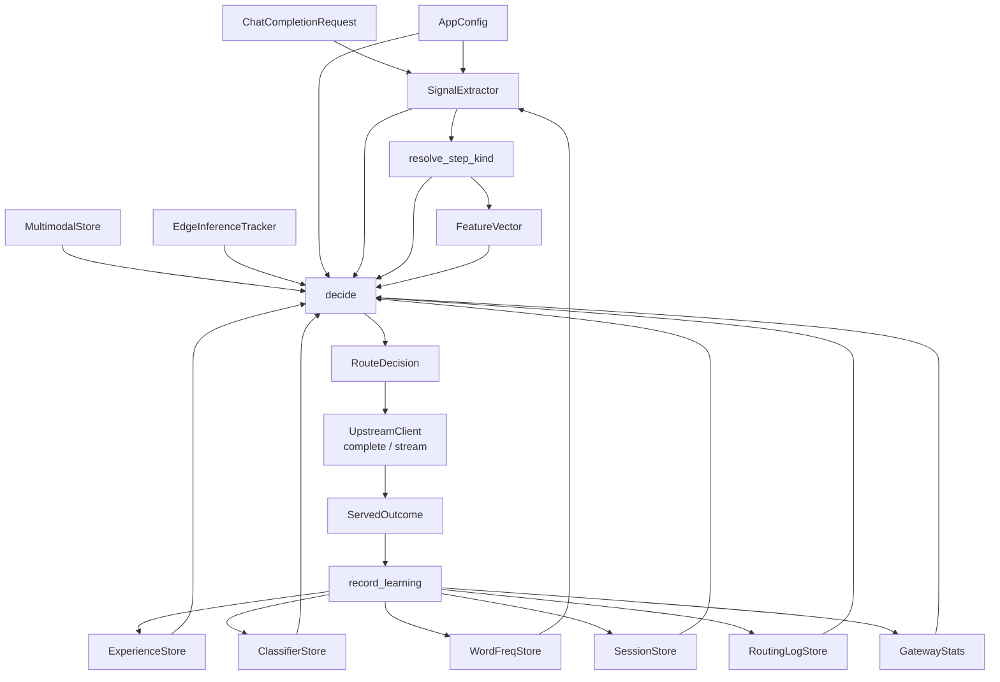
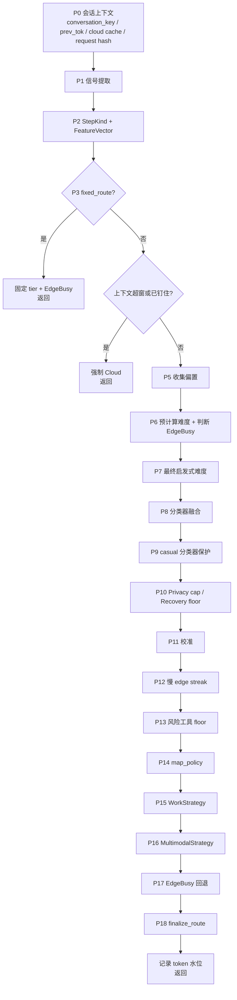

# Model Router 架构文档

> 适用版本：`0.19.11`
> 源码范围：`src/gateway/routing/`、`src/gateway/upstream/`、`src/gateway/{experience,classifier,session,multimodal,stats}/` 中与决策相关的部分
> 配套文档：[`architecture.md`](./architecture.md)（网关整体架构、HTTP 层、持久化、桌面端）

---

## 目录

- [1. 范围与定位](#1-范围与定位)
- [2. 设计目标与约束](#2-设计目标与约束)
- [3. 核心概念](#3-核心概念)
- [4. 组件与数据流](#4-组件与数据流)
- [5. 入口与数据结构](#5-入口与数据结构)
- [6. 决策流水线](#6-决策流水线)
- [7. 信号体系](#7-信号体系)
- [8. StepKind 步态分类](#8-stepkind-步态分类)
- [9. 难度模型](#9-难度模型)
- [10. 学习与状态如何影响路由](#10-学习与状态如何影响路由)
- [11. 策略映射](#11-策略映射)
- [12. 模型解析与执行策略](#12-模型解析与执行策略)
- [13. 配置与调参手册](#13-配置与调参手册)
- [14. 可观测性与调试](#14-可观测性与调试)
- [15. 测试策略](#15-测试策略)
- [16. 扩展指南](#16-扩展指南)
- [17. 已知限制与风险](#17-已知限制与风险)
- [18. 附录](#18-附录)

---

## 1. 范围与定位

Model Router 是 Token Router 的**决策内核**：给定一次聊天请求，决定它应该由端侧模型（edge）、云端模型（cloud）、还是“先 edge 再 cloud”（cascade）来服务。

需要先澄清一个命名问题：它目前**不是**“在多个模型之间按能力选模型”的路由器，而是：

1. **Tier Router**：在 `edge` / `cloud` 两个层级之间做选择；
2. **Model Resolver**：确定该层级实际使用的模型名（`model` 是展示 id，`upstream_model` 是真实转发名）；
3. **Execution Policy**：决定 cascade、verify、multimodal probe、失败回退等执行方式；
4. **Online Learner**：把服务结果写回 experience / classifier / wordfreq / session，影响下一次决策。

本文只覆盖这四件事。HTTP 协议转换、鉴权、桌面端通信、SQLite schema 等见 `architecture.md`。

---

## 2. 设计目标与约束

| 目标 | 具体做法 |
|---|---|
| **对 Agent 透明** | 只从请求体 `messages[]` / `tools[]` / `max_tokens` 推断，不要求自定义 Header |
| **可解释** | 每次决策产出 `reason_codes`，写入日志、响应头、响应体 |
| **可预测** | 固定 `route=edge/cloud` 时严格 fail-closed，绝不跨层 |
| **成本优先但不牺牲质量** | 难度阈值 + 级联质量门 + 云端校验抽样 |
| **越用越准** | experience 偏置、朴素贝叶斯、词频学习、多模态能力缓存 |
| **可增量演进** | 规则集中在 `routing/`，新增信号/门控/学习组件有固定接入点 |
| **无外部依赖** | 纯内存 + 本地 JSON/SQLite，无在线模型服务 |

约束：

- 路由决策**不做网络探测**；上游是否可用只看配置（`base_url` 是否非空）。
- 决策阶段**只读** store，不写库；写回在请求完成后的 `record_learning()`。
- 单次决策必须足够快（纯字符串/哈希/算术，无 IO）。

---

## 3. 核心概念

| 概念 | 定义 | 代码位置 |
|---|---|---|
| **RouteTier** | 路由结论：`Edge` / `Cloud` / `Cascade` | `routing/decision.rs` |
| **RoutingMode** | 中间难度区间的落点：`single` / `cascade` / `split` | `routing/decision.rs` |
| **Profile** | 阈值档位：`economy` / `balanced` / `premium` / `privacy` | `routing/policy.rs` |
| **difficulty** | `[0,1]` 难度分，sigmoid 后的综合评分 | `routing/difficulty.rs` |
| **θ_edge / θ_cloud** | `d < θ_edge` → Edge；`θ_edge ≤ d < θ_cloud` → Cascade/Single 分支；`d ≥ θ_cloud` → Cloud | `routing/policy.rs` |
| **StepKind** | Agent 当前步态，11 种 | `routing/step_kind.rs` |
| **conversation_key** | 由首条 system、首个 user、工具名集合稳定哈希出的会话键 | `routing/conversation.rs` |
| **cloud cache** | 会话级云端 prompt cache 热度，按半衰期衰减 | `routing/cloud_cache.rs` + `session/` |
| **request route cache** | 按请求前缀哈希缓存“上次走了哪层” | `routing_log/route_cache.rs` |
| **EdgeBusy** | 端侧是否有在飞推理 | `gateway/edge_load.rs` |
| **slow edge streak** | 端侧连续生成过慢的次数，180s 衰减一级 | `stats/edge_slow.rs` |
| **WorkStrategy** | work 步态的执行策略，目前只有 `None` / `Verify` | `routing/work.rs` |
| **MultimodalStrategy** | 视觉请求的执行策略：`CachedEdge` / `CachedCloud` / `CachedEdgeFallback` / `Probe` | `multimodal/` |
| **fallback** | 决策是 Edge/Cascade，但实际由 cloud 服务 | `served_outcome.rs` |

---

## 4. 组件与数据流



关键点：

- `decide()` 是**纯读取**：接收 store 引用，返回 `RouteDecision`，不产生写操作（唯一副作用是 `sessions.record_tokens` 更新 token 水位）。
- 写回集中在 `api/chat.rs::record_learning()` 与 `served_outcome.rs`。
- 执行层拿到 `RouteDecision` 后，可能产生与决策不同的 `served_tier`（cascade 回退、质量门失败、预算降级），这个差异会写入 `served_route` 并计入统计。

---

## 5. 入口与数据结构

### 5.1 `decide()` 签名

`routing/decision.rs`：

```rust
pub fn decide(
    config: &AppConfig,
    req: &ChatCompletionRequest,
    sessions: &SessionStore,
    experience: Option<&ExperienceStore>,
    multimodal: Option<&MultimodalStore>,
    routing: &EffectiveRouting,
    edge_load: Option<&EdgeInferenceTracker>,
    edge_tps: Option<f64>,
    classifier: Option<&ClassifierStore>,
    routing_logs: Option<&RoutingLogStore>,
    wordfreq: &WordFreqStore,
    slow_edge_streak: u32,
) -> RouteDecision
```

`Option<&T>` 是为了单测可省略学习组件；生产路径全部传入。

### 5.2 `RouteDecision`

```rust
pub struct RouteDecision {
    pub route: RouteTier,
    pub profile: Profile,
    pub mode: RoutingMode,
    pub step_kind: StepKind,
    pub difficulty: f32,
    pub reason_codes: Vec<String>,
    pub tokens_in_estimate: u32,
    pub tokens_out_estimate: u32,
    pub cloud_input_saved_estimate: u32,

    // 内部/写回用，不参与序列化
    pub conversation_key: String,
    pub assistant_failed_recent: bool,
    pub consecutive_tool_error_streak: u32,
    pub multimodal_strategy: MultimodalStrategy,
    pub work_strategy: WorkStrategy,
    pub force_cloud_sticky: bool,
    pub edge_ok_probability: Option<f32>,
    pub classifier_features: Option<FeatureVector>,
    pub casual_quality_fallback: bool,
    pub lexical_learn: LexicalLearnContext,
    pub routing_log_id: Option<i64>,
}
```

| 字段 | 用途 |
|---|---|
| `route` | 执行层的主分支 |
| `difficulty` | 可观测性、日志、测试断言 |
| `reason_codes` | 可解释性核心 |
| `tokens_in_estimate` | 预算检查、日志、云节省统计 |
| `cloud_input_saved_estimate` | Edge 全量节省 / Cascade 减半 / Cloud 为 0 |
| `casual_quality_fallback` | DirectChat 在 Edge 时允许质量门回退 |
| `multimodal_strategy` | 执行层选择缓存/探测路径 |
| `work_strategy` | 执行层选择是否双调校验 |
| `classifier_features` | 请求完成后用于训练 |
| `lexical_learn` | 请求成功后强化词频 |
| `routing_log_id` | 回写 served/error/token 用量 |

### 5.3 `EffectiveRouting`

`routing/adaptive.rs`：

```rust
pub struct EffectiveRouting {
    pub enabled: bool,
    pub work_verify_sample_rate: f32,
    pub theta_edge: f32,
    pub theta_cloud: f32,
    pub base_verify_sample_rate: f32,
    pub base_theta_edge: f32,
    pub base_theta_cloud: f32,
    pub reasons: Vec<String>,
}
```

当前实现是**配置静态值**：`compute_effective_routing()` 直接取 `default_profile.thresholds()` 与 `work_verify_sample_rate`，学习只通过难度分体现，不直接改 θ 或抽样率。`AdaptiveTuner::refresh()` 每次请求调用，但结果不变。

---

## 6. 决策流水线

`decide()` 的实际执行顺序如下。注意：**早退分支会跳过后续所有步骤**。



### P0 会话上下文

```rust
let conv_key = conversation_key(req);
let prev_tok = sessions.get_last_tok_in(&conv_key);
let cloud_cache = sessions.cloud_cache_state(&conv_key);
let ctx_hash = request_context_hash(req);
```

- `conversation_key` 只哈希：首条 message（通常是 system）、第一条 user、工具数量与工具名。**不哈希完整 transcript**，保证 Agent 循环中会话键稳定，否则 `tok_loop_delta` 每轮重置会虚高难度。
- `request_context_hash` 是请求体的规范 JSON SHA-256，但**去掉最后两条消息**，用于“相似前缀”路由缓存。

### P1–P2 信号与步态

见 [§7](#7-信号体系) 与 [§8](#8-stepkind-步态分类)。

### P3 固定路由早退

```rust
if let Some(fixed) = config.fixed_route {
    // 仍然会应用 EdgeBusy 回退
    // 不调用 finalize_route：固定 tier 缺配置时按失败处理，不偷偷改到另一层
    return finish(...);
}
```

语义：

- `route = "edge"`：即使 cloud 可用、edge 失败，也不回退 cloud。
- `route = "cloud"`：即使 edge 可用，也不回退 edge。
- 固定路由下 `casual_quality_fallback = false`、`work_strategy = None`、`multimodal_strategy = None`。
- EdgeBusy 仍可能把固定的 `Edge` 改成 `Cloud`？不会：`edge_busy_applies` 里 `strict_single_tier` 会排除固定路由。

### P4 上下文溢出早退

```rust
if fixed_route.is_none()
    && cloud_configured(config)
    && (signals.tok_total_in > config.ctx_edge_max_tokens
        || sessions.ctx_overflow_pinned(&conv_key))
{
    return Cloud; // reason: CTX_OVER_EDGE
}
```

- 只看 `tok_total_in`（system + tools schema + transcript），不做 80% 余量判断。
- `ctx_overflow_pin` 在 edge 真实返回上下文溢出错误后由执行层设置，后续请求直接走 cloud，避免反复撞墙。
- 固定路由不受此规则影响。

### P5 偏置收集

依次合并：

1. `gates::collect_gate_biases()`：用户否定、上下文超 80%、assistant 失败、风险工具。
2. `experience.bias_for(step_kind)`：按步态的历史回退率。
3. 请求级路由缓存命中：`REQ_ROUTE_CACHE_CLOUD`。
4. 多模态缓存提示：`MULTIMODAL_CACHE_CLOUD` / `MULTIMODAL_CACHE_EDGE`。
5. `CLOUD_INTENT` / `EDGE_INTENT`。
6. `MEMORY_COMPACT_IN_BUDGET`（压缩步态但未超窗时压回 edge）。
7. 会话 cloud cache 衰减项 `CLOUD_CACHE_BOOST`。
8. 工具类步态对 cloud cache 项乘以 `0.4`（避免一次 cloud 服务拖走整个工具循环）。

### P6–P7 难度计算

先算一次 `d_preliminary` 判断 EdgeBusy 是否适用；若适用，再用 `edge_busy=true` 重算。两次计算都使用同一组 `external_parts`。

### P8 分类器融合

`predict_and_fuse(features, d_heuristic)`，详见 [§10.2](#102-classifierstore)。

### P9 casual 分类器保护

若步态是 `DirectChat` / `HeartbeatAck`，且启发式难度本来低于 `θ_cloud`，但分类器把难度推到了 `θ_cloud` 以上，则压回 `θ_cloud - ε`，并写 `CASUAL_CLASSIFIER_GUARD`。

目的：防止冷启动/噪声分类器破坏“日常闲聊走 edge”的基本盘。

### P10–P13 校准与 floor

见 [§9.3](#93-决策后校准)。

### P14 策略映射

`map_policy_with_thresholds(d, step_kind, profile, mode, θ_edge, θ_cloud)`，见 [§11](#11-策略映射)。

### P15–P17 执行策略

- `attach_work_verify`：work 步态在 Cascade 下按确定性哈希抽样，决定是否 `Verify`。
- `derive_multimodal_strategy`：按缓存与步态决定视觉请求的执行方式。
- `apply_edge_busy_fallback`：edge 忙时把会使用 edge 的非 casual 请求升 cloud。

### P18 上游可用性

`finalize_route`：

- 只配置 edge → 强制 Edge（`UPSTREAM_EDGE_ONLY`）。
- 只配置 cloud → 强制 Cloud（`UPSTREAM_CLOUD_ONLY`）。
- 两侧都配置或都没配置 → 保持原结论（都没配置会在入口被 `require_any_upstream` 拒绝）。

最后写 `sessions.record_tokens(conv_key, tok_total_in)`，供下一次计算 `tok_loop_delta`。

---

## 7. 信号体系

### 7.1 Token 估算

`signals.rs::estimate_tokens` 使用 **4 字符 ≈ 1 token** 的启发式，未接入 tiktoken：

```rust
((text.len() as f64) / 4.0).ceil() as u32
```

- 图片内容额外按 **512 token** 计。
- 工具调用按 `name + arguments` 的字符数估算。
- `tok_system` 只统计首条 system；`tok_rest` 统计其余所有消息。
- `tok_total_in = tok_system + tok_rest + tok_tools_schema`。
- `tok_loop_delta = tok_total_in - prev_tok`（无上轮则为全量）。

> 这意味着中文/代码等字符密度不同的内容会有系统性偏差；当前所有阈值都建立在这个估算上，调参时需保持同一口径。

### 7.2 信号全表

| 字段 | 来源 | 用途 |
|---|---|---|
| `tok_system` / `tok_tools_schema` / `tok_rest` | 消息与工具 schema | casual 判断、溢出判断 |
| `tok_total_in` | 三者之和 | 上下文溢出、预算、日志 |
| `tok_loop_delta` | 与上轮差值 | 工作步态难度 |
| `n_tool_defs` | `tools.len()` | `TOOL_RATIO` |
| `n_turns` | user 消息数 | casual 判断 |
| `last_user_tok` | 最新 user 消息 | `USER_CTX_RATIO`、mid-loop 跟帖判断 |
| `loop_steps` | assistant 消息数 | casual 判断、特征桶 |
| `pending_tool_calls` | 最后一条 assistant 是否带 tool_calls | StepKind、门控 |
| `tool_arg_ready` | 所有 tool_call 的 arguments 是否 `{...}` 完整 | ToolArgFill vs ToolSelect |
| `last_role_tool` | 最后一条消息是否 tool | ToolResultDigest |
| `synthetic_tool_result` | tool 内容是否为占位符 | 避免把占位结果当真实回执 |
| `assistant_failed_recent` | 最近 4 条中 assistant 是否含 `[assistant turn failed` | Recovery、难度 +0.15 |
| `is_heartbeat_poll` | 最新 user 是否等于 `[OpenClaw heartbeat poll]` | HeartbeatAck |
| `voice_repair_loop` | 最新 user 含 `[Audio transcript` 且有过 tool | 归为 ToolResultDigest |
| `subagent_spawn_hint` | transcript 含 `[Subagent Task]` / `sessions_spawn(` / 子代理 | SubagentSpawn |
| `memory_compact_hint` | transcript（非 system）含 `[OpenClaw memory compact]` / compaction | MemoryCompact |
| `cron_background` | 任意消息含 `[cron]` / `cron background` / `cron job` | CronBackground |
| `tools_enabled` | `tools` 非空 | 步态与 casual |
| `had_tool_roundtrip` | 出现过 `role=tool` | FinalReply、casual |
| `consecutive_tool_error_streak` | 自最后 user 起尾部连续 tool 错误 | 难度、门控、Recovery |
| `tool_invocations_since_last_user` | 最后 user 之后的 tool 数 | tool loop、认知意图首轮判断 |
| `user_rejects_answer` | 最后两条是 assistant→user，且 user 含否定词 | 门控 +0.55 |
| `intent_hard` / `intent_hard_specific` | 最新 user 命中硬意图词表 | 难度 +0.30 |
| `intent_easy` | 最新 user 命中 easy 词表 | 难度 -0.40、casual |
| `intent_plan` | 最新 user 命中计划词表 | InitialPlan、+0.15 |
| `intent_cloud` / `intent_edge` | 最近 4 轮 user 的最新明确偏好 | ±偏置、校准 |
| `intent_long_gen` | `max_tokens ≥ 4096` 或长生成词表 | 长生成校准 |
| `intent_analysis` / `intent_decision` / `intent_research` | 5 语言认知词表 | 首轮认知加成 |
| `multimodal` / `user_multimodal` | 任意/最新 user 含图片 | 多模态策略、难度 |
| `risky_tool_hard` / `risky_tool_soft` | 待执行 tool_calls 的风险等级 | 门控、难度 |
| `rare_lexical` / `special_lexical` / `rare_token_ratio` | 词频统计与领域词表 | 难度、词频学习 |

### 7.3 casual 判断

`is_casual_chat(signals)` 必须同时满足：

- 没有 tool 往返、没有 `pending_tool_calls`；
- 没有 `intent_hard`；
- 没有 `assistant_failed_recent`；
- 没有首轮认知意图（plan/analysis/decision/research）；
- `tok_rest < 8192` 且 `n_turns ≤ 8`；
- 不同时出现“图片 + tools”；
- mid-loop 带 tools 时，最新 user 必须命中 easy 意图；
- mid-loop 不带 tools 时，允许 `last_user_tok ≤ 512` 的短跟帖。

casual 是 `DirectChat` 的前提，也是 `HeartbeatAck` 之外的“低成本”兜底。

### 7.4 分层意图窗口

`resolve_recent_tier_intent_with_limit(messages, 4)`：

- 只看最近 **4 条 user** 消息；
- 从新到旧扫描，遇到第一个明确的 cloud/edge 意图就返回；
- 中间的中性 turn 会继承更早的偏好；
- 超出窗口的偏好重置。

这样用户说“用云端”后，后续几轮工具调用仍保持 cloud，直到窗口滑出。

### 7.5 词法稀有度

`lexical.rs::analyze_lexical`：

1. 空文本 → 无信号；
2. `special_lexical`：命中领域词表（GDPR、K8s、CVE、RLHF 等）；
3. 若命中 easy 意图且非 special，只做 `wordfreq.observe_casual()` 学习，跳过稀有判断；
4. 否则用 `whatlang` 检测语言（失败时按字符集回退到 en/zh/ja/ko），
5. 英文用 `tokenizers` WordLevel + Whitespace；中日韩用词表最长匹配；
6. 查 `wordfreq.db`：
   - `rare_token_ratio ≥ 25%`，或
   - 稀有 token ≥ 2，或
   - 频率为 0 / `< 1e-9` 的超稀有 token，
   则 `rare_lexical = true`。

难度加成：仅 rare `+0.08`、仅 special `+0.12`、两者 `+0.18`。

### 7.6 工具风险

`tool_risk.rs::assess_tool_calls`：

| 等级 | 判定 | 影响 |
|---|---|---|
| Hard | `Delete` 工具；`exec` 命令含 `rm` / `mv` / `git mv` / 删除或移动语义 | 门控 `+0.30`；最终难度若低于 `θ_cloud` 则抬到 `θ_cloud` |
| Soft | `browser` / `message` / `sessions_spawn` | 难度 `+0.10` |
| None | `write` / `edit` / 普通 `exec` / `read` | 无影响 |

Hard 只在 `ToolSelect` / `ToolArgFill` 且尚无 tool 结果时生效；已经有结果后不再重复加码。

### 7.7 OpenClaw 包装剥离

`strip_openclaw_user_wrappers` 只处理**最新 user 消息的前缀**：

- 可选 `Sender (untrusted metadata):` + 代码块；
- 可选 `[Mon 2026-01-01 10:00 GMT+8]` 时间戳；
- 只剥离一次，用户正文中后续出现的类似文本不动。

这样避免 OpenClaw 注入的元数据污染关键词/词频判断，同时不破坏用户粘贴的日志。

---

## 8. StepKind 步态分类

`resolve_step_kind()` 按优先级返回第一个匹配项：

| 优先级 | 条件 | StepKind | bias |
|---:|---|---|---:|
| 1 | `is_heartbeat_poll` | `HeartbeatAck` | -0.60 |
| 2 | `assistant_failed_recent` | `RecoveryAfterFailure` | +0.55 |
| 3 | `pending_tool_calls && tool_arg_ready` | `ToolArgFill` | -0.35 |
| 4 | `pending_tool_calls` | `ToolSelect` | -0.20 |
| 5 | `last_role_tool && !synthetic_tool_result` | `ToolResultDigest` | -0.45 |
| 6 | `voice_repair_loop` | `ToolResultDigest` | -0.45 |
| 7 | `subagent_spawn_hint` | `SubagentSpawn` | +0.50 |
| 8 | `is_casual_chat()` | `DirectChat` | -0.55 |
| 9 | `memory_compact_hint` | `MemoryCompact` | +0.20 |
| 10 | `cron_background` | `CronBackground` | -0.15 |
| 11 | `intent_plan` 或首轮认知意图 | `InitialPlan` | +0.55 |
| 12 | 再次 `is_casual_chat()` | `DirectChat` | -0.55 |
| 13 | `!tools_enabled && had_tool_roundtrip` | `FinalReply` | +0.05 |
| 14 | 兜底 | `ToolSelect` / `FinalReply` | — |

“首轮认知意图”只在 `tool_invocations_since_last_user == 0 && !pending_tool_calls` 时成立；工具循环中的 analysis/research 不再加 planning 偏置。

`StepKind` 同时是：

- 难度公式的一项（bias）；
- experience 的统计键；
- classifier 的特征键；
- 路由日志的展示字段；
- 测试断言的主要维度。

---

## 9. 难度模型

### 9.1 公式

```text
raw = 0.20 × min(ctx_ratio, 1)
    + 0.25 × min(user_ctx_ratio, 1)
    + 0.05 × min(tool_ratio, 1)
    + 0.30 × intent_hard
    + 0.25 × intent_cloud
    + 0.25 × intent_long_gen
    - 0.30 × intent_edge
    - 0.40 × intent_easy
    + 0.12 × user_multimodal
    + step_kind.bias()
    + experience_bias
    + 0.15 × assistant_failed_recent
    + tool_error_streak_bias
    + tool_loop_bias
    + lexical_rarity_bias
    + risky_tool_soft_bias
    + cognitive_intent_bias
    + gate_parts
    + external_parts
    + context_parts

d = sigmoid(raw)
```

### 9.2 各项取值

| 项 | 取值 |
|---|---|
| `ctx_ratio` | `DirectChat`/`HeartbeatAck` 用 `tok_rest`，其余用 `tok_loop_delta`，除以 `ctx_edge_max_tokens` |
| `user_ctx_ratio` | `last_user_tok / ctx_edge_max_tokens` |
| `tool_ratio` | `n_tool_defs / 20` |
| `assistant_failed_recent` | `+0.15` |
| `tool_error_streak_bias` | 1 → 0.10；2 → 0.28；3 → 0.38；4+ → 0.48 |
| `tool_loop_bias` | 仅当 `tok_total_in > 50%` 窗口：15–17 → 0.08；18–22 → 0.12；23+ → 0.15 |
| `lexical_rarity_bias` | rare 0.08 / special 0.12 / both 0.18 |
| `risky_tool_soft_bias` | 0.10 |
| 认知意图 | plan 0.15 / analysis 0.18 / decision 0.15 / research 0.15（仅首轮） |
| `GATE_USER_REJECT` | +0.55 |
| `GATE_CTX_OVERFLOW` | casual +0.35 / 其他 +0.50 |
| `GATE_OPENCLAW_COMPACT` | +0.45 |
| `GATE_ASSISTANT_FAILURE` | +0.20（heartbeat 除外） |
| `GATE_RISKY_TOOL` | +0.30 |
| `CLOUD_INTENT` | +0.40 |
| `EDGE_INTENT` | -0.25 |
| `MEMORY_COMPACT_IN_BUDGET` | -0.75 |
| `MULTIMODAL_CACHE_CLOUD` | +0.55 |
| `MULTIMODAL_CACHE_EDGE` | -0.30 |
| `CLOUD_CACHE_BOOST` | 会话衰减值，上限 `cloud_cache_boost_max`（默认 0.18） |
| `REQ_ROUTE_CACHE_CLOUD` | 0.12（与 session boost 合计后统一截断） |
| `GATE_EDGE_BUSY` | +0.30 |
| `MULTIMODAL_COMPLEX_CLOUD` | +0.35 |
| `LONG_GEN_EDGE_TPS_LOW` | +0.50 |
| `LONG_GEN_EDGE` | -0.15（长生成但 edge TPS 不低） |

### 9.3 决策后校准

按代码顺序执行：

| 条件 | 动作 | reason |
|---|---|---|
| 用户否定上一轮 | 抬到 `θ_cloud` | `DIFF_D:CALIB_USER_REJECT` |
| `intent_cloud` + casual | 抬到 `θ_cloud` | `DIFF_D:CALIB_CLOUD_INTENT` |
| 多模态缓存命中 cloud | 抬到 `θ_cloud` | `DIFF_D:CALIB_MULTIMODAL_CACHE` |
| 长生成且 edge TPS 低 | 抬到 `θ_cloud` | `DIFF_D:CALIB_LONG_GEN_TPS` |
| MemoryCompact 未超窗 | 压到 `θ_cloud - ε` | `DIFF_D:CALIB_MEMORY_COMPACT` |
| `intent_edge` + casual | 压到 `θ_edge - ε` | `DIFF_D:CALIB_EDGE_INTENT` |
| work 执行步态且未超窗、无多模态、错误 streak < 2 | 压到 `θ_edge - ε` | `DIFF_D:CALIB_WORK_EXEC_EDGE` |

之后：

1. **slow edge streak**：连续 1/2/3+ 次慢 edge，难度 `+0.08 / +0.18 / +0.28`（`EDGE_SLOW_STREAK_n`）。一次慢样本只进入 cascade 带，edge 仍会生成；继续慢才升 cloud。
2. **风险工具 floor**：若命中 `GATE_RISKY_TOOL` 且 `d < θ_cloud`，直接抬到 `θ_cloud`（`DIFF_D:GATE_RISKY_TOOL_FLOOR`）。

### 9.4 Privacy profile

`Profile::Privacy` 有额外规则：

- Recovery 步态：难度下限 `θ_cloud`（失败恢复必须上云）。
- 其他步态：`d = min(d, 0.20)`（`apply_privacy_cap`），强制尽量走 edge。
- 与 `intent_cloud` 冲突时，calibrate 阶段仍可能抬回 `θ_cloud`；隐私 profile 不是硬保证。

---

## 10. 学习与状态如何影响路由

### 10.1 ExperienceStore

文件：`experience.json`。按 StepKind 统计：

```rust
pub struct StepExperience {
    pub edge_ok: u64,
    pub cascade_fallback: u64,
    pub upstream_error: u64,
    pub tool_failure: u64,
}
```

偏置：

```text
effective_failures = cascade_fallback + tool_failure
verified           = edge_ok + effective_failures
fallback_rate      = effective_failures / verified
raw                = learning_rate × (fallback_rate - target_fallback)
bias               = clamp(raw, -max_bias, +max_bias)
```

默认 `learning_rate=0.08`、`max_bias=0.12`、`target_fallback=0.15`。偏置直接进入难度公式。

`edge_trusted` 仍存在（`verified ≥ 3` 且失败率 ≤ target），但当前 `routing/work.rs` **已不再用它直接定路**，只用于统计快照；这与 README 的 “CachedEdge” 描述不一致。

### 10.2 ClassifierStore

文件：`classifier.json`。离散特征朴素贝叶斯：

- 先验默认 `80/20`，可由 `seed_heuristic_priors()` 按 StepKind bias 与特征权重初始化。
- 特征不含正文，只有：
  `step_kind:*`、`ctx_bucket:*`、`tool_bucket:*`、`loop_bucket:*`、`turn_bucket:*`、`intent:*`、`tool_error_streak:*`、`tool_loop:*`、`lexical:*`，以及 `flag:multimodal`、`flag:risky_tool_hard`、`flag:risky_tool_soft`、`flag:pending_tool_calls`、`flag:assistant_failed_recent`、`flag:is_heartbeat_poll`、`flag:had_tool_roundtrip`、`flag:tools_enabled`、`flag:intent_analysis` 等。
- 推理：log 空间先验 + 特征似然，softmax 得 `p_edge`。
- 融合：

```text
w = min(step_samples / min_samples, 1.0) × max_weight   // max_weight ≤ 0.60
d = (1 - w) × d_heuristic + w × (1 - p_edge)
```

- 标签只来自 **edge 曾被尝试且结果可判定** 的请求：
  - `edge_ok && !fallback && !upstream_error` → `EdgeOk`
  - `cascade_fallback || upstream_error` → `CloudNeeded`
  - 其他（纯 cloud 成功）不训练。
- 后台每 3600s 检查一次，距离上次 ≥ half_life/2 才衰减：
  `factor = 0.5^(elapsed / half_life_hours)`，小样本特征并入先验后删除。

### 10.3 WordFreqStore

文件：`wordfreq.db`。只影响词法稀有度信号：

- 种子词表 `wordfreq_seed.rs`（en/zh/ja/ko）。
- easy 对话中观察新词（`observe_casual`）。
- edge 成功的 `DirectChat` / `HeartbeatAck` 且无 rare/special 时，`reinforce_from_outcome` 强化。
- 新词 `seen_count` 达到 `min_seen_to_promote`（默认 3）后权重提升。
- 每语言最多 5000 个 learned 词。

词频越准，`rare_lexical` 越少误报，简单请求越容易留在 edge。

### 10.4 MultimodalStore

文件：`multimodal.json`。按模型 + 上游指纹缓存视觉能力：

- `CachedEdge`：edge 已验证支持；
- `CachedCloud`：edge 不支持、cloud 支持；
- `CachedEdgeFallback`：两者都不支持，但 edge 曾尝试；
- `Probe`：未知，先探测 edge。

指纹由 `edge:<url>|ek:<key>|cloud:<url>|ck:<key>` 组成，换上游即清空缓存。

### 10.5 会话 cloud cache

`session/store.rs::apply_served_outcome`：

- edge 成功（`served_tier=edge && edge_ok && !fallback && !upstream_error`）→ 清空 cloud cache。
- cloud 服务 → 刷新 anchor 与 peak：
  - 基础 peak = `cloud_cache_boost_max`；
  - 若响应带 `cached_tokens`，按 `cached/prompt` 比例最多放大 25%（仍不超过 `boost_max`）。
- edge 失败且 `force_cloud_sticky` 或 `should_set_cloud_sticky(step_kind)` → 刷新 cloud cache。

`cloud_cache_extra_parts` 再按半衰期衰减并截断：

```text
session_boost = peak × 0.5^(elapsed / half_life)
total         = session_boost + request_route_boost(0.12)
若 total > boost_max，按比例缩放
```

工具类步态会再乘 `0.4`，避免一次 cloud 服务让整个 Agent 循环都留在 cloud。

> 注意：`apply_served_outcome` 里基础 peak 已经等于 `boost_max`，随后 `(boost_max × (1 + ratio × 0.25)).min(boost_max)` 恒等于 `boost_max`，因此 `cached_tokens` 比例放大目前实际不生效，等价于固定使用最大 boost。

### 10.6 请求级路由缓存

`request_route_cache` 表按 `request_context_hash`（去掉最后两条消息）记录上次 tier 与 model：

- 命中 `cloud` → `REQ_ROUTE_CACHE_CLOUD:<model>`，+0.12 线性偏置；
- 命中 `edge` → 只记录 reason，不加偏置；
- 保留期默认 7 天，后台每小时清理。

它的作用是让“相同前缀的重复请求”保持稳定，而不是让所有请求都跟着上一次走。

### 10.7 Slow edge streak

`stats/edge_slow.rs`：

- 完成 token < 16 的短回复忽略。
- TPS < `LONG_GEN_EDGE_TPS_MIN`（25）时 streak +1，否则清零。
- 每 180s 衰减一级。
- 决策层只对非 casual 步态加成，且 cloud 未配置时不生效。

### 10.8 反馈闭环的偏置风险

- **选择偏差**：classifier 只学习 edge 尝试过的请求，纯 cloud 样本不参与，长期会让“难请求”在训练集中缺失。
- **延迟反馈**：cascade 回退的训练信号来自质量门，不是用户真实满意度。
- **词频自增强**：edge 成功的 easy 对话会强化词频，可能让某些词越来越“常见”，进一步降低难度。
- **会话粘性**：cloud cache 会让同一会话持续偏 cloud；工具步态已用 0.4 缩放缓解。

---

## 11. 策略映射

### 11.1 Profile 阈值

| Profile | θ_edge | θ_cloud | 默认 Mode |
|---|---:|---:|---|
| `economy` | 0.40 | 0.60 | Cascade |
| `balanced`（默认） | 0.35 | 0.55 | Cascade |
| `premium` | 0.25 | 0.45 | Single |
| `privacy` | 0.45 | 0.65 | Cascade（实际受 privacy cap 约束） |

### 11.2 映射规则

```text
DirectChat / HeartbeatAck（mode != split）:
  d < θ_cloud ? Edge : Cloud        // 不产出 Cascade

Single:
  d < θ_edge ? Edge : Cloud

Cascade:
  d < θ_edge ? Edge
  : (d < θ_cloud ? Cascade : Cloud)

Split:
  恒为 Cloud
```

### 11.3 固定路由与强制路由

| 输入 | 行为 |
|---|---|
| `route = "edge"` | 恒 Edge；不跨层回退；忽略上下文溢出规则 |
| `route = "cloud"` | 恒 Cloud；不跨层回退 |
| `route = "cascade"` | `fixed_route = Some(Cascade)`；恒为 Cascade，跳过难度与策略映射；执行层走 edge → 质量门 → cloud，允许跨层回退 |
| `route = "auto"` | `fixed_route = None`；完整流水线 |
| `X-Token-Router-Force-Route: cloud` | 非固定 edge 且 cloud 已配置时改为 Cloud，写 `FORCE_ROUTE_CLOUD` |
| 只配置一侧 | `finalize_route` 强制该侧，写 `UPSTREAM_*_ONLY` |

`route = "cascade"` 与 `routing_mode = "cascade"` 是两个不同概念：前者固定策略，后者只决定中间区间落点。

---

## 12. 模型解析与执行策略

### 12.1 每 agent 的上游解析

`AppConfig::resolve_upstream(agent_id, tier)`：

- 优先 `[agent.<id>.upstream.<tier>]`，缺失字段回退全局 `[upstream.<tier>]`。
- 返回四元组：`base_url`、`api_key`、`model`、`upstream_model`。
- `agent_id` 来自请求头 `x-agent-id`；缺省用全局配置与 `__default__` 预算。

### 12.2 模型名优先级

`apply_upstream_model`：

1. `upstream_model`（真实转发名）优先；
2. 其次 `model`（展示 id）；
3. 若值为空或 `auto`，保留客户端请求的 `model`。

因此：

- `model = "auto"` + `upstream_model = "qwen2.5:14b"` → 请求被改写为 `qwen2.5:14b`；
- `model = "auto"` 且无 `upstream_model` → 透传客户端 model；
- `model = "deepseek-chat"` 且无 `upstream_model` → 改写为 `deepseek-chat`。

`/v1/models` 会把 `auto`、显式 edge/cloud model、图片/视频 model 一起列出，供 Agent 选择。

### 12.3 执行分支

`UpstreamClient::complete()` / `stream()`：

| 决策/策略 | 行为 |
|---|---|
| 固定 `edge` | 只调 edge，失败直接返回 |
| 固定 `cloud` | 只调 cloud |
| `MultimodalStrategy != None` | 按 Cached/Probe 分派 |
| `WorkStrategy::Verify` | edge + cloud 双调，cloud 校验 edge |
| `Edge` + `casual_quality_fallback` | edge → 质量门 → cloud |
| `Edge`（普通） | edge → 上下文溢出则钉住并升 cloud |
| `Cloud` + 预算允许 | 直接 cloud |
| `Cloud` + 预算耗尽 | 先试 edge 质量门，再 cloud |
| `Cascade` | edge → 质量门 → cloud |

流式与非流式分支对齐；流式一旦开始向客户端输出，就不再回退。

### 12.4 Cascade 质量门

`cascade_gate_pass(resp)`：

- 文本：非空、长度 > 8、且不含不确定性表达（5 语言词表）。
- 工具：所有 tool_call 的 `function.name` 与 `arguments` 都非空。

失败 → `cascade_fallback` → 调 cloud。

### 12.5 Verify

抽样命中时同时调用 edge 与 cloud：

- 任一方有 tool_calls：两方都必须有，且工具名序列完全一致；
- 否则文本比较：两段 ≥ 8 字符、cloud 不含不确定性词、词集合 Jaccard ≥ 0.12。

通过 → 采用 edge（省 cloud 输出）；否则采用 cloud。

### 12.6 上下文溢出回退

edge 返回的错误消息命中 `context length` / `max context` / `too many tokens` / `n_ctx` 等模式时：

- 自动模式（非固定路由）下设置 `ctx_overflow_pin`；
- 本次及后续请求直接走 cloud；
- 下一次 context 变短也不会自动解除钉住（当前实现是单向）。

### 12.7 云预算

- 粒度：`agent_id` × 5 小时窗口。
- `cloud_token_budget = None/0` 表示不限。
- 预算耗尽时 `Cloud` 分支会先尝试 edge 质量门，但仍保底 cloud，避免请求失败。

---

## 13. 配置与调参手册

### 13.1 路由相关配置

| 键 | 默认 | 作用 |
|---|---|---|
| `gateway.route` | `auto` | `auto` / `edge` / `cloud` / `cascade` |
| `gateway.routing_mode` | `cascade` | `single` / `cascade` / `split` |
| `gateway.default_profile` | `balanced` | 阈值档位 |
| `gateway.ctx_edge_max_tokens` | 200000 | edge 上下文预算 |
| `gateway.work_verify_sample_rate` | 0.1 | Verify 抽样率 |
| `gateway.experience_enabled` | true | 经验偏置开关 |
| `gateway.experience_learning_rate` | 0.08 | 偏置学习率 |
| `gateway.experience_max_bias` | 0.12 | 偏置上限 |
| `gateway.experience_target_fallback` | 0.15 | 目标回退率 |
| `gateway.cloud_cache_decay_half_life_secs` | 600 | cloud cache 半衰期 |
| `gateway.cloud_cache_boost_max` | 0.18 | cloud cache 最大线性偏置 |
| `gateway.request_route_cache_enabled` | true | 请求级路由缓存 |
| `gateway.request_route_cache_retention_days` | 7 | 缓存保留期 |
| `gateway.classifier_enabled` | true | 贝叶斯开关 |
| `gateway.classifier_min_samples` | 100 | 达到后满权重 |
| `gateway.classifier_max_weight` | 0.60 | 贝叶斯权重上限 |
| `gateway.classifier_prior_alpha` | 1.0 | 平滑 |
| `gateway.classifier_decay_half_life_hours` | 168 | 衰减半衰期 |
| `gateway.classifier_prior_from_heuristic` | true | 启发式先验 |
| `gateway.wordfreq_learning_enabled` | true | 词频学习 |
| `gateway.wordfreq_min_seen_to_promote` | 3 | 新词提升门槛 |
| `gateway.adaptive_routing_enabled` | true | 仅影响 reason/统计；当前不调 θ |
| `gateway.adaptive_*` | — | 预留参数，当前未参与阈值计算 |

### 13.2 常用配方

| 目标 | 配置 |
|---|---|
| 全部走本地 | `route = "edge"`，只配 `[upstream.edge]` |
| 全部走云端 | `route = "cloud"` 或只配 `[upstream.cloud]` |
| 最大化节省 | `default_profile = "economy"`，`routing_mode = "cascade"`，`work_verify_sample_rate = 0` |
| 质量优先 | `default_profile = "premium"`，`routing_mode = "single"`，提高 `classifier_max_weight` |
| 隐私优先 | `default_profile = "privacy"`，只配 edge 或 `route = "edge"` |
| 反复误走 cloud | 检查 `reason_codes`：`CTX_OVER_EDGE`、`GATE_*`、`EDGE_SLOW_STREAK_*`、`CLOUD_INTENT` |
| 反复误走 edge | 检查 `DIFFICULTY_*`、`CALIB_*`、`EDGE_INTENT`、`LEXICAL_*` |

### 13.3 调参排查顺序

1. 看 `reason_codes`，定位是**硬规则、门控、校准、分类器、还是缓存**导致的。
2. 若是 `CTX_OVER_EDGE`：确认 `ctx_edge_max_tokens` 与真实模型窗口是否匹配。
3. 若是 `EXP_BIAS`：看 `experience.json` 对应 StepKind 的回退率。
4. 若是 `BAYES_*`：确认样本量是否已过 `classifier_min_samples`，冷启动时权重很低。
5. 若是 `CLOUD_CACHE_BOOST`：说明同会话最近有 cloud 服务，等半衰期或换会话验证。
6. 若是 `EDGE_SLOW_STREAK`：检查 edge 实际 TPS 与 `LONG_GEN_EDGE_TPS_MIN`。
7. 若一切正常但仍不符合预期：用离线 `routing/tests.rs` 构造同款请求复现。

---

## 14. 可观测性与调试

### 14.1 响应元数据

非流式：

```json
{
  "route": "edge",
  "fallback": false,
  "difficulty_score": 0.31,
  "step_kind": "direct_chat",
  "reason_codes": ["STEP_DIRECT_CHAT", "DIFFICULTY_0.31"],
  "tokens_in": 812,
  "tokens_out": 96,
  "input_ratio": 0.894,
  "cloud_input_saved": 812,
  "profile": "balanced"
}
```

流式响应头：

- `x-token-router-route`
- `x-token-router-fallback`
- `x-token-router-step-kind`
- `x-token-router-profile`
- `x-token-router-difficulty`
- `x-token-router-edge-prob`
- `x-token-router-reason-codes`

### 14.2 路由日志

`routing_logs` 表记录：

- 决策快照：`route`、`step_kind`、`profile`、`mode`、`difficulty`、`reason_codes`、`edge_prob`
- 服务结果：`served_route`、`served_model`、`tokens_in/out/cached`、`error_reason`

`served_route` 与 `route` 不同即说明发生了回退或策略改写。查询：

```bash
curl 'http://127.0.0.1:11088/v1/admin/routing-logs?limit=50'
```

### 14.3 统计

`/v1/admin/stats` 与 `token-router stats` 提供：

- 路由分布（edge/cloud/cascade）
- fallback 率
- 云输入节省
- 各 StepKind 难度与路由
- experience 偏置与 trusted 状态
- classifier 先验、特征、样本量、衰减代
- slow edge streak / TPS

### 14.4 常用 reason code 分组

| 分组 | 前缀/示例 |
|---|---|
| 步态 | `STEP_DIRECT_CHAT`、`STEP_INITIAL_PLAN` |
| 配置/上游 | `CONFIG_ROUTE_EDGE`、`UPSTREAM_CLOUD_ONLY`、`FORCE_ROUTE_CLOUD`、`CTX_OVER_EDGE` |
| 门控 | `GATE_EDGE_DOWN`、`GATE_USER_REJECT`、`GATE_CTX_OVERFLOW`、`GATE_ASSISTANT_FAILURE`、`GATE_RISKY_TOOL`、`GATE_OPENCLAW_COMPACT`、`GATE_EDGE_BUSY` |
| 意图 | `CLOUD_INTENT`、`EDGE_INTENT`、`PLAN_INTENT`、`ANALYSIS_INTENT`、`DECISION_INTENT`、`RESEARCH_INTENT` |
| 词法/工具 | `LEXICAL_RARE`、`LEXICAL_SPECIAL`、`LEXICAL_BOTH`、`RISKY_TOOL_SOFT:<names>` |
| 难度 | `DIFFICULTY_0.42`、`DIFF_HEUR`、`DIFF_LINEAR_SUM`、`DIFF_D:<part>:±x` |
| 学习 | `EXP_BIAS_+0.08`、`BAYES_P_0.73`、`BAYES_COLD_START`、`DIFF_FUSE:...` |
| 缓存/多模态 | `MULTIMODAL_CACHE_CLOUD`、`MULTIMODAL_CACHE_EDGE`、`MULTIMODAL_PROBE_EDGE`、`REQ_ROUTE_CACHE_CLOUD:<model>` |
| 执行 | `WORK_EXEC_EDGE`、`WORK_VERIFY_SAMPLE(p=0.10)`、`WORK_SAMPLE_SKIP(p=0.10)`、`CASUAL_EDGE_FALLBACK`、`EDGE_SLOW_STREAK_2` |

---

## 15. 测试策略

`routing/tests.rs` 有 **90 个**测试，覆盖：

| 类别 | 代表用例 |
|---|---|
| 上游可用性 | `require_any_upstream_rejects_empty`、`edge_only_forces_edge_even_for_hard_tasks`、`cloud_only_forces_cloud` |
| 固定路由 | `fixed_cloud_never_routes_edge`、`fixed_edge_skips_work_verify_and_multimodal_strategies`、`fixed_edge_ignores_edge_busy_redirect` |
| casual / heartbeat | `simple_greeting_prefers_edge`、`heartbeat_prefers_edge`、`openclaw_large_prompt_greeting_stays_edge` |
| OpenClaw 兼容 | `openclaw_untrusted_metadata_greeting_stays_edge`、`openclaw_memory_compact_overflows_to_cloud` |
| 工具循环 | `fourteen_tool_loop_no_difficulty_bump_under_budget`、`fifteen_tool_loop_emits_reason_when_over_half_budget`、`tool_error_streak_keeps_execution_on_cloud` |
| 意图 | `edge_intent_forces_edge`、`cloud_intent_forces_cloud`、`tier_intent_carries_forward_within_window`、`analysis_intent_skipped_after_tool_result` |
| 多模态 | `multimodal_simple_chat_tries_edge`、`multimodal_complex_with_tools_forces_cloud`、`multimodal_uses_cached_cloud_after_probe` |
| 缓存 | `cloud_cache_boosts_work_exec`、`edge_ok_clears_cloud_cache`、`hash_lookup_cloud_boosts` |
| EdgeBusy / 慢 edge | `edge_busy_routes_cloud_for_work_when_edge_inference_active`、`one_slow_edge_raises_tool_arg_fill_but_still_uses_edge`、`three_slow_edge_samples_send_tool_arg_fill_to_cloud` |
| 分类器 | `classifier_emits_bayes_reason_when_enabled`、`openclaw_greeting_stays_edge_with_poisoned_classifier`、`casual_classifier_guard_caps_difficulty` |
| 风险工具 | `exec_delete_on_tool_arg_fill_stays_at_cloud_floor`、`exec_git_status_on_tool_arg_fill_no_risky`、`read_on_tool_arg_fill_no_risky_signal` |

写新测试的建议：

1. 用 `AppConfig::from_file(ConfigFile, home)` 构造最小配置；
2. 用 `ChatCompletionRequest` 手写 messages/tools；
3. 断言 `decision.route` + `reason_codes` + `step_kind`，不要只断言 route；
4. 需要学习组件时使用 `ExperienceStore::new_in_memory` / `ClassifierStore` 测试构造器；
5. 时间相关逻辑（cloud cache、slow streak）传入固定 `now`。

---

## 16. 扩展指南

### 16.1 新增一个信号

1. 在 `RequestSignals` 加字段，并在 `SignalExtractor::extract` 填充；
2. 决定它影响：
   - 难度：在 `difficulty.rs::compute_with_context` 或 `push_context_parts` 加权重；
   - 门控：在 `gates.rs::collect_gate_biases` 加偏置；
   - 步态：在 `resolve_step_kind` 加分支；
   - 分类器：在 `features.rs` 加 bucket/flag；
3. 加 reason code，并在 `meta.rs::summarize_route_reasons` 里判断是否“决定性”；
4. 在 `routing/tests.rs` 加正反用例。

### 16.2 新增一个门控

- 若只是“提高难度”，加在 `collect_gate_biases` 的 `parts`；
- 若需要保底，仿照风险工具在 `decide()` 后段加 floor；
- 若需要真正硬短路，必须放在 P3/P4 早退区，并明确是否受 `fixed_route` 影响。

### 16.3 新增一个 StepKind

1. `StepKind` 枚举 + `bias()`；
2. `resolve_step_kind` 插入到正确优先级；
3. `signals.rs::step_kind_code`、`meta.rs::step_kind_name`；
4. `classifier/features.rs::step_kind_key`、`classifier/model.rs::step_kind_feature_key`；
5. `session/data.rs::step_kind_name`；
6. `work.rs::is_work_step`（如果属于 work）；
7. 测试。

### 16.4 新增一个学习组件

接入点固定为四处：

1. **读取**：在 `decide()` 中调用，产出偏置或策略；
2. **写回**：在 `api/chat.rs::record_learning` 中记录 outcome；
3. **持久化**：内存 + 5s 脏标记 flush（或 SQLite 直接写）；
4. **可观测**：在 `/v1/admin/stats` 暴露快照。

### 16.5 reason code 命名约定

- 全大写 + 下划线；
- 带数值/细节时用冒号：`DIFF_D:CTX_RATIO:+0.1234`、`GATE_RISKY_TOOL:exec`；
- 前缀表达来源：`STEP_`、`GATE_`、`DIFF_`、`EXP_`、`BAYES_`、`WORK_`、`MULTIMODAL_`、`UPSTREAM_`。

---

## 17. 已知限制与风险

| 问题 | 说明 | 影响 |
|---|---|---|
| **名为 model router，实为 tier router** | 不在多个模型间做能力匹配；模型由配置与 `upstream_model` 决定 | 无法按任务类型自动选不同云模型 |
| **自适应阈值未生效** | `compute_effective_routing` 返回静态配置；`adaptive_*` 参数不参与计算 | README 的“每 30s/40 请求调参”与实现不符 |
| **classifier 选择偏差** | 只学习 edge 尝试过的请求 | 纯 cloud 场景样本缺失，难任务分布偏移 |
| **token 估算是字符启发式** | 4 字符/token，图片 512；`tok_out_estimate` 当前恒为 0，`max_tokens` 只用于 `intent_long_gen` | 中文、代码、JSON 的估算误差会传导到所有阈值 |
| **关键词覆盖有限** | 5 语言词表 ≥64 项，但仍有长尾表达 | 可能漏判 hard/easy/cloud/edge 意图 |
| **规则交互复杂** | 多个偏置叠加，单一规则效果不直观 | 调参需看完整 reason_codes |
| **固定路由不降级** | `route=edge` 时 edge 故障直接失败 | 可用性换确定性 |
| **上下文溢出钉住单向** | 一旦钉住 cloud，不会因请求变短自动解除 | 会话后期可能持续 cloud |
| **conversation_key 可能碰撞** | 只哈希首 system + 首 user + 工具名 | 极端情况下不同会话共享状态 |
| **request hash 忽略最后两条消息** | 用于“相似前缀”缓存 | 同一前缀不同问题的缓存命中可能过宽 |
| **slow edge 只看本进程** | `GatewayStats` session 级 | 重启后 streak 清零 |
| **经验偏置上限较小** | `max_bias` 默认 0.12 | 学习能微调，但无法单独扭转路由 |

---

## 18. 附录

### 18.1 源码地图

```
src/gateway/routing/
├── decision.rs              decide() 主流水线、RouteDecision、apply_forced_cloud_route
├── signals.rs               RequestSignals、SignalExtractor、token 估算、意图窗口
├── step_kind.rs             StepKind 枚举与判定
├── gates.rs                 门控偏置（GATE_*）
├── difficulty.rs            难度公式、校准、隐私 cap
├── policy.rs                Profile 阈值与 tier 映射
├── work.rs                  WorkStrategy、Verify 抽样
├── adaptive.rs              EffectiveRouting（当前静态）
├── adaptive_tuner.rs        refresh / snapshot
├── edge_busy.rs             EdgeBusy 判定与回退
├── upstream_availability.rs 单侧强制、require_any_upstream
├── conversation.rs          conversation_key
├── request_hash.rs          request_context_hash
├── cloud_cache.rs           cloud cache 衰减与偏置
├── lexical.rs               稀有词判定
├── lexical_tokenizer.rs     WordLevel / CJK 最长匹配
├── wordfreq_store.rs        wordfreq.db 与运行时学习
├── wordfreq_seed.rs         种子词表
├── keywords.rs              7 组 × 5 语言词表 + 意图/不确定性判断
├── cognitive_intent.rs      分析/决策/研究意图词表
├── reject_intent.rs         用户否定意图
├── tool_risk.rs             工具风险分级
└── tests.rs                 90 个路由测试

相关：
src/gateway/upstream/{forward,sse,verify}.rs   执行与质量门
src/gateway/{experience,classifier,multimodal,session}/  学习与状态
src/gateway/stats/{metrics,edge_slow}.rs       TPS 与慢 edge
src/gateway/routing_log/                      路由日志与请求缓存
```

### 18.2 默认值速查

| 项 | 默认 |
|---|---|
| `route` | `auto` |
| `routing_mode` | `cascade` |
| `default_profile` | `balanced` |
| `ctx_edge_max_tokens` | 200000 |
| `work_verify_sample_rate` | 0.1 |
| `experience_learning_rate` / `max_bias` / `target_fallback` | 0.08 / 0.12 / 0.15 |
| `cloud_cache_decay_half_life_secs` / `boost_max` | 600 / 0.18 |
| `classifier_min_samples` / `max_weight` / `half_life_hours` | 100 / 0.60 / 168 |
| `wordfreq_min_seen_to_promote` / `max_learned_per_lang` | 3 / 5000 |
| `LONG_GEN_MAX_TOKENS_THRESHOLD` | 4096 |
| `LONG_GEN_EDGE_TPS_MIN` | 25.0 |
| `TOOL_ERROR_STREAK_DIFFICULTY` | 1 |
| `EDGE_SLOW_MIN_COMPLETION_TOKENS` | 16 |
| `EDGE_SLOW_DECAY_SECS` | 180 |
| `TOOL_STEP_CLOUD_CACHE_SCALE` | 0.4 |
| `REQ_ROUTE_CACHE_CLOUD_LINEAR` | 0.12 |
| `MIN_TRUST_SAMPLES`（experience 统计） | 3 |

### 18.3 一次决策的检查清单

1. `fixed_route` 是否设置？设置了就直接按固定层。
2. 是否 `tok_total_in > ctx_edge_max_tokens` 或已钉住？是则 Cloud。
3. 当前 StepKind 是什么？casual 还是 work？
4. 有没有 `GATE_*`？特别是 `USER_REJECT`、`CTX_OVERFLOW`、`RISKY_TOOL`。
5. `intent_cloud` / `intent_edge` / 认知意图是否命中？
6. 有没有 cloud cache / request route cache 偏置？
7. 多模态是否需要探测？
8. 难度落在哪个区间？`θ_edge` / `θ_cloud` 是多少？
9. 是否被 calibrate / slow streak / risky floor 改过？
10. 最终 policy 映射与 `finalize_route` 是否改写？
11. 执行时是否发生 cascade 回退、质量门失败或预算降级？`served_route` 与 `route` 是否一致？
