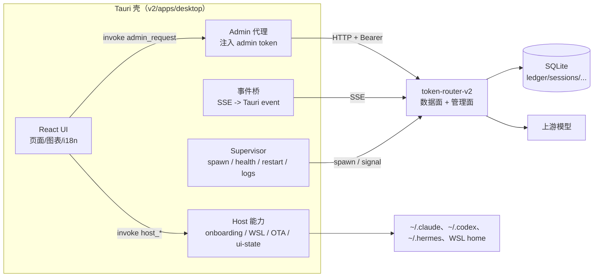

# P4 客户端技术方案（v2 原生）

> 状态：**技术方案 v2（2026-11-16），待评审，未开工**。
> 配套文档：[`p4-client-development-plan.zh.md`](./p4-client-development-plan.zh.md)（开发计划）、
> [`rewrite-v2-design.zh.md`](./rewrite-v2-design.zh.md)（内核设计）、
> [`rewrite-v2-implementation-plan.zh.md`](./rewrite-v2-implementation-plan.zh.md)（S0–P3 实施计划）。
>
> **前提**：v2 是全新产品线。P4 客户端只服务 v2 的配置、账本、虚拟模型与协议面，
> **不做 v1 配置/数据迁移、不做 v1 双跑/回退、不追求 v1 功能对齐**。
> v1 的桌面端实现只作为**代码与交互参考**，不是兼容约束。
>
> P4 不在 S0–P3 的验收范围内；本文与开发计划是 P4 的独立交付设计，
> 不改变 S0–P3 已经完成的验收结论。

---

## 0. 结论摘要

1. **P4 不是把 v1 桌面端换皮**。v1 桌面端把网关链接进 Tauri 进程，管理面直接读配置文件、SQLite 和日志；v2 的边界是“客户端只通过 HTTP 访问内核，不直接读 SQLite”。两者的管理面模型不兼容，必须先补 **v2 管理 API 契约**。
2. **客户端采用 sidecar 进程模型**：Tauri 壳负责拉起/守护 `token-router-v2`，UI 只通过本机 HTTP 管理 API 访问服务端；不把 v2 内核编进桌面进程，不做 FFI。
3. **配置写入采用“文档级 validate → apply → restart”**：以 `config_digest` 做 CAS，原子写文件并备份，服务端返回 `restart_required`，由壳负责重启。不做半加载，不做细粒度 CRUD 直改内存。
4. **鉴权采用 scoped token store**：`inference` / `admin:read` / `admin:write` / `admin:approve`；管理 token 不进 WebView，由 Tauri Rust 代理注入。
5. **前端复用 v1 的 React/Tauri 代码与设计系统，重写数据层与状态模型**：保留路由、组件、i18n、图表；删除 `edgeStore/cloudStore/setupStore` 这类“把服务端状态搬到 Zustand”的写法，改为生成式类型客户端 + TanStack Query。
6. **明确不做**：v1 迁移、云账号/积分、Herdsman、图片/视频、embed/FFI、多租户、配置热加载。P4 客户端是 v2 的原生管理面，不是 v1 的功能复刻。
7. **工期**：完整 P4 约 **165 人日（33 人周）**，含 15% 缓冲约 **38 人周**；2 人约 19–20 周，3 人约 13–14 周。开发计划按任务给出了可裁剪的 MVP/GA 分层。

---

## 1. 背景与现状

### 1.1 v1 客户端：只作参考，不作兼容目标

v1 桌面端是一个**进程内管理面**：

| 层 | 事实 | 位置 |
|---|---|---|
| 壳 | Tauri 2 + React 19 + Vite + TanStack Router/Query + Zustand + ECharts | `desktop/`、`desktop/frontend/` |
| 网关 | `token-router` crate 以 `features = ["desktop"]` 链接进 Tauri 进程，`embedded::start()` 起线程内 tokio runtime | `desktop/src-tauri/Cargo.toml`、`src/embedded.rs` |
| 管理面 | UI 通过 `invoke` 调 Tauri 命令，命令直接读 `gateway.log`、`routing_logs.db`、写 `ui-state.json` | `desktop/src-tauri/src/lib.rs` |
| 配置面 | `POST /v1/admin/setup` 热改 `config.toml` | `src/gateway/api/setup.rs` |
| 统计 | `GET /v1/admin/stats*`，数据来自 v1 的 `stats.db` | `src/gateway/stats/` |
| Agent 接入 | 8 个 Agent 的配置文件直写，另有 WSL 版本 | `src/agent_setup/`、`src/wsl_setup/` |

v1 的页面与能力（代码可参考，语义不复用）：

| 页面 | 能力 | P4 处置 |
|---|---|---|
| Overview | 网关状态、端点复制、Agent 快捷接入、WSL、cc-switch | 重写为 v2 状态/健康/接入总览 |
| Upstream | edge/cloud 上游与模型 CRUD、云 token 配额 | 改为候选（candidate）编辑器 |
| Routing | route/routing_mode/profile、experience/adaptive/classifier 调参 | 改为 profile/虚拟模型/trust tier；调参删除 |
| Stats | 会话/全局统计、时间线、模型维度 | 重写为账本聚合口径 |
| Logs | 路由日志卡片 + 网关日志尾部 | 拆成 Requests（账本）+ Logs（服务端日志） |
| Agents | 接入状态、预算表 | 改为 onboarding；预算删除 |
| Settings | 监听/鉴权/启停/auth keys/OTA | 重写为服务端设置 + token + 更新 |
| 登录/积分 | Flowy 云账号、微信/邮箱登录 | 不做 |
| Herdsman | 本地引擎命名管道/端口探测 | 不做 |
| 图片/视频 | 独立上游 | 不做（P4 之后） |

### 1.2 v2 现有管理面

v2 服务端目前只有**数据面**和极薄的只读管理面：

| 能力 | 现状 | 位置 |
|---|---|---|
| 数据面 | `/v1/chat/completions`、`/v1/messages`、`/v1/responses`、`/v1/models`、`/health` | `v2/crates/server/src/lib.rs` |
| 管理面 | `GET /v2/admin/config`、`/ledger?limit`、`/shadow`、`/trust-tiers`、`/approvals`（GET/POST） | `v2/crates/control/src/lib.rs` |
| 鉴权 | 只有 `AuthMode::{Disabled, InboundKey}`；`RequestAuthority`/`Authenticator` 是扩展点 | `v2/crates/server/src/lib.rs`、`v2/crates/contracts/src/state.rs` |
| 统计 | `GET /v2/admin/stats` 全表聚合；`store::stats` 明确“不做时间窗口” | `v2/crates/agent/src/store/stats.rs` |
| 账本 | 表结构完整，但只暴露 `recent(limit)` | `v2/crates/agent/src/store/migrate.rs`、`ledger.rs` |
| 配置 | `config.toml` + `deny_unknown_fields`；控制面明确“配置变更走文件 + 重启” | `v2/crates/agent/src/config.rs`、`control/src/lib.rs` |
| CLI | `tr-cli` 全部直连 SQLite/文件，没有 HTTP 客户端依赖 | `v2/crates/cli/Cargo.toml` |
| 日志 | 只有 tracing 到 stderr/stdout；无滚动文件、无查询端点 | `v2/crates/server/src/main.rs` |
| 事件 | 无 SSE/WebSocket/订阅；唯一 SSE 是推理流 | `v2/crates/server` |
| CORS | 无 `tower-http` CORS 层 | `v2/crates/server/Cargo.toml` |
| 保留期 | 无账本/shadow 清理任务，只有协议状态 `purge_expired` | `v2/crates/agent/src/store/protocol.rs` |

### 1.3 差距结论

```text
v1 客户端 = UI + 进程内网关 + 文件/DB 直读 + 配置热改
v2 客户端 = UI + sidecar + HTTP 管理面 + 配置文档/重启
```

直接搬 UI 会遇到四个硬缺口：

1. **没有写路径**：不能新增候选、虚拟模型、profile、token，也不能改监听/鉴权。
2. **没有查询路径**：账本只能取最近 50 条；统计没有时间窗/分组/序列；日志不可查。
3. **没有运行时契约**：没有 supervisor/端口/就绪/崩溃恢复；UI 不知道服务端是否“正在重启”。
4. **没有宿主能力契约**：Agent onboarding、WSL、OTA、`ui-state.json` 仍是 Tauri 命令，但 v1 命令实现依赖 v1 crate，不能直接复用。

P4 的工作量因此大致是 **60% 管理面 + 40% 桌面 UI**，不是“前端重构”。

---

## 2. 范围

### 2.1 在范围内

| 模块 | 交付 |
|---|---|
| 管理 API | `/v2/admin` 的 status/health/doctor/config/requests/stats/shadow/judge/approvals/tokens/logs/events |
| 鉴权 | scoped token store、bootstrap token、撤销、审计 |
| 配置 | 文档模型、validate、apply、rollback、schema v2 与 1→2 迁移、config audit |
| 桌面壳 | Tauri 2 应用、sidecar supervisor、admin 代理、宿主命令 |
| UI | Overview、Models/Candidates、Virtual Models、Requests、Stats、Logs、Onboarding、Tokens、Settings、Approvals、Diagnostics |
| Agent 接入 | 8 个 Agent 的 detect/plan/apply/verify，WSL，cc-switch 导出 |
| 客户端库 | `tr-client`（Rust HTTP 客户端）、生成式 TS 类型 |
| 打包 | Windows/macOS 安装包、sidecar 捆绑、签名、更新检查 |
| 文档 | API 契约、配置 schema、配置 schema 升级说明、用户指南、故障排查 |

### 2.2 明确不做

| 项 | 原因 |
|---|---|
| v1 配置/数据迁移、双跑、回退 | v2 是新产品线；从零配置，不背 v1 包袱 |
| v1 功能对齐 | 不做“换皮 v1”；页面按 v2 语义重写 |
| 图片/视频生成、`media` crate | 设计文档 §2.3/§13 已划到 P4 之后 |
| 多租户、grant 表、远程多用户管理 | 单用户本机；`RequestAuthority` 只做最小扩展 |
| Embed/FFI/SDK | 与 sidecar 模型冲突；v1 FFI 冻结 |
| 云账号/微信登录/积分/check-in | 绑定外部服务，不是 v2 内核能力 |
| Herdsman 本地引擎集成 | 专有 host 集成；v2 用普通 candidate 表达本地模型 |
| 配置热加载 | P4 采用“应用 + 重启”；热加载需要 `ArcSwap<Catalog>` 与在途请求语义 |
| 主动上游探测 | 保持 v2 语义：健康度来自真实请求结果；只提供“保存后发一次测试请求”的可选动作 |

### 2.3 范围分层（用于裁剪）

| 层级 | 内容 | 目的 |
|---|---|---|
| **MVP** | 管理 API 只读、token、配置 apply、桌面壳、Overview/Settings/Candidates/Requests/Stats、3 个 Agent 接入 | 可日常自用，能定位坏决策 |
| **GA** | 全部 9 个页面、8 个 Agent、WSL、Logs、Approvals、Diagnostics、打包/更新 | 可替代 v1 桌面端 |
| **Later** | SSE 实时刷新、cc-switch 全量导出、Linux 正式包、上游连通性测试 | 体验增强，不阻塞 GA |

### 2.4 假设与支持矩阵

| 项 | 假设 |
|---|---|
| 用户 | 单用户、本机、可信环境；不做多租户 |
| 平台 | Windows 10/11 x64（GA）、macOS 12+（arm64/x64，GA）、Linux x64（deb/AppImage，beta） |
| 运行时 | WebView2（Windows）、WKWebView（macOS）、WebKitGTK（Linux） |
| 服务端 | 同机 sidecar；允许“外部模式”连接用户指定的 v2 服务 |
| 网络 | 管理 API 默认只监听 loopback；远程管理需显式开关 |
| 数据 | 新数据目录，从空账本开始；不导入 v1 |

---

## 3. 总体架构

### 3.1 进程与责任边界



三条硬边界：

1. **UI 不持有 admin token**：token 由 Rust 侧代理命令注入，避免 WebView XSS 直接偷 token。
2. **UI 不读文件/DB**：日志、账本、配置一律走 HTTP；`ui-state.json`、Agent 配置、OTA 走 host 命令。
3. **服务端不写任意路径**：`config/apply` 只能写启动时加载的那一个配置文件；日志端点只能读配置指定的日志文件。

### 3.2 为什么是 sidecar，不是 in-process

| 方案 | 优点 | 缺点 | 结论 |
|---|---|---|---|
| A. 继续 in-process 链接 | 单进程、无端口/生命周期问题 | v2 workspace 独立且 `forbid(unsafe_code)`；窗口崩溃拖垮网关；CLI/远程无法复用；与 server 边界冲突 | 否 |
| B. sidecar 进程 + supervisor | 与 v2 边界一致；CLI/桌面/未来 Web 共用 API；崩溃隔离 | 需要端口/就绪/孤儿进程/日志治理 | **采用** |
| C. FFI 嵌内核 | 无 HTTP 开销 | 需要 unsafe/ABI 稳定；v2 明确不做；调试困难 | 否 |

### 3.3 目录与 crate 规划

```text
v2/
  apps/
    desktop/                 # 新桌面端（Tauri 2 + React）
      frontend/              # 从 desktop/frontend 复制后改造
      src-tauri/             # 壳、supervisor、host 命令
  crates/
    control/                 # 扩展：管理 API（读写契约、查询、事件）
    onboard/                 # 新：Agent/WSL 检测、计划、应用、校验
    client/                  # 新：Rust 侧 admin HTTP 客户端（CLI/测试/桌面共用）
    cli/                     # 扩展：status/stats/logs/config/onboard 子命令
    server/                  # 扩展：日志、CORS、runtime.json、优雅关闭
    agent/                   # 扩展：token store、审计、保留期、查询
```

`apps/desktop` 是**新目录**，不复用根目录 `desktop/`；v1 桌面端继续冻结，避免边改边迁。

### 3.4 关键数据流

**推理请求**

```text
Agent -> /v1/chat/completions -> server -> Pipeline -> upstream
                                      -> ledger (SQLite)
                                      -> decision headers
```

UI 不参与推理路径；只通过账本与状态观察结果。

**配置修改**

```text
UI 表单 -> validate（纯函数）-> diff 预览 -> apply（CAS + 原子写）
        -> supervisor restart -> /health + /status 校验 digest -> UI 刷新
```

**Agent 接入**

```text
UI 选 Agent -> host detect -> host plan（文件 diff）-> 用户确认
            -> host apply（备份 + 原子写）-> host verify（读回 + 可选探测）
```

### 3.5 启动与关闭时序

启动：

1. Tauri 初始化，读取 `ui-state.json`（主题、语言、上次窗口）。
2. Supervisor 读取数据目录与配置路径；若为外部模式，跳到 5。
3. 选择端口（默认 `127.0.0.1:17621`，占用则递增），spawn `token-router-v2 --config ... --db ... --listen ...`。
4. 轮询 `/health` 与 `/v2/admin/status`，最长 15s；校验 `config_digest`。
5. 读取/创建 admin token；建立 admin 代理。
6. UI 拉取 `/status`、`/config`、`/health`；进入首屏。

关闭：

1. UI 停止轮询/SSE。
2. Supervisor `POST /v2/admin/shutdown`；等待进程退出（默认 5s）。
3. 超时则发送 SIGTERM（Windows `taskkill /T`），再超时强杀。
4. 删除 `runtime.json`；保留日志。

### 3.6 外部模式

允许用户连接已有的 v2 服务（远程/容器/开发机）：

- 设置页填 `base_url` + admin token；不 spawn sidecar。
- 隐藏“启动/停止/重启”按钮；配置 apply 后提示用户自行重启。
- 所有管理 API 仍需 scope；远程必须显式 `allow_remote_admin`。

---

## 4. 管理 API 契约

### 4.1 基本约定

- 前缀：`/v2/admin`；版本随 `schema_version` 演进，不做 URL 版本号。
- 编码：JSON；时间为 Unix 毫秒；金额为 micros；ID 为字符串。
- 响应头：`x-request-id`（每个请求）、`cache-control: no-store`（管理面）。
- 错误统一：

```json
{
  "error": {
    "type": "config_invalid",
    "message": "candidates[1].strength must be 0..=100",
    "request_id": "01J...",
    "issues": [
      {"path": "candidates[1].strength", "code": "out_of_range", "message": "got 120"}
    ]
  }
}
```

- 分页统一游标：`?limit=50&cursor=<opaque>` → `{"items":[...],"next_cursor":"..."}`；游标是 `(created_at, id)` 的编码，不暴露 SQL offset。
- 时间窗统一 `from`/`to`（毫秒，左闭右开）；缺省为最近 24h；最大 90 天。
- 写操作支持 `Idempotency-Key`（可选）；同 key 在 5 分钟内返回首次结果。
- 所有写操作写 `config_audit`/审计日志，不记录密钥值。

### 4.2 版本与兼容规则

- `GET /v2/admin/status` 返回 `api_version: 1` 与 `schema_version`（配置）。
- 新字段只增不改；客户端必须忽略未知字段。
- 删除/重命名字段需要 `api_version + 1`，并提供至少一个版本的弃用期。
- 配置 schema 独立于 API：P4 配置 `schema_version = 2`，加载器接受 1 并迁移到 2。

### 4.3 鉴权与作用域

当前 `AuthMode::InboundKey` 只有一个共享 key，无法区分“推理客户端”和“管理客户端”。P4 增加 token store：

| 作用域 | 允许 |
|---|---|
| `inference` | 数据面三协议、`/v1/models` |
| `admin:read` | 所有 GET 管理端点 |
| `admin:write` | `config/apply`、`config/rollback`、token 管理 |
| `admin:approve` | 审批写操作 |

规则：

- 管理端点必须 `Authorization: Bearer <token>`；兼容 `x-admin-token`（v2 现有调用），新代码用 Bearer。
- 首次启动且 `tokens` 为空时，服务端生成 32 字节 admin token（全部 admin scope），明文写入 `<data_dir>/admin.token`（`0600`），日志只打印路径；桌面端通过 host 命令读取一次，之后只存 Rust 侧内存。
- 默认只监听 loopback；非 loopback 必须显式 `allow_remote_admin = true` 且已有 admin token，否则启动拒绝。
- token 随机 32 字节，展示一次；库中只存 `sha256`，列表只返回 `prefix`（前 8 字符）与 `last_used_at`。
- 比较使用常数时间；撤销立即生效（内存缓存 + 写操作刷新）。
- 推理 key 与管理 token 分离：Agent 配置只拿 `inference` scope 的 key，绝不写 admin token。
- `last_used_at` 每分钟最多更新一次，避免每个请求写库。

### 4.4 端点总表

| 方法 | 路径 | 作用 | 作用域 |
|---|---|---|---|
| GET | `/v2/admin/status` | 版本、监听、运行时长、schema、digest、模式、请求计数 | read |
| GET | `/v2/admin/health` | 候选熔断状态 | read |
| GET | `/v2/admin/doctor` | 配置/迁移/判官/磁盘/日志自检 | read |
| GET | `/v2/admin/config` | 可编辑配置文档（脱敏）+ revision + warnings | read |
| POST | `/v2/admin/config/validate` | 纯校验，返回规范化 TOML、digest、diff、issues | read |
| POST | `/v2/admin/config/apply` | CAS 写配置 + 备份，返回 `restart_required` | write |
| POST | `/v2/admin/config/rollback` | 回滚到上一份可用备份 | write |
| GET | `/v2/admin/config/export` | 导出 TOML/JSON | read |
| GET | `/v2/admin/config/audit` | 配置变更审计（脱敏） | read |
| GET | `/v2/admin/candidates` | 候选只读投影 | read |
| GET | `/v2/admin/virtual-models` | 虚拟模型只读投影 | read |
| GET | `/v2/admin/profiles` | profile 只读投影 | read |
| GET | `/v2/admin/trust-tiers` | 别名 → profile | read |
| GET | `/v2/admin/requests` | 账本列表：时间/会话/模型/outcome/协议/原因码过滤 | read |
| GET | `/v2/admin/requests/{id}` | 单请求详情：plan/judge/contributions/authority/attempts | read |
| GET | `/v2/admin/stats/summary` | 时间窗汇总 | read |
| GET | `/v2/admin/stats/series` | 时间序列：bucket + group_by + metric | read |
| GET | `/v2/admin/stats/models` | 模型维度汇总 | read |
| GET | `/v2/admin/shadow` | shadow 一致率/延迟/成本 | read |
| GET | `/v2/admin/judge/calls` | 判官调用审计 | read |
| GET | `/v2/admin/approvals` | 审批列表（status=all/pending/decided） | read |
| POST | `/v2/admin/approvals` | 记录审批决定 | approve |
| GET | `/v2/admin/tokens` | token 列表（脱敏） | read |
| POST | `/v2/admin/tokens` | 创建 token，明文只返回一次 | write |
| PATCH | `/v2/admin/tokens/{id}` | 改名/改作用域/续期 | write |
| DELETE | `/v2/admin/tokens/{id}` | 撤销 | write |
| GET | `/v2/admin/logs` | 服务端日志尾（ring buffer） | read |
| GET | `/v2/admin/events` | SSE：状态/请求完成/配置应用/熔断/审批 | read |
| POST | `/v2/admin/shutdown` | 优雅关闭（supervisor/CLI 用） | write |

保留 `GET /v2/admin/stats` 作为 `summary` 的兼容别名，避免已有脚本/测试断裂。

### 4.5 公共 DTO

#### Status

```json
{
  "api_version": 1,
  "version": "0.20.0",
  "started_at": 1763000000000,
  "uptime_ms": 12345,
  "listen": "127.0.0.1:17621",
  "schema_version": 5,
  "config_digest": "6f2c...",
  "default_virtual_model": "auto",
  "modes": {"judge": "off", "cost_gate": "shadow", "approvals": "observe"},
  "requests_total": 128,
  "breakers": {"closed": 2, "half_open": 0, "open": 1}
}
```

#### Health

```json
{
  "items": [
    {
      "candidate_id": "local-fast",
      "status": "closed",
      "consecutive_failures": 0,
      "opened_count": 1,
      "open_until": null,
      "half_open_since": null,
      "last_error_class": "timeout",
      "last_failure_at": 1762999000000,
      "updated_at": 1762999000000
    }
  ],
  "counts": {"closed": 1, "half_open": 0, "open": 0}
}
```

#### ConfigDocument

```json
{
  "schema_version": 2,
  "revision": "6f2c...",
  "editable": true,
  "document": {
    "default_virtual_model": "auto",
    "server": {
      "listen": "127.0.0.1:17621",
      "auth_enabled": true,
      "auth_mode": "token_store",
      "allow_remote_admin": false,
      "shutdown_grace_ms": 5000
    },
    "profiles": {
      "default": {
        "mode": "cascade",
        "stream_escalation": "next_turn",
        "strength_order": ["local"],
        "difficulty_weight_micros": 0,
        "hard_signal_weight_micros": 0,
        "unknown_price_policy": "quality_allow"
      }
    },
    "candidates": [
      {
        "id": "local-fast",
        "tier": "local",
        "strength": 20,
        "provider": "openai",
        "base_url": "http://127.0.0.1:11434/v1",
        "model": "qwen2.5:14b",
        "window": 32768,
        "input": ["text"],
        "credential": "env:LOCAL_KEY",
        "enabled": true
      }
    ],
    "virtual_models": [
      {
        "provider": "router",
        "id": "auto",
        "name": "Auto",
        "profile": "default",
        "candidate_pool": ["local-fast"],
        "strategies": ["baseline", "escalation", "classify"],
        "thinking_levels": ["auto"]
      }
    ],
    "judge": {"mode": "off"},
    "cost_gate": {"mode": "shadow"},
    "approvals": {"mode": "observe", "ttl_secs": 300, "min_risk": "high"},
    "trust_tiers": {"trial": "default"},
    "storage": {"ledger_retention_days": 90, "shadow_retention_days": 30},
    "logging": {"file": "logs/server.log", "max_size_mb": 20, "max_files": 5, "level": "info"}
  },
  "secrets": [
    {"path": "candidates[0].credential", "ref": "env:LOCAL_KEY"}
  ],
  "warnings": []
}
```

约束：

- **不返回密钥值**：`credential` 只返回引用（`env:`/`file:`）；若原值是字面量，返回 `redacted:literal`，不返回任何字符。`admin_token` 同理。
- **未知字段不静默丢弃**：`validate` 与加载器共用 `deny_unknown_fields`，未知字段作为 `unknown_field` issue 返回；客户端必须展示并让用户处理。
- **revision 同源**：`revision` 是配置规范化 JSON 的 SHA-256（与账本 `config_digest` 同源，裸 hex），不是 TOML 字节哈希；`normalized_toml` 只用于展示/导出。
- **CAS**：`apply` 必须带 `If-Match: <revision>`；不匹配返回 `409 config_conflict`。

#### RequestSummary / RequestDetail

列表字段：

```json
{
  "request_id": "01J...",
  "created_at": 1763000000123,
  "session_key": "s-...",
  "branch_id": "main",
  "ingress_protocol": "chat",
  "selection_model": "auto",
  "dispatch_model": "glm-5.3-flash",
  "dispatch_source": "cascade",
  "outcome": "success",
  "http_status": 200,
  "ttft_ms": 320,
  "duration_ms": 1820,
  "tokens": {"input": 812, "cache_read": 0, "output": 233},
  "cost_micros": {"answer": 120, "routing": 0},
  "reason_codes": ["CASCADE_ESCALATED"],
  "plan_id": "pl-..."
}
```

详情在列表字段外增加：

```json
{
  "task_id": null,
  "session_key_source": "header",
  "collision_suspect": false,
  "selection_level": "auto",
  "dispatch_provider": "openai",
  "dispatch_level": "auto",
  "plan_mode": "cascade",
  "preference": {},
  "failover": {},
  "attempts": [],
  "switches": 1,
  "cache_write_tokens": 0,
  "facts_completeness": "complete",
  "profile_revision": "p-1",
  "config_digest": "6f2c...",
  "judge": null,
  "contributions": [],
  "authority": {"authority_id": "inbound_key"}
}
```

不返回会话内容/消息正文；账本本身不存 prompt。

#### StatsSummary / Series

```json
{
  "requests": 1200,
  "successes": 1160,
  "success_rate": 0.9667,
  "upstream_errors": 30,
  "quality_fails": 8,
  "cancelled": 2,
  "rejected": 0,
  "switches": 37,
  "tokens": {"input": 100000, "output": 50000, "cache_read": 20000, "cache_write": 1000},
  "cost_micros": {"answer": 123456, "routing": 700},
  "latency": {"ttft_p50": 280, "ttft_p95": 900, "duration_p95": 3200},
  "judge": {"calls": 40, "failed": 1, "cost_micros": 120}
}
```

```json
{
  "bucket": "hour",
  "from": 1763000000000,
  "to": 1763086400000,
  "group_by": "dispatch_model",
  "metric": "requests",
  "series": [
    {"key": "glm-5.3-flash", "points": [{"t": 1763000000000, "value": 12}]}
  ]
}
```

### 4.6 配置校验规则

| 类别 | 规则 |
|---|---|
| 版本 | `schema_version` 只接受 1/2；1 自动补默认并升级为 2 |
| 候选 | `id` 唯一、非空；`window > 0`；`strength` 0..=100；`provider` 合法；`base_url` 是 http/https；`credential` 是 `env:`/`file:`/字面量 |
| 虚拟模型 | `id` 唯一；`profile` 必须存在；`candidate_pool` 非空且每个 id 存在；`strategies` 只允许 `baseline/failover/escalation/classify/competence_guard` |
| profile | `mode` ∈ `single/cascade/verify_after`；`strength_order` 只引用已存在的 tier；`unknown_price_policy` ∈ `quality_allow/deny_all` |
| 判官 | `mode` ∈ `off/shadow/active`；`service` 在 active/shadow 下必须可构造；预算非负 |
| 成本闸 | `mode` ∈ `off/shadow/active` |
| 审批 | `mode` ∈ `off/observe/enforce`；`min_risk` ∈ `low/medium/high`；`ttl_secs > 0` |
| trust tier | 值必须是已存在的 profile |
| 存储/日志 | 保留期 > 0；日志文件在数据目录内；滚动份数 1..=20 |
| 未知字段 | 报 `unknown_field`，不静默忽略 |

校验结果：

```json
{
  "valid": false,
  "revision": null,
  "normalized_toml": null,
  "issues": [
    {"path": "candidates[1].strength", "code": "out_of_range", "message": "got 120"}
  ],
  "diff": []
}
```

`validate` 对“可解析但无效”的文档返回 `200` + `valid:false`；`apply` 返回 `422 config_invalid`。这样 UI 可以逐字段标红而不把校验失败当网络错误。

### 4.7 配置写入时序

```text
UI 编辑
  → POST /config/validate   （纯函数：解析、校验、算 digest、出 diff）
  → 展示 diff + warnings
  → 用户点“应用”
  → POST /config/apply      （If-Match；原子写 + .bak；返回 restart_required）
  → Supervisor 调 POST /shutdown 或发 SIGTERM
  → 新进程启动，/health 就绪，GET /status 的 config_digest == applied_revision
  → UI 重新拉取 config/status
```

细节：

- 原子写：同目录临时文件 → `fsync` → `rename`；旧文件保留为 `config.toml.bak-<unix>`，最多保留 10 份。
- 权限：Unix `0600`；Windows 走当前用户 ACL；写失败不破坏旧文件。
- 不允许“只改内存不落盘”；避免重启后配置回退造成“看起来生效、重启丢失”。
- `restart_required` 恒为 `true`（P4 不做热加载）；`apply` 可带 `"restart": "manual" | "auto"`，默认 `manual`，由壳决定何时重启，避免打断在途流式请求。
- 服务端**不自我重启**：apply 只写文件并返回；重启由 supervisor/用户执行。这样远程/CLI 语义一致，也避免“写配置的进程把自己杀掉”。
- 回滚：`POST /config/rollback` 把最近一份 `bak` 还原并返回新 revision；同样需要重启。
- 审计：每次 validate/apply/rollback 写 `config_audit`，只记录字段路径与脱敏摘要。

### 4.8 查询与聚合语义

- 统计**只从 ledger 聚合**，不建第二套计数器；保证“日志看到的”和“统计看到的”同源。
- `bucket` 只支持 `hour`/`day`；`group_by` 支持 `virtual_model`/`dispatch_model`/`outcome`/`protocol`（分别取 `selection_model`、`dispatch_model`、`outcome`、`ingress_protocol`），缺失归 `unknown`。
- 默认时间窗 24h；最大 90 天（受保留期约束）。
- 查询计划必须走 `idx_ledger_created`；超过 10 万行的窗口返回 `413 window_too_large`，提示缩窗或加过滤。
- 列表分页用 `(created_at, id)` 游标，避免深 offset。
- `requests` 的 `reason` 过滤用 `json_each(reason_codes_json)` 精确匹配，不用 `LIKE`。

### 4.9 事件流

`GET /v2/admin/events`（SSE，`text/event-stream`）：

```text
id: 1024
event: request.completed
data: {"request_id":"01J...","outcome":"success","model":"glm-5.3-flash","cost_micros":120}

id: 1025
event: config.applied
data: {"revision":"6f2c...","restart_required":true}
```

- 支持 `Last-Event-ID` 断线续传；服务端保留最近 1024 条事件，超出后客户端应重新拉取。
- 心跳 15s；事件不含 prompt/响应正文，只含 ID 与元数据。
- 桌面端由 `admin_events_subscribe` 把 SSE 转为 Tauri event，WebView 不直连（避免 token 暴露与 CORS）；CLI/测试可直接连。
- UI 仍以轮询为兜底：M6 之前只做轮询，SSE 不阻塞页面改造。

### 4.10 日志

服务端增加滚动文件日志（`[logging]`），同时维护内存 ring buffer（最近 2000 行）：

```http
GET /v2/admin/logs?cursor=0&limit=200&level=warn&target=tr_agent
→ {"items":[{"seq":1,"at":1763000000123,"level":"warn","target":"tr_agent::pipeline","message":"..."}],
   "next_cursor":1}
```

- 只读配置指定的日志文件/ring，不接受任意路径。
- 消息写入前做脱敏：`Authorization`、`x-api-key`、`api_key`、`token` 字段替换为 `***`。
- 文件滚动、大小/份数由配置控制；UI 提供“打开日志目录”（host 命令）。

### 4.11 错误码

| HTTP | type | 场景 |
|---|---|---|
| 400 | `invalid_request` | 参数/游标非法 |
| 401 | `admin_auth_error` | 缺 token/错 token/已撤销 |
| 403 | `admin_scope_error` | scope 不足；远程管理未开启 |
| 404 | `not_found` | request/token/candidate 不存在 |
| 409 | `config_conflict` | `If-Match` 不匹配 |
| 413 | `window_too_large` | 统计窗口/分页超限 |
| 422 | `config_invalid` | 配置校验失败（带 `issues[]`） |
| 429 | `rate_limited` | 管理面限流（可选） |
| 500 | `internal_error` | 未预期错误（带 request_id） |
| 503 | `server_unavailable` | 正在关闭/数据库忙 |

---

## 5. 数据与存储

### 5.1 迁移 M5

新增两张表（`v2/crates/agent/src/store/migrate.rs`）：

```sql
CREATE TABLE tokens (
  id            TEXT PRIMARY KEY,
  name          TEXT NOT NULL,
  token_sha256  TEXT NOT NULL UNIQUE,
  prefix        TEXT NOT NULL,
  scopes_json   TEXT NOT NULL,
  created_at    INTEGER NOT NULL,
  last_used_at  INTEGER,
  expires_at    INTEGER,
  revoked_at    INTEGER
);

CREATE TABLE config_audit (
  id            INTEGER PRIMARY KEY,
  at            INTEGER NOT NULL,
  actor         TEXT NOT NULL,
  action        TEXT NOT NULL,          -- validate/apply/rollback
  from_revision TEXT,
  to_revision   TEXT,
  note          TEXT,
  diff_json     TEXT                    -- 只存字段路径与脱敏后的旧/新值摘要
);
```

索引与保留期：

```sql
CREATE INDEX idx_ledger_authority
  ON ledger(json_extract(authority_json, '$.authority_id'), created_at);
```

- `[storage] ledger_retention_days`（默认 90）、`shadow_retention_days`（默认 30）。
- 后台任务每天清理一次；清理只删过期行，不 `VACUUM`（避免阻塞写入），由 CLI `tr-cli db vacuum` 手动执行。
- `schema_version` 从 4 升到 5；迁移幂等、带校验和，沿用现有迁移框架。

### 5.2 Token 存储

- 只存 `sha256(token)`；不存明文、不存可逆加密。
- 列表返回 `id`/`name`/`prefix`/`scopes`/`created_at`/`last_used_at`/`expires_at`/`revoked_at`。
- 撤销是软删除（`revoked_at`），保留审计；过期与撤销在鉴权时检查。
- 启动时把未撤销 token 加载到内存 `HashMap<sha256, Token>`；token 变更后重建。
- `last_used_at` 每分钟批量回写，避免写放大。

### 5.3 配置与运行时文件

数据目录：

```text
~/.token-router-v2/            # Windows: %USERPROFILE%\.token-router-v2
  config.toml
  config.toml.bak-<unix>
  token-router-v2.db
  admin.token                  # 0600，首次启动生成
  runtime.json                 # pid/listen/version/config_digest/started_at
  logs/server.log
```

- `runtime.json` 启动时原子写，退出时删除；supervisor 用它发现孤儿进程。
- `config.toml` 是唯一配置真相；DB 只存 token/审计/账本。
- 不创建 v1 目录，不读取 v1 文件。

### 5.4 保留期

- 账本、shadow、judge_calls、approvals 按配置清理。
- `protocol_state` 已有 TTL，沿用。
- 清理任务在服务端启动后每小时检查一次，记录日志；不阻塞请求。

---

## 6. 桌面壳

### 6.1 技术栈

| 层 | 选型 |
|---|---|
| 壳 | Tauri 2 |
| 前端 | React 19 + TypeScript + Vite |
| 路由 | TanStack Router（保留 v1 代码结构） |
| 服务端状态 | TanStack Query v5 |
| UI 状态 | Zustand（仅主题/语言/侧栏/tour） |
| 图表 | ECharts（复用 v1 组件） |
| i18n | 复用 v1 字典，补 P4 文案 |
| 测试 | Vitest/Node test + Playwright |

### 6.2 Supervisor 状态机

```text
Stopped --start--> Starting --ready--> Ready
   ^                  |                 |
   |                  | timeout/fail    | crash
   |                  v                 v
   +--------------- Failed <-------- Restarting
                                      |
                                      +--backoff--> Starting
```

约束：

- 端口：默认 `127.0.0.1:17621`；被占用则 17622..17640；记录到 `runtime.json`。
- 就绪：`GET /health` 2xx + `GET /v2/admin/status` 的 `config_digest` 与启动参数一致；超时 15s。
- 崩溃：退避 1s/2s/4s/8s/16s，最多 5 次；之后进入 `Failed`，UI 展示 stderr 尾部与“重试/打开日志”。
- 停止：`POST /v2/admin/shutdown` → 等待 10s → SIGTERM → 5s → 强杀（Windows 用 Job Object/taskkill 树）。
- 孤儿：启动时读 `runtime.json`；PID 存活但 `/health` 不通，先尝试正常关闭，再强杀。
- 单实例：`tauri-plugin-single-instance`；第二实例只唤起窗口。
- 日志：stdout/stderr 重定向到 `logs/server.log`，同时保留最后 200 行给“诊断”。

### 6.3 Admin 代理

Tauri 命令：

```rust
#[tauri::command]
async fn admin_request(
    method: String,
    path: String,
    body: Option<serde_json::Value>,
) -> Result<AdminResponse, String>;
```

- 从 Rust 内存取 token，注入 `Authorization: Bearer`；不把 token 返回给 JS。
- 只允许 `path` 以 `/v2/admin` 开头；拒绝绝对 URL、`..`、非本机 base（外部模式除外）。
- 统一错误映射为 `{status, error:{type,message,issues}}`，UI 不解析 HTTP 细节。
- 限制响应体大小（默认 8 MiB），日志/账本大响应分页。

SSE：

```rust
#[tauri::command]
async fn admin_events_subscribe(app: AppHandle) -> Result<(), String>;
```

- Rust 侧连 SSE，按 `event` 转成 `admin://event` Tauri event；断线重连并带 `Last-Event-ID`。
- 退出/窗口关闭时取消订阅。

### 6.4 Host 命令

| 命令 | 作用 |
|---|---|
| `host_ui_state_load/save` | 主题、语言、窗口、tour 状态 |
| `host_open_path` | 打开数据/日志目录（白名单） |
| `host_onboard_detect/plan/apply/verify` | Agent/WSL 接入 |
| `host_cc_switch_export` | 生成 cc-switch 链接 |
| `host_ota_check/download/apply` | 更新 |
| `host_app_info` | 版本、平台、数据目录 |
| `host_supervisor_status/start/stop/restart` | 服务生命周期 |

---

## 7. 前端

> 样式层已定为 **UnoCSS + OpenChamber 设计规范**（深浅双主题、语义色板、三级深度），
> 不再使用手写 CSS；落地细节与写法约定见 [`frontend-design-system.zh.md`](./frontend-design-system.zh.md)。

### 7.1 目录

```text
src/
  api/           # 生成类型 + admin client + query keys
  components/    # 复用 v1 组件，新增 v2 专用
  pages/         # 9 个页面 + 详情
  host/          # Tauri host 命令封装
  stores/        # 仅 UI 状态
  i18n/          # 字典
  lib/           # 格式化、diff、校验映射
  styles/uno/    # vendored UnoCSS 预设 + 主题 token（生成物）
```

### 7.2 数据层

1. **生成类型**：管理 API DTO 用 `ts-rs` 导出到 `src/api/types.ts`；CI 跑 `cargo xtask contract-check`，生成物 diff 即失败。
2. **统一客户端**：`src/api/client.ts` 暴露 `admin.get/post/patch/del`，底层 `invoke('admin_request')`；错误映射为 `ApiError {status,type,message,issues}`。
3. **查询键**：`['admin', resource, params]`；写操作后精确 invalidate，不做全局刷新。
4. **轮询**：状态 10s、统计 15s、请求列表手动刷新 + “实时”开关（SSE 就绪后改推送）；页面隐藏时暂停。
5. **删除服务端状态镜像**：`edgeStore`、`cloudStore`、`setupStore` 删除；只保留 UI 偏好。
6. **错误边界**：页面级 ErrorBoundary + 全局 toast；401 引导重新读取 token/重启。

### 7.3 页面规格

| 页面 | 数据 | 主要动作 | 空/错状态 |
|---|---|---|---|
| Overview | status、health、最近 5 条 requests、onboarding 状态 | 复制端点、启动/停止、跳转配置 | 未配置上游 → 引导；服务未启动 → 启动按钮 |
| Models | config.candidates、profiles | 新增/编辑/禁用候选；引用检查；validate/apply | 无候选 → 模板；校验失败 → 字段标红 |
| Virtual Models | config.virtual_models、profiles、candidates | 新增/编辑；候选池；策略；默认模型 | 无 profile → 先建 profile |
| Requests | requests 列表、详情 | 过滤/分页/刷新/复制 request_id | 无数据 → 说明“v2 从空账本开始” |
| Stats | summary、series、models | 时间窗/分组/指标切换 | 窗口过大 → 缩窗提示 |
| Logs | logs | level/target 过滤、尾随、打开目录 | 无日志 → 提示日志级别 |
| Onboarding | host detect/plan | 选择 Agent、预览 diff、应用、验证 | 未安装 → 安装指引 |
| Tokens | tokens | 创建/撤销/改 scope；一次性复制 | 无 token → 创建引导 |
| Settings | status、config、host 状态 | 监听/鉴权/日志/保留期；启停/重启；更新 | 重启中 → 进度态 |
| Approvals | approvals | 批准/拒绝 | 无 pending → 空态 |
| Diagnostics | doctor、config audit、health | 运行自检、回滚配置、看审计 | 失败 → 复制诊断包 |

### 7.4 配置编辑器

- 表单字段与 `ConfigDocument` 一一对应，不维护第二套模型。
- 保存前先 `validate`，把 `issues[].path` 映射到控件；无 issue 才允许 `apply`。
- 凭据字段只允许填“引用”：`env:NAME` / `file:path`；需要新建密钥时走 host 命令写入 keyring/文件，再把引用填回表单。
- 候选删除前检查是否被 `virtual_models[].candidate_pool` 引用；被引用时禁止删除并给出引用列表。
- 修改 `id` 视为删除 + 新增，需二次确认；引用同步更新由 UI 生成 patch，不由服务端猜。
- 提供“复制为 TOML”与“从 TOML 导入”，供高级用户和 CLI 对齐。
- 应用后显示“重启中”进度：supervisor 状态 → 新 digest → 完成；失败展示 stderr 尾部。

### 7.5 UI 状态与可访问性

- 主题/语言/侧栏折叠/tour 已读存 `ui-state.json`。
- 所有表单控件有 label；错误用 `aria-describedby`；键盘可完成创建/应用。
- 颜色对比度 ≥ WCAG AA；图表提供表格替代视图。
- 危险操作二次确认：改监听地址、关闭鉴权、删除候选、撤销当前 token、回滚配置。

### 7.6 性能预算

| 指标 | 目标 |
|---|---|
| 冷启动到首屏 | < 2.5s |
| 页面切换 | < 300ms |
| 请求列表 10 万行 | p95 < 150ms |
| 统计 summary | p95 < 300ms |
| 配置 validate | < 100ms（本地） |
| 配置 apply + 重启生效 | < 5s |
| 打包体积 | Windows < 30MB（不含 WebView2） |

---

## 8. Agent onboarding

### 8.1 原则

- **宿主能力**：写 `$HOME` 是 host 的职责，不进服务端 API。
- **先计划后应用**：`detect → plan（diff）→ apply（备份 + 原子写）→ verify`。
- **幂等**：只改 token-router 自己的 provider/model 键，不覆盖用户其它配置。
- **密钥不落 UI**：`SetupRequest` 只带 token id；host 从 token store 取一次明文写入 Agent 配置；日志与错误不打印明文。
- **可回退**：每次 apply 生成 `.bak-<ts>`；提供“恢复上一次”。

### 8.2 支持的 Agent

| Agent | 配置文件 | 关键写入 |
|---|---|---|
| openclaw | `~/.openclaw/openclaw.json` | `models.providers["token-router"]`：baseUrl `<gw>/v1`、apiKey、models[auto]；仅在未设置时改 `agents.defaults.model.primary` |
| hermes | `~/.hermes/config.yaml` | `providers["token-router"]`：api、api_key、default_model；仅在未选择时改 `model` |
| hermes-flash | `~/.hermes-flash/config.yaml` | 同上 |
| claude-code | `~/.claude/settings.json` | `env.ANTHROPIC_BASE_URL=<gw>/anthropic`、`ANTHROPIC_AUTH_TOKEN`、context window |
| codex | `~/.codex/config.toml`、`auth.json`、catalog | `model_providers.custom`：base_url `<gw>/v1`、wire_api=responses；写 `OPENAI_API_KEY`；模型目录 |
| opencode | `~/.config/opencode/opencode.json` | `provider["token-router"]`：baseURL/apiKey/models.auto；不强制根 model |
| codebuddy | `~/.codebuddy/models.json` | models[]：id=auto、url `<gw>/v1/chat/completions`、能力标记 |
| workbuddy | `~/.workbuddy/models.json` | 同上 |

### 8.3 API

```rust
pub fn detect(target: &Target) -> DetectReport;
pub fn plan(target: &Target, req: &SetupRequest) -> Result<SetupPlan, SetupError>;
pub fn apply(plan: &SetupPlan) -> Result<ApplyReport, SetupError>;
pub fn verify(target: &Target) -> VerifyReport;
```

- `Target::Host` / `Target::Wsl { distro }`。
- `DetectReport`：安装/配置文件/当前 provider/base_url/是否已指向 token-router/冲突。
- `SetupPlan`：逐文件 `{path, format, action, before_digest, after_preview}`；UI 先展示 diff。
- `apply`：备份、原子写、写后重新解析校验；失败回滚已写文件。
- `verify`：读回配置 + 可选发一次 `/v1/models`（不打印 token）。

### 8.4 WSL

- 检测发行版、UNC home、从 WSL 内探测网关可达地址。
- 与应用同一套 plan/apply；WSL 内 Agent 列表与 host 对齐（可少 hermes-flash）。
- 只支持 Windows 宿主。

### 8.5 cc-switch

- 从 v2 配置生成 `ccswitch://` 链接；模型名用虚拟模型 id；不包含 admin token。
- 链接包含 base_url 与 api key 的引用；由用户确认后打开。

---

## 9. 安全

| 威胁 | 缓解 |
|---|---|
| WebView XSS 偷 admin token | token 只在 Rust 侧；UI 经 `admin_request` 代理；CSP 禁止远程脚本 |
| 本机其它进程调管理 API | 默认 loopback + Bearer；token 文件 `0600`；无 cookie/CSRF 面 |
| token 泄漏到日志 | 统一脱敏层；请求头/`api_key`/`token` 字段替换；测试断言响应与日志不含明文 |
| 配置写入路径穿越 | 只允许写启动时加载的 `config_path`；备份同目录；拒绝符号链接 |
| 日志端点读任意文件 | 只读配置指定文件/ring；不接受路径参数 |
| Agent 配置写入被利用 | 路径 allowlist（8 个 Agent 的固定位置 + WSL home）；先解析再写；备份；不执行 shell 拼接 |
| WSL 命令注入 | 参数数组调用 `wsl.exe`，不拼字符串；发行版名白名单校验 |
| 远程管理 | 非 loopback 需显式开关；建议反代 TLS；文档标注风险 |
| 密钥出现在配置 API | 只返回引用；写回只接受引用；密钥值走 host/keyring |
| 账本含用户内容 | 详情默认不含 `facts_json`；UI 不展示消息正文 |
| 供应链 | 依赖锁定、CI 校验、安装包签名、更新 manifest 签名 |

---

## 10. 观测与诊断

- 服务端：滚动日志 + ring buffer；`/v2/admin/logs`；`RUST_LOG` 覆盖。
- 桌面壳：`shell.log`（supervisor 生命周期、端口、退出码）。
- `doctor` 检查项：配置可解析、DB schema、账本可写、判官自检（若配置）、磁盘空间、日志文件、保留期、token 是否存在。
- 决策诊断：账本详情 + `tr-cli replay` + reason codes；UI 提供“复制诊断包”（status/health/config digest/最近 100 行日志，自动脱敏）。
- 不采集用户 prompt/响应正文；不上传遥测（P4 不做遥测）。

---

## 11. 测试

### 11.1 契约

- 每个管理端点：golden JSON（成功 + 400/401/403/404/409/413/422/500）。
- `cargo xtask contract-check`：Rust DTO → TS 类型，生成物无 diff。
- 错误码集中定义，禁止 handler 手写字符串。

### 11.2 服务端

- 鉴权：无 token/错 token/撤销/过期/scope 不足/loopback 限制/常数时间。
- 分页：并发插入下游标不重不漏；非法游标 400。
- 统计：与直接 SQL 聚合逐项相等；时间窗边界；空窗返回 0。
- 配置：CAS 冲突、只读文件、写失败回滚、备份上限、并发 apply、schema 1→2。
- 事件：`Last-Event-ID` 续传、ring 溢出提示、心跳。
- 日志：滚动、脱敏、ring 上限。
- 性能：10 万行账本下 list p95 < 150ms、summary p95 < 300ms。

### 11.3 客户端

- 单元：数据适配、diff 渲染、表单校验、错误映射。
- 组件：候选编辑器、虚拟模型编辑器、token 一次性展示、审批倒计时。
- E2E（Playwright + 真实 `token-router-v2` + mock upstream）：启动 → 配置 → 发请求 → 账本/统计 → 改配置 → 重启 → 生效。
- 视觉：新增页面至少一轮截图评审。
- 真实客户端：Hermes/Codex/Claude Code 通过 onboarding 接入后各发一次流式 + 非流式，账本出现记录。
- 崩溃：kill sidecar，UI 10s 内恢复；端口占用自动换端口。

### 11.4 门禁

```bash
cargo fmt --check
cargo clippy --workspace --all-targets -- -D warnings
cargo test --workspace
cargo xtask check-deps
cargo xtask fixtures-check
cargo xtask config-only-check
git diff --exit-code -- v2/crates/core v2/crates/decide v2/crates/proto
```

最后一条是硬门禁：P4 不得改决策内核与协议编解码。

---

## 12. 打包与发布

- Tauri `externalBin` 捆绑 `token-router-v2` 按目标 triple；安装包同时带 sidecar。
- Windows：NSIS（/或 MSI）；macOS：dmg + 签名/公证；Linux：deb/AppImage（beta）。
- 更新：自有 manifest（版本/平台/sha256/签名），下载后校验再替换；失败保留旧版本。
- 通道：`alpha`/`beta`/`stable`；数据目录与 DB 迁移向前兼容。
- 升级不覆盖 `config.toml`/DB；只替换二进制与前端资源。
- 回滚：安装包保留上一版本；不依赖 v1。

---

## 13. 风险

| 风险 | 影响 | 缓解 |
|---|---|---|
| 把 P4 做成 v1 功能复刻 | 范围失控 | 以“日常路径”验收；明确砍掉云账号/Herdsman/媒体/调参 |
| 配置写入引入半加载/双真相 | 行为与 UI 不一致 | 文档级 apply + 原子写 + 重启；DB 不存配置 |
| supervisor 生命周期不稳 | 孤儿进程/端口占用/重启风暴 | runtime.json + 健康检查 + 退避 + 单实例 + 孤儿清理 |
| 密钥进入前端 | 本机凭据泄漏 | Rust 代理注入；配置只存引用；日志脱敏测试 |
| 统计口径漂移 | 用户不信任数据 | 只聚合 ledger；与 SQL 对照测试 |
| 账本无限增长 | 查询变慢/磁盘涨 | 保留期 + 每日清理 + 索引 |
| WSL/Windows 路径差异 | onboarding 失败 | UNC + 参数数组 + 临时 HOME golden 测试 |
| 打包/签名/OTA 基建缺失 | 无法发布 | M7 前完成 CI 产物与安装器演练；OTA 可先手动更新 |
| 契约先行但 UI 反向改契约 | 返工 | 契约冻结后只允许追加字段；破坏性变更升版本 |
| macOS 公证/Linux WebKit 依赖 | 平台延期 | 先 Windows GA，macOS/Linux 分阶段 |

---

## 14. 决策与待确认

| 决策 | 建议 | 状态 |
|---|---|---|
| UI 复用还是重写 | 复用 v1 前端代码与组件，重写数据层 | 建议 |
| sidecar 还是 in-process | sidecar | 建议 |
| 配置写路径 | 文档级 validate/apply + 重启 | 建议 |
| admin 鉴权 | scoped token store | 建议 |
| token 是否进 WebView | 不进，Rust 代理注入 | 建议 |
| v1 迁移/兼容 | 不做；v2 从零配置 | 已定（产品） |
| 云账号/积分/Herdsman/媒体 | 不做 | 建议 |
| 热加载 | P4 不做 | 建议 |
| FFI/embed | P4 不做 | 建议 |
| SSE | GA 前做；MVP 轮询 | 建议 |
| 支持矩阵 | Windows/macOS GA，Linux beta | 待确认 |
| 默认端口/数据目录 | 17621 / `~/.token-router-v2` | 待确认 |

---

## 15. 与现有文档的关系

- 本文是 P4 的**技术方案**；开发计划见 [`p4-client-development-plan.zh.md`](./p4-client-development-plan.zh.md)。
- 设计文档 §2.3/§13 的 P4 行保持“规划中、未开工”，不与 S0–P3 验收混在一起。
- 实施计划 §十 改为“P4 独立交付：方案/计划已就绪，未开工；v2 原生，不做 v1 迁移”。
- P4 不改 `core`/`decide`/`proto`；不改变 S0–P3 的结论。

---

## 附录 A：配置字段清单（P4 新增/变更）

| 字段 | 默认 | 说明 |
|---|---|---|
| `schema_version` | `2` | P4 起为 2；加载器接受 1 并迁移 |
| `server.auth_mode` | `token_store` | `disabled`/`inbound_key`/`token_store` |
| `server.allow_remote_admin` | `false` | 非 loopback 管理开关 |
| `server.shutdown_grace_ms` | `5000` | 优雅关闭等待 |
| `storage.ledger_retention_days` | `90` | 账本保留期 |
| `storage.shadow_retention_days` | `30` | shadow 保留期 |
| `logging.file` | `logs/server.log` | 相对数据目录 |
| `logging.max_size_mb` | `20` | 单文件上限 |
| `logging.max_files` | `5` | 滚动份数 |
| `logging.level` | `info` | 日志级别 |

## 附录 B：Agent 文件写入矩阵

| Agent | 格式 | 写入策略 | 备份 |
|---|---|---|---|
| openclaw | JSON | 合并 `models.providers["token-router"]`；仅未设置时改默认模型 | `.bak-<ts>` |
| hermes/hermes-flash | YAML | 合并 `providers["token-router"]`；仅未选择时改 model | `.bak-<ts>` |
| claude-code | JSON | 合并 `env` 的 4 个键 | `.bak-<ts>` |
| codex | TOML + JSON | `toml_edit` 保留注释；写 provider/auth/catalog | `.bak-<ts>` |
| opencode | JSON | 合并 provider；不强制根 model | `.bak-<ts>` |
| codebuddy/workbuddy | JSON | 追加/更新 models[] 中 id=auto | `.bak-<ts>` |

## 附录 C：术语

| 术语 | 含义 |
|---|---|
| 候选 / candidate | 物理上游 + 模型 + 价格 + 能力 |
| 虚拟模型 / virtual model | 客户端看到的模型 id，映射到 profile + 候选池 + 策略 |
| profile | 路由模式、强度顺序、权重、未知价格策略 |
| 判官 / judge | 在 shadow/active 下回答路由问题 |
| 成本闸 / cost gate | 切换的等价成本闸门 |
| 账本 / ledger | 每请求一行的决策与执行事实 |
| shadow | 判官与内核决策的对照记录 |
