# Token Router v2 实施计划

> 配套文档：[`rewrite-v2-design.zh.md`](./rewrite-v2-design.zh.md)（下称"设计文档"）。
> 本文只负责**怎么干、按什么顺序干、什么时候算干完**；契约与语义以设计文档为准，冲突时以设计文档为准并回改本文。

---

## 一、实施总则

### 1.1 起点与终点

- **起点**：不是"把 v1 改造成 v2"，是**新 workspace**。v1 冻结（只修线上 bug 与安全更新），v2 在 `v2/` 下从 `contracts` 长出来。
- **终点（P3 完成）**：一个可日常自用的 v2 内核——三协议、流式、判官可 shadow、成本闸可校准、虚拟模型可选、账本可回放。**不含新客户端**（P4）。
- **P4 完成**：桌面端/CLI/管理台可用，v2 才能替代 v1 成为默认发布物。

### 1.2 硬门禁（违反就不推进）

| 门禁 | 内容 | 违反后果 |
|---|---|---|
| G0 | S0 fixtures 达标 | 不进入 P0a，只做 Chat Completions |
| G1 | §13 P0a 四项验收 | 不进入 P0b（不许"先写流式后面补契约"） |
| G2 | P0b 语义提交正确 | 不进入 P1 |
| G3 | `judge test` Passed + shadow 达标 | 判官保持 off，不进入 escalation active |
| G4 | 成本闸 shadow 校准达标 | 成本闸保持 shadow，不允许 active 拦截 |
| G5 | `xtask check-deps` 常绿 | 禁止合并（`core` 一旦有 IO 就失去回放能力） |

### 1.3 完成定义（Definition of Done）

一个任务只有同时满足以下四条才算完成，否则算"写了代码"：

1. 有测试：单测或 fixture 测试，覆盖正常路径 + 至少一个失败路径；
2. 有账本证据：涉及决策/执行的改动能在 `ledger` 里看到对应字段；
3. 有回放证据：影响决策的改动跑 `make v2-replay` 投影一致（或显式说明投影变化原因）；
4. 有文档增量：设计文档对应章节若被实现细化，回写设计文档，不留在 PR 描述里。

### 1.4 节奏

- 2 周一个 sprint，每个 sprint 末必须能**演示一个可运行切片**（真实进程 + 真实上游 + 真实账本），不接受"单元测试全绿但跑不起来"。
- 每个 sprint 第一天锁定范围，中途只接受两类插入：线上 v1 事故、G0–G5 门禁失败修复。
- 排期按**单人全职**估算；2 人时 P1 与 P2 可并行，但 S0/P0a 不建议并行（契约未稳，并行=返工）。

---

## 二、排期与里程碑

| 里程碑 | 周 | 主题 | 退出标志 |
|---|---|---|---|
| S0 | W1 | 协议兼容 spike | G0 通过 + gap report |
| P0a | W2–W4 | 契约与垂直切片 | 单协议非流式跑通 + 回放一致 + 账本一致 |
| P0b | W5–W8 | 流式与三协议 | 三客户端流式/非流式通过 + 语义提交正确 |
| P1 | W9–W12 | 判官与棘轮 | shadow 报告 + latch 行为正确 |
| P2 | W13–W16 | 成本闸与评测 | 三列对照表 + 校准达标 |
| P3 | W17–W22 | 虚拟模型与审批 | 多虚拟模型/多候选只改配置 |
| P4 | W23+ | 产品交付 | 新客户端覆盖 v1 核心工作流 |

```mermaid
gantt
    dateFormat  X
    axisFormat  W%d
    section 内核
    S0 协议 spike        :s0, 0, 1
    P0a 契约与切片        :p0a, 1, 3
    P0b 流式与三协议      :p0b, 4, 4
    P1 判官与棘轮         :p1, 8, 4
    P2 成本闸与评测       :p2, 12, 4
    P3 虚拟模型与审批     :p3, 16, 6
    section 产品
    P4 客户端/管理台      :p4, 22, 8
```



> 合计 22 周（约 5 个月）到 P3，不含 P4。这是**单人全职**下限；若为业余投入，按 ×1.5–2 估算。排期偏乐观的风险已在设计文档 R8 记录，缓解手段是每个 sprint 的切片演示——**任何 sprint 错过演示，下一 sprint 先缩范围，不加人**。

---

## 三、工作流与关键路径

| 工作流 | 范围 | 主要 crate | 活跃期 |
|---|---|---|---|
| W1 协议面 | 三协议编解码、SSE 状态机、compat、fixtures | `proto`、`contracts` | S0–P0b，P1 后低频 |
| W2 契约与内核 | 类型、Signals、策略、Plan 合并与校验 | `contracts`、`core` | P0a–P3 |
| W3 执行面 | 上游客户端、ErrorClass、接力、熔断 | `upstream`、`agent` | P0a–P2 |
| W4 状态与账本 | 迁移、仓储、CAS、影子记录、保留期 | `agent` | P0a–P3 |
| W5 判官 | DecisionModel、服务契约、adapter、预算 | `decide` | P1 |
| W6 评测与观测 | 回放、shadow、指标、trace、评测集 | `cli`、`agent`、`server` | P1–P2 |
| W7 虚拟模型与控制面 | 目录、每虚拟模型策略/state、审批、admin API | `agent`、`control`、`server` | P3 |
| W8 产品 | 桌面端、CLI UX、onboarding、embed | `apps/desktop`、`embed` | P4 |

关键路径（不可压缩）：

```text
fixtures(S0) → contracts(P0a) → core 决策(P0a) → agent 编排(P0a) → upstream 执行(P0a)
            → 流式与协议(P0b) → 判官(P1) → 成本闸(P2) → 虚拟模型(P3)
```

可并行支线：`proto` 的第二、三协议（P0b 内）、`cli` 命令面、评测集构造（P1 前即可开始）。

---

## 四、S0：协议兼容 spike（W1）

目标不是"写完 proto"，是**用最小代价证明三协议能不能无损进 canonical**。

| 编号 | 任务 | 产物 | 验收 |
|---|---|---|---|
| S0-1 | 建 `v2/` workspace 骨架：9 个 crate 空壳、`xtask`、`rust-toolchain.toml`、CI 作业 | `v2/` 可 `cargo check` | `make v2-check` 全绿，`check-deps` 对空依赖通过 |
| S0-2 | v1 fixture 采集：三协议 ×（流式/非流式）×（纯文本/工具调用/多轮/thinking） | `v2/tests/fixtures/{chat,responses,anthropic}/` | 每类 ≥ 6 个样本，含 1 个错误样本 |
| S0-3 | fixture 回放器（跑 v1 二进制，比对录制与重放） | `xtask fixture-record/replay` | 同一输入两次重放字节一致（除时间戳/UUID） |
| S0-4 | **覆盖探针**：`Value` 级解码→canonical 映射表→再编码→diff | `proto::probe` + 报告 | 输出每 fixture 的丢失字段清单 |
| S0-5 | 三客户端冒烟（Hermes / Codex / Claude Code → v1） | `docs/s0-client-smoke.md` | 每个客户端一次流式 + 一次非流式成功 |
| S0-6 | gap report + P0 范围重估 | `docs/s0-gap-report.md` | 明确：三协议全做 / 缩到 Chat Completions |

**对设计文档 §13 的一处实施口径收紧**：S0 的 "canonical round-trip" 用 S0-4 的覆盖探针完成，**不要求类型化 codec**（类型化 codec 是 P0a 的事）。理由：一周内写三个类型化 codec 不可能，硬写会把 S0 变成 P0a 的一半，且探针已能回答"丢不丢字段"这个 S0 唯一要回答的问题。

**G0 判据**：≥95% fixture 无字段丢失；三客户端各跑通流式/非流式；SSE 事件顺序与 v1 一致。

---

## 五、P0a：契约与垂直切片（W2–W4）

目标：**一条真实请求从客户端进、从上游出、落到账本、可回放**。只有一个协议（Chat Completions）、只有非流式、没有判官、没有状态学习。

### Sprint 1（W2）：契约与内核

| 编号 | 任务 | 产物 | 验收 |
|---|---|---|---|
| P0a-1 | `contracts`：`Canonical*`、`Signals`、`Candidate`、`Plan`、`LedgerRecord`、`ReasonCode`、`ErrorClass` | `v2/crates/contracts/` | serde golden：序列化字节稳定、未知字段保真 |
| P0a-2 | `contracts`：`DecisionSnapshot` + 投影类型（排除 timing/UUID） | `snapshot.rs` | 同一快照两次投影字节一致 |
| P0a-3 | `core`：Signals 抽取（`ctx_fill_ratio`、`candidate_inflight`、错误 streak、`StepKind`） | `core/src/signals.rs` | 表驱动单测；零 IO |
| P0a-4 | `core`：`Baseline` + `Failover` + 合并器 + Plan 校验不变量（§4.8） | `core/src/strategy/` | 覆盖 6 条校验；非法 Plan 必定被拒 |
| P0a-5 | `core::decide(&DecisionSnapshot) -> Plan` | `core/src/lib.rs` | 纯函数；`cargo test -p core` 无 `tokio` |
| P0a-6 | `cli replay`：读 snapshots，输出投影 + diff | `cli/src/replay.rs` | 对 P0a-5 输出稳定；差异可读 |

### Sprint 2（W3）：存储与执行

| 编号 | 任务 | 产物 | 验收 |
|---|---|---|---|
| P0a-7 | 迁移框架 + migration 1（§18.4.1 全部 DDL） | `agent/src/store/migrate.rs` | 空库/上一版库/连跑两次均幂等 |
| P0a-8 | 仓储层：sessions / ledger / breakers，单写连接 + 读连接 | `agent/src/store/` | 并发写不 `SQLITE_BUSY`（busy_timeout 生效） |
| P0a-9 | `upstream`：OpenAI 兼容非流式客户端 + `ErrorClass` 归一化（§18.4.2） | `upstream/src/openai.rs` | 12 类错误映射表逐项单测 |
| P0a-10 | 熔断器：连续失败、open_until、half-open probe | `agent/src/health.rs` | 状态机单测；`Auth`/`InvalidRequest` 不计数 |
| P0a-11 | `agent` 编排：加载 → 决策 → 执行 → 账本提交（单事务） | `agent/src/pipeline.rs` | 失败也写失败账本；事务失败不覆盖原始错误 |

### Sprint 3（W4）：协议入口与 e2e

| 编号 | 任务 | 产物 | 验收 |
|---|---|---|---|
| P0a-12 | `proto`：Chat Completions 类型化解码/编码（fixtures 驱动） | `proto/src/chat.rs` | S0 fixtures 全绿 |
| P0a-13 | `server`：`/v1/chat/completions`、入站 key、`Authenticator` 扩展点 | `server/src/routes.rs` | 无 key 拒绝；`RequestAuthority` 进账本 |
| P0a-14 | 模型解析：`model` = 虚拟模型，`auto` 内置；未知返回 400 | `agent/src/selection.rs` | 未知模型 400 `MODEL_NOT_FOUND` |
| P0a-15 | 响应头与账本一致性：served slot、dispatch source、plan id | `server/src/headers.rs` | 头 ↔ 账本逐字段比对测试 |
| P0a-16 | e2e：Hermes → v2 → 1 个真实上游，非流式 | `tests/e2e/` | 请求成功；账本 token/cost 与响应 usage 一致 |
| P0a-17 | `make v2-*` 目标与 CI 接入 | `Makefile`、`.github/workflows/v2.yml` | PR 触发全部 v2 作业 |

**G1 判据**（对应设计文档 §13 P0a）：
① 单协议非流式跑通 Hermes；② 快照回放两次投影一致；③ 账本 served slot 与响应头一致；④ 无判官、无状态学习。

---

## 六、P0b：流式与三协议（W5–W8）

目标：三协议、流式、接力语义正确。**这一阶段最重要的是"语义提交"边界，不是功能数量。**

### Sprint 4（W5）：流式地基

| 编号 | 任务 | 产物 | 验收 |
|---|---|---|---|
| P0b-1 | `CanonicalStreamEvent` + SSE 状态机（解码/编码/错误帧） | `proto/src/stream.rs` | 事件顺序与 v1 golden 一致 |
| P0b-2 | 流式转发：逐块 flush、背压、客户端断开传播 | `upstream/src/relay.rs` | 断开后上游请求被取消（无泄漏任务） |
| P0b-3 | 语义提交点定义 + `committed` 标记进 attempt | `agent/src/pipeline.rs` | 提交后不换候选；测试注入中途失败 |
| P0b-4 | TTFT 与 duration 计量进账本 | `contracts`、`agent` | 与客户端观测差 < 50ms |

### Sprint 5（W6）：Responses 协议

| 编号 | 任务 | 产物 | 验收 |
|---|---|---|---|
| P0b-5 | `proto`：Responses 解码/编码 + `previous_response_id` | `proto/src/responses.rs` | fixture 全绿 |
| P0b-6 | `protocol_state` 仓储与 TTL | `agent/src/store/protocol.rs` | 过期清理；缺失降级不 500 |
| P0b-7 | Codex 历史/工具调用兼容修复 | `proto/src/compat.rs` | 工具调用配对修复单测 |

### Sprint 6（W7）：Anthropic 协议

| 编号 | 任务 | 产物 | 验收 |
|---|---|---|---|
| P0b-8 | `proto`：Anthropic 解码/编码（thinking/redacted block） | `proto/src/anthropic.rs` | fixture 全绿 |
| P0b-9 | 三协议交叉：请求 Anthropic、上游 OpenAI 的等价映射 | `proto/src/cross.rs` | 映射表逐项测试；不支持字段显式拒绝 |
| P0b-10 | `stream_escalation = off / next_turn` 实现 | `agent/src/stream_policy.rs` | 流式当轮不改选；下一轮生效 |

### Sprint 7（W8）：接力与 e2e

| 编号 | 任务 | 产物 | 验收 |
|---|---|---|---|
| P0b-11 | failover 接力：逐候选 attempt、错误分类驱动、switch 计数 | `agent/src/failover.rs` | 注入 429/503/超时各一次，接力路径正确 |
| P0b-12 | 三客户端 e2e（流式 + 非流式） | `tests/e2e/clients/` | Hermes/Codex/Claude Code 全通过 |
| P0b-13 | SSE golden 回归测试 | `tests/golden/stream/` | 与 v1 事件序对比通过 |
| P0b-14 | 协议状态缺失降级 | `agent` | 无 `previous_response_id` 时不 500，记 reason |

**G2 判据**：三客户端流式/非流式通过；SSE golden 通过；语义提交前可接力、提交后不切换；协议状态缺失降级不 500。

---

## 七、P1：判官与棘轮（W9–W12）

目标：让"升级/保持"从阈值直觉变成**有判定、有预算、可 shadow、可释放**的机制。

### Sprint 8（W9）：判官服务与 adapter

| 编号 | 任务 | 产物 | 验收 |
|---|---|---|---|
| P1-1 | `decide`：`DecisionModel` trait、预算、deadline、并发额度 | `decide/src/lib.rs` | 超预算降级不重试；deadline 硬生效 |
| P1-2 | 判官服务契约：信封、问题定义、上下文策略、失败码 | `decide/src/service.rs` | §7.5 全字段；`revision`/`protocol_digest` 进 trace |
| P1-3 | LLM adapter：动态 schema、`Uncertain`、结构化输出三模式 | `decide/src/llm.rs` | schema digest 稳定；非法输出→失败码不 panic |
| P1-4 | `LocalDecisionSnapshot` 兜底 + `judge test` 命令 | `decide`、`cli` | off/服务不可用/超时三条路径均可运行 |
| P1-5 | 判官调用审计写 `judge_calls` | `agent` | 成本与延迟可查；不写 prompt 正文 |

### Sprint 9（W10）：Shadow

| 编号 | 任务 | 产物 | 验收 |
|---|---|---|---|
| P1-6 | shadow 记录：判官建议 vs 内核结论、一致率、快照指纹 | `agent/src/shadow.rs` | 不阻塞主路径（异步批量写） |
| P1-7 | `Classify` 策略 shadow 模式 | `core/src/strategy/classify.rs` | shadow 下 Plan 不变，只记录 |
| P1-8 | shadow 报告 CLI（一致率/延迟/P95/预算消耗） | `cli shadow-report` | 输出可直接贴进 G3 评审 |

### Sprint 10（W11）：Escalation 与释放

| 编号 | 任务 | 产物 | 验收 |
|---|---|---|---|
| P1-9 | `Escalation` 状态机（Idle/Armed/Latched/Released） | `core/src/strategy/escalation.rs` | 状态迁移全覆盖单测 |
| P1-10 | `ReleaseCheck`：只在 Latched 调判官，默认值兜底 | `core`、`decide` | judge off 时靠 `strong_max_calls` 释放 |
| P1-11 | 事件型 latch：同类失败第 2 次触发；一好一坏不升级 | `core` | 注入样本复现 §13 P1 验收②③ |
| P1-12 | 无会话键退化 + warn + `collision_suspect` | `agent` | 无 state 时每轮从零，不报错 |

### Sprint 11（W12）：真实流量验证

| 编号 | 任务 | 产物 | 验收 |
|---|---|---|---|
| P1-13 | 自用流量接入（dogfood），收集 shadow 数据 ≥ 500 条 | `docs/p1-shadow-report.md` | 达到 N 条并出报告 |
| P1-14 | 判官预算熔断与降级观测 | `agent`、`server` 指标 | 超限有明确 reason，不静默 |
| P1-15 | P1 回顾：D-1 是否达到 active 门槛 | 决策记录（更新设计文档 §16.2） | 达标→active；不达标→长期 shadow/off |

**G3 判据**：`judge test` Passed + shadow 报告（一致率/延迟/预算）；latch 行为四项验收（设计文档 §13 P1）。

---

## 八、P2：成本闸与评测（W13–W16）

目标：把"换模型会不会亏"变成**可计算、可校准、可拒绝**的闸，以及一套能回答"v2 到底好在哪"的评测。

### Sprint 12（W13）：成本量纲与账本完善

| 编号 | 任务 | 产物 | 验收 |
|---|---|---|---|
| P2-1 | `PriceModel` / `Cost` 全链路（含 cache read/write 定价） | `contracts`、`upstream` | 缺价格 → `unknown_price` reason，不猜 |
| P2-2 | 缓存损失估计（`CacheAnchor` + 半衰期） | `agent/src/cache_cost.rs` | 与 v1 公式对齐；无数据按全丢 |
| P2-3 | answer/routing 分账 + 逐 attempt 成本 | `agent` | 账本合计 = 上游账单（抽样核对） |

### Sprint 13（W14）：切换成本闸（shadow）

| 编号 | 任务 | 产物 | 验收 |
|---|---|---|---|
| P2-4 | 闸门判定器：质量升级未知价格放行、成本降级拒绝 | `core/src/gate.rs` | 方向性规则逐条单测 |
| P2-5 | shadow 模式：记录反事实决策 + `SWITCH_DENIED_*` | `agent` | 主路径不变；拒绝原因可解释 |
| P2-6 | `CompetenceGuard`（可选） | `core/src/strategy/competence.rs` | 任务变化时抑制升级 |

### Sprint 14（W15）：评测与校准

| 编号 | 任务 | 产物 | 验收 |
|---|---|---|---|
| P2-7 | 评测集 + checker（不用 LLM 判成功） | `tests/eval/` | ≥ 30 个任务，覆盖简单/中等/难/工具 |
| P2-8 | 三列对照（成功率 / 等价成本 / 首 token 延迟） | `cli eval` | 输出表落盘 `docs/p2-eval.md` |
| P2-9 | 校准：MAPE ≤ 25%、false deny ≤ 5% | `cli eval calibrate` | 不达标则闸保持 shadow |

### Sprint 15（W16）：观测与 profile 版本化

| 编号 | 任务 | 产物 | 验收 |
|---|---|---|---|
| P2-10 | 指标：`tr_decision_total`、`tr_switch_denied_total`、`tr_judge_*`、`tr_sticky_*`、`tr_context_hold_*` | `server` | 与账本口径一致（同源计算） |
| P2-11 | `decision` span + reason codes 链路 | `agent` | 单请求可追到每个策略贡献 |
| P2-12 | profile 版本化 + `config_digest` 入账 | `agent` | 回放先比 digest，配置变更不误判漂移 |

**G4 判据**：三列对照表落盘；`SWITCH_DENIED_*` 可解释；缺数据行为符合 §9.4；判官成本入账；校准达标。

---

## 九、P3：虚拟模型与审批（W17–W22）

目标：**新增模型/新增虚拟模型只改配置，内核 diff 为 0**。

### Sprint 16（W17）：多 slot 与虚拟模型目录

| 编号 | 任务 | 产物 | 验收 |
|---|---|---|---|
| P3-1 | `VirtualModel` 目录：加载、校验（禁止虚拟→虚拟）、遮蔽规则 | `agent/src/catalog.rs` | 非法目录配置报错带路径 |
| P3-2 | 每虚拟模型 `profile` / `strategies` / `candidate_pool` | `agent`、`core` | 两个虚拟模型不同策略互不影响 |
| P3-3 | `Selection` / `Dispatch` 全链路 + 账本/头字段 | `agent`、`server` | 两者都落账；thinking level clamp 正确 |
| P3-4 | 多 slot Plan 全量启用 | `upstream`、`agent` | `mode = Single` 多候选只用于接力 |

### Sprint 17（W18）：StickyDispatch + ContextHold

| 编号 | 任务 | 产物 | 验收 |
|---|---|---|---|
| P3-5 | `RequestReason` 判定（User/Continuation/Retry/Direct） | `agent/src/reason.rs` | 三协议均可判定；缺省 User |
| P3-6 | StickyDispatch：`FailedDispatch`、`usable()`、回退 reason | `agent/src/sticky.rs` | `STICKY_TARGET_UNAVAILABLE` 等四码逐项测试 |
| P3-7 | ContextHold：TTL、六元组校验、失效 reason、内存 LRU | `agent/src/context_hold.rs` | 改价格不失效，改候选组失效 |
| P3-8 | 优先级融合 `Retry.failed > Continuation.previous > ContextHold > Plan` | `agent` | 组合矩阵测试（4 reason × 4 可用性） |

### Sprint 18（W19）：每虚拟模型 state

| 编号 | 任务 | 产物 | 验收 |
|---|---|---|---|
| P3-9 | `VirtualModelState` 存储与 branch 隔离 | `agent` | fork/tree 各自状态；compaction 保留 |
| P3-10 | 恢复 fallback：虚拟模型缺失 → 上次物理模型 | `agent` | 记 `VIRTUAL_MODEL_MISSING` |
| P3-11 | 明确 `VirtualModelState` 非 sticky 的测试 | `agent` | `direct` 忽略 state |

### Sprint 19（W20）：审批复用

| 编号 | 任务 | 产物 | 验收 |
|---|---|---|---|
| P3-12 | 审批类型与路由共享、预算池独立 | `contracts`、`agent` | 审批延迟不进判官 deadline |
| P3-13 | `approvals` 表 + 规则兜底（工具风险信号） | `agent` | 审计可查；默认不阻塞非风险工具 |
| P3-14 | 信任档位别名映射（trial/familiar/trusted） | `control` | 只改 profile 别名，不改内核 |

### Sprint 20–21（W21–W22）：控制面与收尾

| 编号 | 任务 | 产物 | 验收 |
|---|---|---|---|
| P3-15 | `control` admin API：配置读写、诊断、账本查询、shadow 报告 | `control` | 写端点需 admin token |
| P3-16 | `cli` 完整命令面（config/doctor/replay/shadow/eval/judge test） | `cli` | 每命令有 `--json` 输出 |
| P3-17 | 文档回写：设计文档按实现细化（不确定项清零） | `docs/` | §16.2 只留"靠数据定"的项 |
| P3-18 | P3 验收：新增候选/虚拟模型 `core` diff = 0 | CI 记录 | 只改 TOML 完成两次新增 |

**G5 判据**：新增物理候选与虚拟模型各一次，只改配置，`core` 无 diff；Selection/Dispatch 分离且入账；每虚拟模型策略与 state 独立；审批与路由共享类型、预算池独立。

---

## 十、P4 边界（只列入口条件，不排期）

P4 开工的三个前提：

1. P3 已 dogfood 至少 4 周，账本与 shadow 数据稳定；
2. 三协议在真实客户端上无回归（G2 持续通过）；
3. 管理面/诊断命令足以支撑"不看日志也能定位一次坏决策"。

P4 的第一件事不是画 UI，是**把 v1 客户端的能力清单转成 v2 的 API 契约**（配置、统计、日志、Agent 接入、虚拟模型管理），否则会做出一个只是换了皮的 v1 桌面端。

---

## 十一、测试与 fixture 策略

| 层 | 位置 | 要求 |
|---|---|---|
| 契约 | `contracts/tests/` | serde golden、未知字段保真、投影稳定性 |
| 内核 | `core/tests/` | 纯函数、表驱动；禁止 `tokio` |
| 协议 | `proto/tests/golden/` | S0 录制样本，任何字段丢失即失败 |
| 存储 | `agent/tests/store/` | 临时目录库；迁移幂等；CAS 冲突 |
| 执行 | `upstream/tests/` | mock server（超时/断连/坏帧/429/503） |
| e2e | `tests/e2e/` | 真实二进制 + 真实上游（可配 mock 开关） |
| 回放 | `tests/snapshots/` | 决策投影字节一致 |

fixture 纪律：

- golden 文件**只能由 `make v2-fixtures` 生成**，手改一律拒绝（CI 校验生成标记）；
- 每次重新生成必须在 PR 里贴 diff 说明"为什么变"；
- 错误样本与正常样本同权：每个协议至少 1 个 429、1 个 5xx、1 个断流。

---

## 十二、分支与交付纪律

- `dev`：v1 维护线（当前发布分支），只接受 bugfix/安全/依赖升级；v2 代码不落 `dev`。
- `v2`：v2 实施主线（从 `dev` 切出，文档一并迁入）；每个 sprint 一个 PR，标题 `sprint-N: <切片名>`。
- `v2-*`：任务分支，合并前必须过全套 v2 CI。
- 文档（`docs/rewrite-v2-*.md`）随 `v2` 分支走；设计决策变更必须同 PR 改设计文档，不接受"下个 PR 再补"。
- 版本号：v2 从 `0.20.0` 起（继承 v1 版本序列，但包名/产物区分 `token-router-v2`），P4 发布时定 1.0 讨论。

---

## 十三、风险检查点与决策门

| 检查点 | 时点 | 看什么 | 不达标怎么办 |
|---|---|---|---|
| C1 | S0 末 | fixture 覆盖率、客户端冒烟 | 缩到 Chat Completions，Responses/Anthropic 进 P0c |
| C2 | P0a 末 | 回放一致、账本一致 | 不加功能，先修契约；契约不稳不准进流式 |
| C3 | P0b 末 | 语义提交、SSE golden | 流式降级为"整轮缓冲"（牺牲 TTFT，保正确） |
| C4 | P1 中（Sprint 9 末） | shadow 一致率、判官延迟 | 判官长期 shadow；latch 只做稳定性 |
| C5 | P1 末 | D-1 active 门槛 | 不达标则默认 off，不影响主线 |
| C6 | P2 中 | 成本闸 shadow 误拒率 | 闸长期 shadow；P3 不受阻 |
| C7 | P3 中 | 多虚拟模型是否真的只改配置 | 若有内核 diff，先抽象再继续 |
| C8 | P3 末 | dogfood 稳定性 | P4 延后，先修内核 |

---

## 十四、第一天清单（按顺序执行）

```bash
# 1. 切分支与迁移文档
git switch dev && git pull
git switch -c v2
git add docs/rewrite-v2-design.zh.md docs/rewrite-v2-implementation-plan.zh.md
git commit -m "docs: v2 设计与实施计划"

# 2. 建 v2 workspace（只建骨架，不写业务）
mkdir -p v2/crates/{contracts,proto,core,decide,agent,upstream,server,control,cli}/src v2/xtask/src v2/tests/fixtures
# v2/Cargo.toml: [workspace] members + resolver = "2"
# v2/rust-toolchain.toml: 固定当前 channel

# 3. 依赖方向门禁先立起来（空依赖也要能跑）
cargo xtask check-deps

# 4. contracts 只落三个类型 + 一个 golden 测试
#    CanonicalRequest / Plan / DecisionSnapshot
cargo test -p contracts

# 5. 采集第一批 fixture（S0-2），先录 1 个协议 6 个样本
cargo xtask fixture-record --from v1 --protocol chat

# 6. 跑覆盖探针，把丢失字段打成表
cargo xtask fixture-probe
```

**第一天结束时应该能回答的问题**：`v2/` 能不能编译、依赖门禁能不能拦人、canonical 拿到第一个真实请求后丢不丢字段。

---

## 十五、计划外诱惑（明确不做）

| 诱惑 | 为什么现在不做 |
|---|---|
| 先写桌面端 | P4 才该动；内核契约未稳时写 UI，等于给未定型的 API 做外壳 |
| 先接十家 provider | 协议面与执行面各一家跑通即可；provider 数量是配置问题，不是架构问题 |
| 提前做 grant/多租户 | 设计文档 §8.5 已留扩展点，P4 前做只会引入权限与内核耦合 |
| 用 LLM 判"任务成功" | 与路由判官循环；评测用自带 checker（§14） |
| 流式中途换模型 | 语义已禁止（§10.6）；实现阶段"顺手支持"会撕裂输出与缓存 |
| 为性能提前做缓存/连接池优化 | 先有 P99 数据（P2 才有指标），否则优化的是想象 |
| 兼容 v1 配置/数据 | 已明确不做（§2.4、D-5）；兼容层会拖住 crate 边界 |

---

## 附录 A：任务编号总览

| 阶段 | 编号 | 数量 |
|---|---|---|
| S0 | S0-1 ~ S0-6 | 6 |
| P0a | P0a-1 ~ P0a-17 | 17 |
| P0b | P0b-1 ~ P0b-14 | 14 |
| P1 | P1-1 ~ P1-15 | 15 |
| P2 | P2-1 ~ P2-12 | 12 |
| P3 | P3-1 ~ P3-18 | 18 |
| 合计 | — | 82 |

## 附录 B：与设计文档的对应关系

| 本文 | 设计文档 |
|---|---|
| 一、实施总则 | §2、§13、§16 |
| 四、S0 | §13 S0、§11.3 fixtures |
| 五、P0a | §4、§5、§6.2、§8.3、§18.4 |
| 六、P0b | §10、§6.5 |
| 七、P1 | §7、§6.4 |
| 八、P2 | §9、§11.4、§11.5 |
| 九、P3 | §3.6、§4.9、§10.5、§12 |
| 十一、测试 | §11.6 |
| 十三、风险检查点 | §16.1 |

---

## 附录 C：执行记录

> 只记录**与计划不一致的地方**和门禁结论；逐任务进度以 commit 为准。

### 2026-11-16：S0 收口

| 任务 | 状态 | 说明 |
|---|---|---|
| S0-1 workspace 骨架 | 完成 | 包名统一 `tr-` 前缀（避开 sysroot `core`），`check-deps` 正反用例均验证 |
| S0-2 fixtures | 完成（自建） | 19 个样本：chat 7 / anthropic 6 / responses 6，各含流式与错误样本 |
| S0-3 回放器 | **改期** | 由“重放 v1”改为 `mock-upstream`（P0a 与 e2e 一起做）；当前用 fixture 自检代替 |
| S0-4 覆盖探针 | 完成 | `cargo xtask fixtures-check`，三协议请求字段覆盖率 100%，报告落 `docs/s0-gap-report.md` |
| S0-5 客户端冒烟 | **未执行** | 需要 Hermes / Codex / Claude Code 与上游凭据，属用户环境；补录真实样本后重跑门禁 |
| S0-6 gap report | 完成（部分） | 报告已生成；真实客户端带来的新增字段待 S0-5 后刷新 |

**G0 结论**：协议形状门禁通过（覆盖率、SSE 事件序列、错误分类、流式顺序）；**客户端冒烟未做，G0 记为“条件通过”**。按计划不因此阻塞 P0a——P0a 只做 Chat Completions 单协议，等真实样本补录后再决定是否需要 P0c。

下一步：P0a-1 ~ P0a-6（内核契约与 `core::decide`），e2e 目标改为 `crates/mock-upstream`。

### 2026-11-16：P0a 收口（非流式垂直切片）

| 任务 | 状态 | 说明 |
|---|---|---|
| P0a-1/2 契约与快照投影 | 完成 | `contracts` 11 个模块；`DecisionSnapshot::view()` + `projection_digest()` |
| P0a-3/4/5 Signals + Baseline/Failover + decide | 完成 | `core` 零 IO；token 估算为字符启发式（P0a 末换 tokenizers） |
| P0a-6 `cli replay` | 完成 | `tr-cli replay --snapshot --digest` |
| P0a-7/8 迁移 + 仓储 + CAS | 完成 | migration 1 全部 10 张表；sessions/ledger/breakers/strategy/vm_state |
| P0a-9 upstream 非流式 | 完成 | OpenAI 兼容；`ErrorClass` 归一化；credential `env:`/`file:` |
| P0a-10 熔断 | 完成 | 按 §18.4.2 权重计数；`InvalidRequest`/`Auth`/`Quota` 不计数 |
| P0a-11 编排 + 事务提交 | 完成 | 会话 CAS + 熔断 + 账本同事务；失败也写账本 |
| P0a-12 Chat 编解码 | 完成 | fixture 往返无损；`passthrough` 保留未知字段 |
| P0a-13/14/15 端点/鉴权/头 | 完成 | `/v1/chat/completions`、`/v1/models`、`/health`；常数时间 key 比较 |
| P0a-16 e2e | 完成（mock） | `mock-upstream` + axum `oneshot`；**未用真实 Hermes** |
| P0a-17 CI | 完成 | 三个门禁 + `cargo test --workspace`（84 tests） |

**G1 结论**：① 单协议非流式跑通（mock 上游，非真实客户端）；② 快照回放投影一致；③ 响应头与账本同源；④ 无判官、无状态学习。第①项与计划口径有偏差：真实 Hermes 冒烟仍属 S0-5 环境依赖。

**新增架构修订**：`upstream -> proto` 允许（唯一 HTTP 边界需要 wire 编解码与错误分类），已更新设计文档 §3.2 依赖图。P0a 期间还发现并修正三处契约缺口：`LedgerRecord` 缺 `failover`/token 聚合/`profile_revision`/`config_digest`/`ttft_ms`、`FailedDispatch` 需要 `error_class`、`SessionKeySource`/`FactsCompleteness` 需要 `as_str`。

下一步：P0b（流式 + Responses/Anthropic + 语义提交）。

### 2026-11-16：P0b 收口（三协议 + 流式）

| 任务 | 状态 | 说明 |
|---|---|---|
| P0b-1 SSE 状态机与编码 | 完成 | 增量解码 `ChatStreamDecoder`；三协议 `StreamEncoder`；chat 编解码往返测试 |
| P0b-2 流式转发 | 完成 | channel 背压；接收端丢弃即停上游（取消语义） |
| P0b-3 语义提交 | 完成 | 首事件到达才提交 headers；提交后不再换候选（测试覆盖） |
| P0b-4 TTFT/时长 | 完成 | 首事件耗时写 `attempts` 与账本 `ttft_ms` |
| P0b-5 Responses 编解码 | 完成 | `instructions`/`input` items/`previous_response_id`；三协议往返测试 |
| P0b-6 protocol_state | 完成 | `resp:<id>` 映射 + 7 天 TTL + `purge_expired` |
| P0b-7 兼容修复 | 完成 | 工具调用配对（孤儿结果丢弃 / 中断合成）、空消息清理 |
| P0b-8 Anthropic 编解码 | 完成 | thinking/redacted_thinking、`tool_use.input` 对象化 |
| P0b-9 跨协议转发 | 完成 | Anthropic/Responses 入站 → OpenAI 上游（e2e 覆盖） |
| P0b-10 stream_escalation | 完成 | `core::stream_policy` 唯一判断点；`GateBeforeTool` 只允许提交前 |
| P0b-11 接力 | 完成 | 未提交字节前可换候选；已提交只发错误帧 |
| P0b-12 三协议 e2e | 完成（HTTP 层） | 三个端点 × 流式/非流式；**未用真实客户端** |
| P0b-13 SSE golden | 完成 | fixture `expect_events` + 编码器往返；anthropic/responses 为结构性断言 |
| P0b-14 协议状态缺失降级 | 完成 | 记 `PROTOCOL_STATE_MISSING`，不 500 |

**G2 结论**：语义提交、SSE 顺序、三协议端点、状态缺失降级均通过；**真实客户端冒烟仍待 S0-5 环境**。

**已知取舍（写进实现与文档）**：
- Anthropic `message_start` 的 `input_tokens` 先发 0，真实值在后续 `message_delta`/usage 里补；
- Responses 的 `response.completed` 在流结束时补齐（需要先收齐 output）；
- 流式 Responses 的 protocol_state 由事件重组（仅文本），工具调用历史待 P1 补全。

架构修订：`upstream -> proto` 已在 §3.2 记录；`agent` 因流式任务需要 `Arc<Db>`/`tokio`，依赖方向未变。

下一步：P1（判官与棘轮）。
